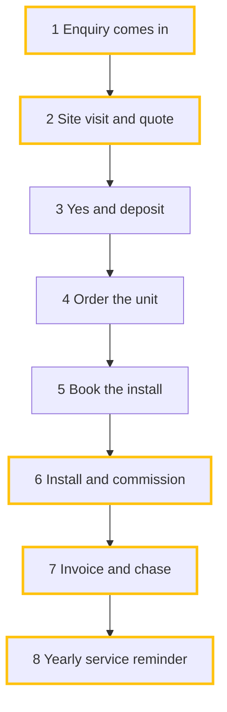

# The intro post and the starter pack

Step 6 and 7. Everything here comes from the **confirmed** summary. Nothing new, nothing invented.

## 1. The intro post text

Four short lines in their voice, shown in a copyable block, for them to paste above the card:

```text
G'day all, I'm Sam from Coolabah Air: air con installs and servicing in Western Sydney, me plus 3 techs.
Here for: quotes out the same day, and no more typing the same job into three places.
Biggest time sink right now: writing quotes up at night (about 6 hours a week).
Happy to help with: ducted vs split for old fibro houses, and running a small service team.
```

Line 1 who and what · line 2 why they're here · line 3 the top bottleneck · line 4 ask me about.
Respect the Q16 choices (hidden business name means no business name here either).

## 2. The starter pack

**Everything gathered goes in it.** A folder named exactly `My Business`, zipped as
`<slug>-my-business.zip` (slug: lowercase, hyphens, 64 characters at most) with code execution. Zip
the folder itself, so the zip holds `My Business/README.md`, not loose files, and unzipping it in
Documents → AI Builders Hub gives `AI Builders Hub/My Business/`. Check the listing before offering
it.

```
My Business/
  README.md                    what's in here and what to do with it (template below)
  profile.md                   the shared business profile Adam's tools and later lessons read
  hub-profile.md               the full profile (template below); also the file for Adam
  answers.md                   every question asked and their answer, as tables, incl. parking list
  how-we-run.html              the confirmed process drawing
  bottlenecks.md               ranked table, hours, why, what to automate first, what stays your call
  instructions-for-claude.md   a short "about me" to paste into Claude's settings
  welcome-card/
    welcome-card-<slug>.png    the card
    card.json                  what's on it, so the card can be redrawn later
    intro-post.txt             the four lines
```

- **`profile.md`** is the shared business profile the Hub's other tools and the trade intakes read,
  so the member never answers "what do you do?" twice. Copy the "Business" and "How the business
  runs" sections of `hub-profile.md` into it with the heading `# <Business>: business profile`.
- **`answers.md`** is the raw record: one table per part (`| Q | Asked | Their answer | Status |`,
  status confirmed, from website, assumed or UNCONFIRMED), then the parking list. Nothing gathered
  is left out of the folder except what rule 3 to 5 of the skill keep out everywhere.
- **Where it lives.** The skill tells them to make **Documents → AI Builders Hub** and unzip there.
  Later lessons point Cowork at the AI Builders Hub folder and read `My Business/`.
- **`instructions-for-claude.md`** is under 150 words: who they are, the business, the tools they
  use, how they like answers (short, tables, Australian English, inc or ex GST on every price), and
  what Claude must always ask them first (Q13). Ends with: "Paste this into Claude → Settings →
  General → personal preferences (the box that tells Claude about you)." Never secrets.
- **No customer or staff names, no phones, emails, addresses, logins** anywhere in the pack.

### README.md template

```markdown
# My Business: <Name>, <Business>

| File | What it's for |
|---|---|
| welcome-card/ | Your card picture and intro post words, to comment on the Hub's pinned Stage 1 thread |
| how-we-run.html | Your business, drawn out. Open it in a browser |
| bottlenecks.md | Where your hours go, and what to fix first |
| instructions-for-claude.md | Paste into Claude's settings so it knows you |
| profile.md | Adam's tools and later lessons read this, so you never repeat yourself |
| answers.md | Every question and your answer |
| hub-profile.md | Everything in one file |

**Keep this folder in Documents → AI Builders Hub → My Business.** Later lessons use it.

**Your next step:** <the one row from "Your next step" below>
```

## 3. hub-profile.md template

A YAML block at the top (for Adam), then plain sections a person can read. Unknown is `not given`;
defaults are marked `(assumed)`. Worked example, all made up:

````markdown
---
intake: hub-welcome
intake_version: 0.1.0
status: complete              # complete | incomplete
date: 2026-10-15
name_shown: Sam
track: business               # business | builder
role: Tradie automating my own business
also: "Maybe build for other air con businesses later"
business: Coolabah Air
trade: Air conditioning installs and servicing
area: Western Sydney
team: "Owner + 3 techs + office 2 days a week"
years: 12
website: https://coolabahair.example
ai_level: "Uses ChatGPT or Claude for emails and questions"
claude_plan: Pro
tools: [ServiceM8, Xero, Excel, Gmail, Supplier portal]
hours_on_bottlenecks_per_week: 13
diagram_confirmed: true
card_made: true
card_posted: yes             # yes | later | unknown
card_shows: { name: first name, business: true, area: region, hours: true }
next_step: /map-quoting
consent_to_send: not asked    # yes | no | not asked
sent_via: not sent            # submit_intake | owner (posted card only) | not sent
---

# Sam, Coolabah Air: Hub profile

## Who
Tradie automating my own business; maybe builds for other air con businesses later.

## Business
| | |
|---|---|
| What we do | Split systems and ducted for homes, plus service contracts for a few small offices and cafes |
| Area | Western Sydney |
| Team | Owner + 3 techs + office 2 days a week |
| Years | 12 |
| Tools | ServiceM8, Xero, Excel, Gmail, supplier portal |

## Here for (90 days)
1. Quotes out the same day, not at 10pm
2. Stop typing the same job into three places
3. Maybe build this for other air con businesses later

## How the business runs
| # | Step | Who | Using | Hours/wk | Pain |
|:-:|---|---|---|:-:|---|
| 1 | Enquiry comes in | Owner | Phone, website | not given | ! Missed calls on the tools |
| 2 | Site visit and quote | Owner | Notepad, Excel | 6 | ! Written up at night |
| 3 | Yes and deposit | Customer | Text, Xero | | |
| 4 | Order the unit | Office | Supplier portal | | |
| 5 | Book the install | Office | ServiceM8 | | |
| 6 | Install and commission | Techs | ServiceM8 app | 4 | ! Photos and certs re-typed |
| 7 | Invoice and chase | Office | Xero | 3 (with 8) | ! Chasing slips |
| 8 | Yearly service reminder | Office | Spreadsheet | | ! Often never sent |



## Bottlenecks (top three)
| Rank | Bottleneck | Hours/wk | Why |
|:-:|---|:-:|---|
| 1 | Writing quotes up at night | 6 | Site notes to Excel to PDF, every quote |
| 2 | Job paperwork after the install | 4 | Photos, compliance certs and refrigerant log typed again |
| 3 | Service reminders and chasing invoices | 3 | Done when the office has time, so mostly not |

Still done by hand: quote write-ups, re-keying into ServiceM8, compliance certs, refrigerant log,
service reminders, invoice chasing.

## Wants
- First thing to automate: turn site notes and photos into a quote I can send from the ute.
- Stays my call: the final price; anything the customer sees before it's sent.
- Ask me about: ducted vs split for old fibro houses, running a small service team.

## Parking list
- Hours on step 1 (missed calls): not given. Owner to check call log.

## Still to ask
None.
````

## 4. Your next step

Show the one row that matches their #1 bottleneck, plus one backup. All four intakes are in the same
plugin they already installed.

| If the #1 bottleneck is… | Next step |
|---|---|
| Quoting or estimating | Type **/map-quoting**: builds your own quoting assistant |
| Measuring up from drawings | Type **/map-takeoffs**: builds your takeoff assistant |
| Ordering materials | Type **/map-purchasing**: builds your ordering assistant |
| Enquiries, missed calls, follow-up | Type **/map-sales**: builds your enquiry assistant |
| Paperwork, certs, reminders, invoices | Post your card and ask in the Hub's Community tab who has built this; tag Adam |
| Building AI tools for clients | Open the Hub's Classroom and start the next unlocked course |
| On the Free plan | Move to Claude Pro first: the add-ons need it |

## 5. Close of the pack

Offer, in this order: the card PNG, the intro post block, the zip. Then the posting table in
SKILL.md step 6, then step 7.
