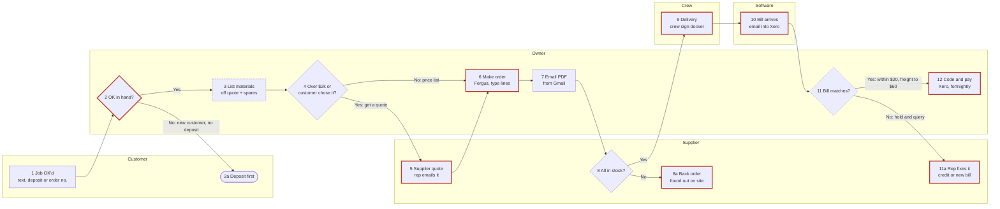

# The PO intake file

One Markdown file, named `map-purchasing-<business-name>-<YYYY-MM-DD>.md`. The block at the top is for
Adam's build (and for whatever reads it later); the sections below it are for a person. Write
every section, in this order.

- Anything not given: `not given`.
- A default you applied: the value followed by `(assumed)`, and listed in `assumed`.
- Something they weren't sure of: `UNCONFIRMED`, and listed in `unconfirmed`.
- No customer, site contact or supplier rep personal details anywhere. Suppliers' business names
  only if `supplier_names_ok: true`; otherwise "supplier A", "supplier B". Never a password, login,
  bank detail or card number.
- Every price says inc or ex GST.
- Step numbers are the same everywhere: the drawing, the Process map, the step table and the
  exceptions table.
- `consent_to_send` and `sent_via` are written as `not asked` and `not sent` when the file is made,
  then changed (and nothing else) after the send question in step 13 of the skill:
  - `consent_to_send`: `yes` (they said yes to sending it to Adam) · `no` · `not asked` (no send
    tool here, or they stopped before it)
  - `sent_via`: `submit_intake` (sent by the tool after a yes) · `owner (download and share)` ·
    `not sent`
- `skill_exported: false`, `skill_name: not made` and `skill_added_to_cowork: unknown` are written
  when the file is made, then set after step 12 (their ordering assistant):
  - `skill_exported`: `true` once the zip was made (or the copyable fallback shown) · `false`
  - `skill_name`: the folder name, e.g. `ironbark-ordering` · `not made`
  - `skill_added_to_cowork`: `yes` (they said added) · `later` · `unknown` (no answer)
- `diagram_confirmed: true` only once they said the drawing is right; if they stopped before that,
  `false` and the Process map is marked `draft, not checked`.

The worked example below is for the made-up business _Ironbark Plumbing_. Every name and figure in
it is invented. Replace all of it with what the person told you.

````markdown
---
intake: po
intake_version: 0.4.0
status: complete            # complete | incomplete
date: 2026-10-15
consent_to_send: no         # yes | no | not asked
sent_via: owner (download and share)   # submit_intake | owner (download and share) | not sent
skill_exported: true        # true | false
skill_name: ironbark-ordering   # folder and zip name | not made
skill_added_to_cowork: later    # yes | later | unknown
diagram_confirmed: true     # true once they said the drawing is right; false if draft
business: Ironbark Plumbing
trade: Plumbing and gas (residential and light commercial)
area: Toowoomba and the Darling Downs
website: https://ironbarkplumbing.example
licence: not given
raises_pos: yes             # yes | no (orders by email, text, phone or counter)
po_lives_in: Fergus
accounts_software: Xero
bill_capture: none
who_orders: "owner; leading hand for counter top-ups"
approval: { approver: owner, threshold_ex_gst: 3000, cover_when_away: "none; big orders wait" }
orders_per_week: 12
minutes_per_order: 20
share_typing_quote_lines: "about half"
regular_suppliers: 5
supplier_names_ok: false
most_asked: "has it arrived?"
status_lives_in: "owner's head and text threads with reps"
trigger: job_booked
must_have_before_ordering: [customer_ok, job_number, start_date, materials_list]
customer_gate: { regular: "text OK", new: "deposit paid", builder: "their order number on our invoice" }
gate_rule: warn             # block | warn | ignore
done_means: "every bill matched and coded to the job, nothing open, before the final invoice (assumed)"
quantities_from: "quote materials list"
waste: { pipe: 10, fittings: "2 spare of each" }   # percent unless stated
order_ahead_days: 7
long_lead: ["hot water units", "customer-selected tapware"]
other_sources: [van_stock, customer_supplied]
pricing: { price_list: "pipe and fittings", quote_above_ex_gst: 2000, quote_always: "customer-selected fixtures" }
stale_price_days: 90 (assumed)
pack_rules: { copper: "6 m lengths", poly: "50 m coils", fittings: "bags of 10", small_order_fee_under_ex_gst: 100 }
po_number_format: "<job number>-<letter>, e.g. 2215-A"
job_cost_split: [rough_in, fit_off, variation]
code_known_at_order: "owner only"
po_required_fields: [job_number, site_address, required_by_date, delivery_instructions]
gst_on_order: ex
freight_on_order: no
send_route: "PDF emailed from owner's inbox"
send_boundary: "tool prepares; owner sends"
ordered_before_po: often   # never | sometimes | often
confirmations: "big orders only"
delivery_to: site
docket_route: "signed by crew; stays in the ute"
bill_check: "total against order; pay if close"
tolerance: { bill_total: "within $20", freight_ex_gst: 60, other: "hold and query" }
coding: "job tracking category in Xero"
terms: "30 days end of month (most suppliers)"
pay_run: fortnightly
subcontractor_rule: not applicable
status_report: { when: "Monday morning", by: job }
current_tools: [Fergus, Xero, Gmail, Excel]
steps: 12                   # main steps on the Process map
exceptions: 16              # rows in the exceptions table
test_cases: 3               # 2 full + 1 partial (the one that went wrong)
parking_list: 3
questions_asked: 30
assumed: [stale_price_days, done_means, confirmation_check]
unconfirmed: [restocking_fee_rule]
---

# How Ironbark Plumbing buys for a job

## The business
Ironbark Plumbing does plumbing and gas for houses, renovations and small commercial jobs around
Toowoomba and the Darling Downs. The owner orders anything big and approves every order over $3,000
ex GST; the leading hand rings the counter for small top-ups. Orders are made in Fergus; bills land
in Xero.

## The numbers now (the "before")
- About 12 orders a week across 5 regular suppliers.
- About 20 minutes an order from "we need this" to sent; about half of that is typing the supplier's
  quote lines into Fergus.
- Most-asked question: "has it arrived?" The answer lives in the owner's head and text threads.
- Bills checked at night, 5 to 10 minutes each, a couple of hours a week.

## Where it starts and where it ends
- **Starts:** the job's booked with a start date. Site texts for top-ups.
- **Must have before ordering:** the customer's OK (see the gate below), the job number, a start
  date, the materials list. **Nice to have:** the supplier's quote for big items, delivery details.
- **Ends:** the last bill is paid and coded to the job. Nobody checks today that nothing's left open
  before the final invoice. Wanted: that check (assumed).
- **Who's told:** the crew find out the gear's there when it's on site; the customer isn't told.

## Process map

Confirmed with the owner in the drawing, step by step, on 2026-10-15. Paste the block into
mermaid.live to see it drawn.



**The steps, in order** (! = where it goes wrong, ◷ = slow or waiting):

1. **Customer:** OKs the job: a text (regulars), a deposit (new customers) or a builder's order
   number.
2. **Owner, decision:** customer's OK in hand? No (new customer, no deposit) → **2a** deposit asked
   for first. Yes → 3. ! Ordered before a deposit once; left with a special-order vanity.
3. **Owner:** lists the materials off the quote, adds 10% on pipe and two spare of each fitting.
   ◷ 5 min.
4. **Owner, decision:** over $2,000 ex GST, or something the customer chose? Yes → 5. No → 6, priced
   from the list.
5. **Supplier:** the rep emails a quote. ◷ 0 to 2 days. ! Often short a line.
6. **Owner:** makes the order in Fergus: types each line, job number, site, required-by date.
   ◷ 10 min. ! Cost code (rough-in, fit-off) often skipped; typos.
7. **Owner:** emails the PDF from Gmail so it shows in Sent.
8. **Supplier, decision:** all in stock? Yes → 9. No → **8a** back order. ! Found out when the crew
   turn up.
9. **Crew:** take the delivery on site and sign the docket. ! The docket stays in the ute.
10. **Software:** the bill emails in and lands in Xero. ! The crew's counter buys show up here first,
    with no order.
11. **Owner, decision:** does the bill match the order? Within $20 and freight up to $60 ex GST → 12.
    Anything else → **11a** held, rep emailed with the order price; the rep sends a credit or a new
    bill. ◷ 5 to 10 min a bill. ! Credits take weeks.
12. **Owner:** codes it to the job tracking category in Xero, pays in the fortnightly run. ! A counter
    card buy was paid again when the emailed bill came in.

## Each step in detail
| # | Step | Who | Software or paper | How long | Where it goes wrong |
|---|---|---|---|---|---|
| 1 | Customer OKs the job | Customer | Text, Xero (deposit) | — | — |
| 2 / 2a | Check the OK is in; deposit first for new customers | Owner | In head | — | Ordered once before the deposit |
| 3 | Take materials off the quote, add spares and waste | Owner | Fergus quote, paper | 5 min | Quote list missing a variation |
| 4 | Price list or supplier quote? | Owner | In head | — | — |
| 5 | Rep quotes big or customer-chosen items | Supplier | Email, phone | 0–2 days | Quote comes back short a line |
| 6 | Make the order: type each quote line, job number, site, date | Owner | Fergus | 10 min | Typos; cost code often skipped |
| 7 | Email the PDF from own inbox to prove it went | Owner | Gmail | 2 min | No confirmation asked for on small orders |
| 8 / 8a | In stock, or back order | Supplier | — | — | Back orders found out on site |
| 9 | Delivery to site; crew sign the docket | Crew | Paper | — | Docket stays in the ute |
| 10 | Bill emails in, flows into Xero | Supplier → software | Xero | — | Counter buys arrive with no order |
| 11 / 11a | Check bill total against the order; hold and query if out | Owner, rep | Xero, Fergus, email | 5–10 min each | Freight and small-order fees surprise; no docket to check; credits slow |
| 12 | Code bill to the job, pay in the fortnightly run | Owner | Xero | 2 min | Card counter buys sometimes paid twice |

## From job to order
- Quantities: straight from the quote's materials list, plus 10% on pipe and two spare of each fitting.
- Ordered a week ahead. Long lead: hot water units and customer-selected tapware, three to four
  weeks; the supplier's "two weeks" is not reliable.
- Customer first: regulars a text OK; new customers pay a deposit; builders send their own order
  number, which goes on Ironbark's invoice, not the supplier order. Rule: warn, don't block.
- Other sources: common fittings from van stock (no stock list); the customer supplies their own
  tapware about one job in five, so those lines must not be ordered or costed.

## Suppliers and prices
- Price list for pipe and fittings; a quote for anything over $2,000 ex GST and any fixture the
  customer picked. Supplier names not to be kept (supplier A to E).
- Supplier A sends a PDF price list every few months; rarely loaded anywhere. Supplier B gives trade
  less 5%, not shown on the list.
- Flag any price older than 90 days (assumed).
- Pack sizes: copper in 6 m lengths, poly in 50 m coils, fittings in bags of 10. Small-order fee
  under $100 ex GST. Always round up to whole units.
- Supplier quotes checked for every line and the quantity against the job list. Missed lines are
  common. Cheapest wins unless it's three weeks slower.
- Names: crew say "a 450 flexi"; bills use the supplier's long code and description. Name list to
  be built from the first orders.

## Writing and sending the order
- Every order: job number, site address, required-by date, delivery instructions (e.g. "deliver
  before 7am, leave at the garage").
- Order number: job number plus a letter (2215-A, 2215-B). Jobs split into rough-in, fit-off and
  variations; only the owner knows the code.
- Lines ex GST, GST at the total; freight left off the order.
- Specials (custom vanity) described in full with the supplier's quote number; never "as per quote".
  One job per order.
- Sent as a PDF from the owner's Gmail so it shows in Sent. Standard line: "Please confirm price and
  delivery date for order 2215-A."
- The tool prepares the order; the owner always presses send.

## Confirm, chase and receive
- Confirmations only on big orders. Check price, quantity and delivery date (assumed).
- Back orders found out on site. Wanted: a list of open lines every Monday, flagged when a
  required-by date passes. Customer approves any substitute for something they chose.
- Deliveries to site; crew sign the docket; the docket stays in the ute. Wanted: a photo of the
  signed docket to the job the same day.

## The bill, coding and paying
- Bills email to the accounts address and flow into Xero. Checked against the order total only.
- Tolerance: within $20 on the bill is paid; freight up to $60 ex GST is fine; anything else is held
  and the rep is emailed the order price.
- Coded to the job tracking category in Xero. Most suppliers 30 days end of month. Fortnightly pay run.

## Exceptions and edge cases

From Q24 and the quick-fire sweep (Q25 to Q28). Step = the step number on the drawing.

| Case | Step | What happens now | Rule or check | Source |
|---|---|---|---|---|
| Emergency jobs: no order, counter buy on card | 6, 10 | Receipt in the ute; bill arrives later | Order written after the fact, flagged | Q24 |
| Crew grab fittings at the counter before any order | 6, 10 | Owner finds out when the bill comes | Same as above | sweep 1 |
| Builder jobs: builder's order number | 1 | Goes on Ironbark's invoice, not the supplier order | — | sweep 1 |
| Variation mid-job adds material | 6 | New letter on the job number, coded as variation "if I remember" | Ask for the code on every variation order | sweep 1 |
| Customer supplies their own tapware | 3 | About one job in five; sometimes ordered anyway | Never order or cost customer-supplied lines | sweep 1 |
| Specials can't be returned | 5, 6 | Described with the rep's quote number | Specials need the customer's OK in hand (step 2) | sweep 1 |
| Flat out | 11 | Bills paid without checking | — | sweep 1 |
| Supplier quote expired (job pushed back) | 5 | Rep rung for a new price if over 30 days | Flag supplier quotes older than 30 days | sweep 2 |
| Changing a sent order | 7 | Same number; rep emailed "amended" | — | sweep 2 |
| Cancelled order | 7 | Restocking fee once, 15% | UNCONFIRMED whether it applies to all suppliers | sweep 2, parking list |
| Delivery to the wrong site | 9 | Happened once | Site address and delivery note on every order | sweep 2 |
| Coils come a few metres over | 9, 11 | Fine | Over-delivery on coils not flagged | sweep 2 |
| Freight never split across jobs | 11 | Whole freight to the first job on the bill | — | sweep 3 |
| Statements binned | 12 | Never checked against bills | — | sweep 3 |
| Supplier A in Xero twice | 10, 12 | Newer one used | — | sweep 4 |
| Owner away | 2, 11 | Big orders wait; nobody checks bills | — | sweep 3, sweep 4 |

Didn't apply: insurance work, imports, paying suppliers up front (except specials, covered above),
progress claims.

## Judgement calls (rules of thumb)
- **Rep says two weeks on a hot water unit, allow four.** Why: "it's never been two". **Rule**:
  long-lead items ordered four weeks ahead.
- **Freight on a pickup order means the bill's wrong.** Why: "we collected it". **Check** for the tool.
- **Check whether the customer is supplying tapware before ordering it.** Why: they paid for their
  own once and Ironbark's went back with a restocking fee. **Rule.**
- **Bills checked at night.** Why: "that's when I get time". **Habit**, not a rule.

## What's gone wrong (and what the tool must check)
- **Last one that went wrong:** billed for a full pallet when half was returned; three phone calls and
  a month to get the credit. → The tool lists every credit owed against its original order until it
  shows on a bill or statement.
- **If the tool got one wrong (owner's guess):** ordering customer-supplied tapware, or putting an
  order on the wrong job. → The tool asks "is the customer supplying anything?" and shows the job
  number and site big on every draft.

## Test case 1: bathroom renovation rough-in
**Inputs:** job booked, start date set; materials list from Ironbark's own quote; supplier A price
list; job number 2215; required by the day before start; deliver to site before 7am.
**Steps:** take list off the quote; add 10% on pipe and two spare fittings; price from the list; ring
the rep for the vanity price; make order 2215-A in Fergus; email the PDF from Gmail.
**Order:**
| Line | Item | Unit | Qty | Price ex GST |
|---|---|---|---|---|
| 1 | 20 mm copper pipe | 6 m length | 4 | 62.00 (price list) = 248.00 |
| 2 | 20 mm brass elbow | bag of 10 | 2 | 18.50 (price list) = 37.00 |
| 3 | Floor waste 100 mm | each | 1 | 35.00 (price list) = 35.00 |
| 4 | Custom vanity (rep's quote number) | each | 1 | 1,620.00 (rep's quote) = 1,620.00 |
**Order total:** $1,940 ex GST, $2,134 inc GST.
**Back half:** no confirmation; delivered to site, signed by the apprentice, docket kept in the ute.
Bill came with $45 ex GST freight not on the order: $1,985 ex GST, $2,183.50 inc GST. **Decision:** paid (freight under the $60 limit),
coded to job 2215 rough-in.
**Source:** from files they dropped in (order 1 and its bill).
**Differences found:** my reading had 3 bags of elbows; they confirmed 2 (one bag from van stock).

## Test case 2: small commercial amenities upgrade
**Inputs:** two supplier quotes requested (over $2,000 ex GST); builder's order number to go on the
invoice; hot water unit on a long lead.
**Steps:** as Order 1, plus compare two quotes (cheapest chosen); order 2231-A to supplier C.
**Order:** each line, unit, quantity and price as on supplier C's quote; total $6,380 ex GST.
**Back half:** valve on back order three weeks, found out when the crew arrived; part delivery;
bill came for the full order. **Decision:** held and queried; paid when the valve arrived.
**Source:** from files they dropped in, plus their account of the back order.

## Test case 3 (partial): the one that went wrong
Billed for a full pallet when half was returned. Three phone calls and a month to get the credit.
The tool should list the credit owed against the original order until it's on a statement.
**Source:** from memory.

## What they want the tool to do
- **Must:** drop in the supplier's quote and get the order ready to send, with job number, site,
  required-by date and delivery note filled in.
- **Checks it runs** (from what's gone wrong and the odd ones): customer's OK in hand before any
  special is ordered; customer-supplied lines left off; cost code asked for on variations; supplier
  quotes over 30 days old flagged; prices over 90 days old flagged (assumed); freight on a pickup
  flagged; a bill matching a counter card buy flagged before it's paid; credits owed listed until
  received.
- **Should:** a Monday list per job of what's ordered, arrived and still open; check each bill
  against its order and docket; nothing open before the final invoice.
- **Stays the owner's call:** pressing send on every order; paying every bill; any substitute the
  customer chose.

## Success measure
| | Now | Target |
|---|---|---|
| Time per order | 20 min | 5 min |
| Bill checking | a couple of hours a week, at night | in the day, exceptions only |
| Wrong bills paid | "a few a year" | none |

## Systems they use
Fergus (jobs and orders), Xero (bills and coding), Gmail (sending orders), Excel (an old price list).
Names only; no logins.

## Files they showed
- Order 1 (2215-A) and its bill
- Order 2 (2231-A) and supplier C's quote behind it
- Supplier A's price list, dated a few months ago
They said they'd send all of these to Adam.

## Your skill

Their own ordering assistant, built from this file after it was approved, tried on test case 1,
and given to them as `ironbark-ordering.zip` to add to Claude (Customize → Skills → Upload skill).
Not sent to Adam (only this file was).

- **Folder:** `ironbark-ordering/`
- **Files:** `SKILL.md` · `references/prices.csv` · `references/rules.md` · `references/process.md`
  · `references/examples.md` · `references/suppliers.csv` (supplier A to E, no names) ·
  `references/order-layout.md`
- **Trigger phrases:** "order this job", "turn this quote into an order", "check this bill",
  "what's still open"; and "update my skill" to write in a correction.
- **Test run (test case 1):** order 2215-A, $1,940.00 ex GST, same lines as theirs; bill with $45
  freight: pay. Match.
- **Added to Cowork:** later (they were on the phone; will add it at the computer).

## Parking list (open items)
| # | Item | Who can answer | Status |
|---|---|---|---|
| 1 | Does the 15% restocking fee apply at every supplier, or just one? | Owner, after asking the reps | open |
| 2 | Should freight on a multi-job bill be split by order value? | Adam to suggest | open |
| 3 | Which supplier A record in Xero is the right one to keep | Owner's bookkeeper | open |

## Still to ask
None (status complete). If unfinished, list each unasked question number and topic here, so the next
session can pick up where this stopped.

## Questions log
| Q | Topic | Answer (short) | Source |
|---|---|---|---|
| 1 | Business and website | Ironbark Plumbing, website read | answered |
| 2 | What starts an order | Job booked with a start date | answered |
| 3 + ↳ | Before you spend money | Checklist above; warn, don't block; builder order no. on invoice | answered |
| 4 | When it's done, most-asked | "Has it arrived?"; no open check | answered; close check assumed |
| 5 | Who orders and OKs | Owner; leading hand under $500; owner OKs over $3,000 | answered |
| 6 | What you send, software | Fergus order, emailed from Gmail; Xero | read from file, confirmed |
| 7 + ↳ | Volume and time | 12 a week, 20 min, half typing; 5 suppliers | answered |
| 8–9 | Order 1 | Bathroom rough-in, paid with freight | read from file, confirmed |
| 10 | Order 2 | Commercial amenities, back order, held | read from file, confirmed |
| 11 | Quantities and waste | Off the quote, +10% pipe, 2 spare fittings | answered |
| 12 | Lead times | A week; HWUs and tapware 3–4 weeks | answered |
| 13 | Price list or quote | List for pipe and fittings; quote over $2,000 ex GST; names not kept | answered |
| 14 | Pack sizes and minimums | 6 m, 50 m coils, bags of 10; fee under $100 | answered |
| 15 | Checking supplier quotes | Lines and quantities; cheapest unless slow | answered |
| 16 | On every order | Job number, site, date, delivery note | read from file, confirmed |
| 17 | Numbering and codes | 2215-A; rough-in, fit-off, variations | read from file, confirmed |
| 18 | How it's sent | PDF from Gmail | answered |
| 19 | Confirmations, back orders | Big orders only; check assumed | answered; check assumed |
| 20 | Deliveries and dockets | Site; docket in the ute | answered |
| 21 | Bills in and checking | Email into Xero; total against order | answered |
| 22 | Tolerance | $20; freight to $60 ex GST | answered |
| 23 | Coding, terms, paying | Xero tracking; 30 days EOM; fortnightly | answered |
| 24 | Is it always like this? | Emergency counter buys | answered |
| 25–28 | Quick-fire sweep, 4 rounds | See exceptions table | answered |
| 29 + why | Judgement calls | Allow four weeks; freight on pickup; tapware check | answered |
| 30 + ↳ | What's gone wrong | Pallet credit; wrong job, customer tapware | answered |
| 31 | What they want | Quote to order; Monday list | answered |
| 32 | Success | 5 min an order; no wrong bills | answered |
````
