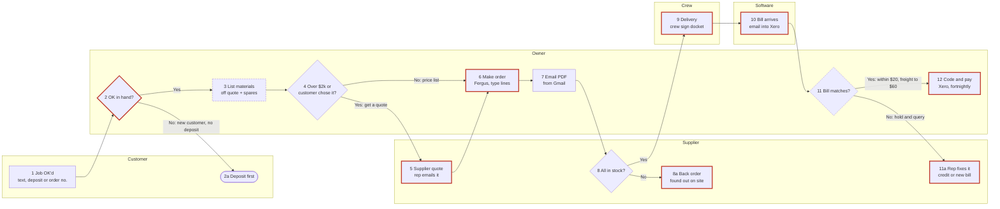

# See it and confirm it: drawing their process

Step 7 of the interview. The owner must **see** how they buy for a job, drawn out, and confirm it
step by step before the summary and the file. People spot a missing step in a drawing that they'd
nod through in a list.

Build it from the running step list (Parts 1 and 2), the exceptions (Q24 and the sweep) and the slow
or broken steps they mentioned. Use their words on the boxes.

## 1. What to build

One **self-contained HTML page with an inline SVG drawing**, shown as an artifact. No external
scripts, libraries, fonts or images: everything inline, so it works offline and on any plan.

- **Title:** `How [Business] does ordering` (e.g. "How Ironbark Plumbing does ordering"), and one
  line under it: "Check each step. Tell me what's wrong or missing."
- **Swimlanes, one per who:** customer, owner, office, crew (site), supplier, software. Only lanes
  that are used. Software is its own lane for steps the software does or where the numbers land
  (Xero, the job software, a bill-capture app).
- **Numbered steps** matching the step list and the file. Exceptions and side branches get a letter
  (2a, 8a). Keep the box text short: the step on line one, the how or where on line two.
- **Decisions as diamonds**, with **both branches labelled** ("Yes", "No: back order").
- **Red markers** (a red circle with "!") on every step where it goes wrong or has an exception,
  each explained in a short "Where it goes wrong" list under the drawing, keyed by step number.
- **A clock note** under slow steps or waits ("10 min", "0 to 2 days for the rep").
- **A legend:** box = step, diamond = decision, red ! = where it goes wrong, clock = slow or waiting.
- **Phone-friendly.** On a narrow screen, show the steps stacked top to bottom as cards (lane name,
  step, decision branches, red and clock notes), with the full drawing below in a box that scrolls
  sideways. No sideways scroll on the page itself.
- **Light and dark.** Colours as variables with a dark set; the page has its own background.
- **No customer, site contact or rep names, phones, emails or addresses** on the drawing. "Customer",
  "the rep", "supplier A". Supplier business names only if they said that's OK.
- **About 12 main steps at most.** More than that: group the small ones ("6 Make the order" covers
  lines, job number, delivery details) or split into two drawings ("Getting it ordered" and
  "Delivery to paid").

## 2. How to show it and confirm it

1. Publish the page as an artifact, then say:
   "Here's your process drawn out. Have a look (on your phone it's in the Artifacts tab)."
2. Confirm **step by step**, two or three steps per message, never "looks good?":
   - "Steps 1 to 3: the customer OKs the job, you check you've got the deposit, then you list the
     materials off your quote. Is that right?"
   - "Anything missing between 7 and 8?"
   - At each diamond: "At step 4, is 'over $2,000 or something the customer chose' really what
     decides whether you get a quote?"
   - At each red marker: "Step 9, the docket stays in the ute. Is that the main thing that goes
     wrong there?"
   - Last: "Anyone or anything missing from the lanes? The office, a bookkeeper, a bill app?"
3. **After every change, redraw** (update the same artifact, don't start a new one) and say what
   changed in one line: "Redrawn: step 10 now goes through Hubdoc before Xero." Then carry on from
   where you were.
4. **Nothing is final until they say the drawing is right.** Ask plainly at the end: "Is this how
   [Business] does ordering?" (Yes, that's it · Something's still wrong).
5. These confirmations don't count toward the 35 questions.

## 3. If you can't make an artifact

Send the steps as plain text, **grouped by who does them**, every decision and exception spelled
out, then the Mermaid source in a block:

```text
How Ironbark Plumbing does ordering

CUSTOMER
1. OKs the job: a text (regulars), a deposit (new customers) or a builder's order number.
2a. Asked for the deposit first, if it's not in. (! ordered before the deposit once, stuck with a vanity)

OWNER
2. OK in hand? No -> 2a. Yes -> 3.
3. Lists the materials off the quote, adds 10% on pipe and two spare fittings. (clock: 5 min)
4. Over $2,000 ex GST, or something the customer chose? Yes -> 5. No -> 6 (price list).
6. Makes the order in Fergus, types each line, job number, site, date. (clock: 10 min) (! cost code often skipped; typos)
7. Emails the PDF from Gmail so it shows in Sent.
11. Bill matches the order? Within $20, freight up to $60 ex GST -> 12. Anything else -> 11a. (clock: 5 to 10 min a bill)
12. Codes it to the job in Xero, pays in the fortnightly run. (! a counter card buy paid twice once)

CREW
9. Takes the delivery on site, signs the docket. (! docket stays in the ute)

SUPPLIER
5. Rep emails a quote. (clock: 0 to 2 days) (! often short a line)
8. All in stock? Yes -> 9. No -> 8a.
8a. Back order. (! found out when the crew turn up)
11a. Rep fixes the bill: credit or a new bill. (! credits take weeks)

SOFTWARE
10. Bill emails in and lands in Xero. (! crew counter buys show up here first, with no order)
```

Then: "To see it drawn, copy this and paste it into mermaid.live." and the Mermaid block. Confirm
the same way, step by step.

## 4. Mermaid source rules

- `flowchart LR`, one `subgraph` per lane, steps `S1`, `S2a` and so on, labels in double quotes,
  `<br>` for a second line.
- Diamonds `{"..."}` for decisions; every branch labelled with `-->|"..."|`.
- `classDef risk` with a red border for the red-marker steps; `classDef slow` with a dashed border
  for the clock steps.
- Keep it exactly in step with the drawing. The final version goes in the file's "Process map".

## 5. Worked example (Ironbark Plumbing, made up)

### Mermaid



### The HTML page

Copy this shape. Change the lanes, boxes, arrows and notes to fit their process; keep the CSS,
legend, phone layout and colour variables. When you add or move a box, re-check that no arrow runs
through another box.

```html
<!doctype html>
<html lang="en-AU">
<head>
<meta charset="utf-8">
<meta name="viewport" content="width=device-width, initial-scale=1">
<title>Ironbark ordering map</title>
<style>
  :root { --bg:#fbfaf7; --ink:#1d1d1b; --muted:#5f5e58; --line:#4a4a45; --lane-a:#f1efe8;
          --lane-b:#e7e4da; --box:#ffffff; --box-line:#8a877c; --risk:#c0392b; --risk-ink:#fff; }
  @media (prefers-color-scheme: dark) {
    :root:not([data-theme="light"]) { --bg:#171716; --ink:#ecebe6; --muted:#a8a69e; --line:#c9c7bf;
          --lane-a:#22221f; --lane-b:#2b2b27; --box:#1d1d1b; --box-line:#77756c; --risk:#e5675a; --risk-ink:#171716; }
  }
  :root[data-theme="dark"] { --bg:#171716; --ink:#ecebe6; --muted:#a8a69e; --line:#c9c7bf;
          --lane-a:#22221f; --lane-b:#2b2b27; --box:#1d1d1b; --box-line:#77756c; --risk:#e5675a; --risk-ink:#171716; }
  body { margin:0; background:var(--bg); color:var(--ink); font:15px/1.45 system-ui, sans-serif; }
  main { max-width:1200px; margin:0 auto; padding:20px 16px 40px; }
  h1 { font-size:22px; margin:0 0 4px; } p.sub { margin:0 0 16px; color:var(--muted); }
  .drawing svg { width:100%; height:auto; display:block; }
  .lane-a { fill:var(--lane-a); } .lane-b { fill:var(--lane-b); }
  .lane-name { font:600 13px system-ui, sans-serif; fill:var(--ink); }
  .box { fill:var(--box); stroke:var(--box-line); stroke-width:1.5; }
  .t { font:600 12px system-ui, sans-serif; fill:var(--ink); }
  .s { font:11px system-ui, sans-serif; fill:var(--muted); }
  .arrow { fill:none; stroke:var(--line); stroke-width:1.5; }
  .head { fill:var(--line); }
  .branch { font:italic 11px system-ui, sans-serif; fill:var(--ink); }
  .risk { fill:var(--risk); } .risk-t { font:700 12px system-ui, sans-serif; fill:var(--risk-ink); }
  .clock { fill:none; stroke:var(--muted); stroke-width:1.2; }
  .stack { display:none; padding:0; list-style:none; }
  .stack li { background:var(--box); border:1px solid var(--box-line); border-radius:8px;
              padding:10px 12px; margin:0 0 8px; }
  .stack .who { font-size:12px; color:var(--muted); text-transform:uppercase; letter-spacing:.04em; }
  .stack .bad { color:var(--risk); } .stack .slow { color:var(--muted); }
  .legend, .notes { margin-top:16px; } .legend span { margin-right:16px; white-space:nowrap; }
  .bang { color:var(--risk); font-weight:700; }
  .drawing-title { display:none; font-weight:600; margin:16px 0 6px; }
  @media (max-width:720px) {
    .stack { display:block; }
    .drawing { overflow-x:auto; border:1px solid var(--box-line); border-radius:8px; }
    .drawing svg { width:1100px; }
    .drawing-title { display:block; }
  }
</style>
</head>
<body>
<main>
  <h1>How Ironbark Plumbing does ordering</h1>
  <p class="sub">Check each step. Tell me what's wrong or missing.</p>

  <!-- Phone view: steps stacked top to bottom -->
  <ol class="stack">
    <li><div class="who">Customer</div><b>1 Job OK'd</b>: a text, a deposit or a builder's order number</li>
    <li><div class="who">Owner · decision</div><b>2 OK in hand?</b>
      <div>Yes → 3 · No (new customer, no deposit) → 2a, deposit first</div>
      <div class="bad">! Ordered before the deposit once; stuck with a vanity</div></li>
    <li><div class="who">Owner</div><b>3 List materials</b>: off the quote, plus 10% on pipe and two spare fittings
      <div class="slow">◷ 5 min</div></li>
    <li><div class="who">Owner · decision</div><b>4 Over $2,000 ex GST, or the customer chose it?</b>
      <div>Yes → 5, get a quote · No → 6, price list</div></li>
    <li><div class="who">Supplier</div><b>5 Supplier quote</b>: the rep emails it
      <div class="slow">◷ 0 to 2 days</div>
      <div class="bad">! Often short a line</div></li>
    <li><div class="who">Owner</div><b>6 Make order</b>: Fergus, type each line, job number, site, date
      <div class="slow">◷ 10 min</div>
      <div class="bad">! Cost code often skipped; typos</div></li>
    <li><div class="who">Owner</div><b>7 Email PDF</b>: from Gmail, so it shows in Sent</li>
    <li><div class="who">Supplier · decision</div><b>8 All in stock?</b>
      <div>Yes → 9 · No → 8a, back order <span class="bad">! found out when the crew turn up</span></div></li>
    <li><div class="who">Crew</div><b>9 Delivery</b>: to site, crew sign the docket
      <div class="bad">! Docket stays in the ute</div></li>
    <li><div class="who">Software</div><b>10 Bill arrives</b>: email into Xero
      <div class="bad">! Crew counter buys show up here first, with no order</div></li>
    <li><div class="who">Owner · decision</div><b>11 Bill matches the order?</b>
      <div>Yes (within $20, freight up to $60 ex GST) → 12 · No → 11a, hold and query the rep
        <span class="bad">! credits take weeks</span></div>
      <div class="slow">◷ 5 to 10 min a bill</div></li>
    <li><div class="who">Owner</div><b>12 Code and pay</b>: job tracking category in Xero, fortnightly pay run
      <div class="bad">! A counter card buy was paid twice once</div></li>
  </ol>

  <div class="drawing-title">Full drawing (scroll sideways)</div>
  <div class="drawing">
  <svg viewBox="0 0 1500 500" role="img" aria-label="Swimlane drawing of how Ironbark Plumbing does ordering">
    <defs>
      <marker id="ah" viewBox="0 0 10 10" refX="9" refY="5" markerWidth="7" markerHeight="7" orient="auto-start-reverse">
        <path class="head" d="M0,0 L10,5 L0,10 z"/>
      </marker>
    </defs>
    <!-- lanes -->
    <rect class="lane-a" x="0" y="0"   width="1500" height="100"/>
    <rect class="lane-b" x="0" y="100" width="1500" height="100"/>
    <rect class="lane-a" x="0" y="200" width="1500" height="100"/>
    <rect class="lane-b" x="0" y="300" width="1500" height="100"/>
    <rect class="lane-a" x="0" y="400" width="1500" height="100"/>
    <text class="lane-name" x="14" y="55">Customer</text>
    <text class="lane-name" x="14" y="155">Owner</text>
    <text class="lane-name" x="14" y="255">Crew</text>
    <text class="lane-name" x="14" y="355">Supplier</text>
    <text class="lane-name" x="14" y="455">Software</text>

    <!-- arrows (drawn first so boxes sit on top) -->
    <path class="arrow" marker-end="url(#ah)" d="M170,77 V150 H250"/>
    <path class="arrow" marker-end="url(#ah)" d="M290,116 V79"/>
    <text class="branch" x="296" y="102">No</text>
    <path class="arrow" marker-end="url(#ah)" d="M328,150 H363"/>
    <text class="branch" x="332" y="142">Yes</text>
    <path class="arrow" marker-end="url(#ah)" d="M475,150 H505"/>
    <path class="arrow" marker-end="url(#ah)" d="M545,184 V321"/>
    <text class="branch" x="551" y="268">Yes: get a quote</text>
    <path class="arrow" marker-end="url(#ah)" d="M583,150 H613"/>
    <text class="branch" x="588" y="142">No</text>
    <path class="arrow" marker-end="url(#ah)" d="M600,350 H670 V179"/>
    <path class="arrow" marker-end="url(#ah)" d="M725,150 H748"/>
    <path class="arrow" marker-end="url(#ah)" d="M860,150 H930 V314"/>
    <path class="arrow" marker-end="url(#ah)" d="M892,350 H857"/>
    <text class="branch" x="864" y="342">No</text>
    <path class="arrow" marker-end="url(#ah)" d="M968,350 H1025 V279"/>
    <text class="branch" x="972" y="342">Yes</text>
    <path class="arrow" marker-end="url(#ah)" d="M1055,277 V450 H1108"/>
    <path class="arrow" marker-end="url(#ah)" d="M1165,423 V150 H1260"/>
    <path class="arrow" marker-end="url(#ah)" d="M1338,150 H1363"/>
    <text class="branch" x="1340" y="142">Yes</text>
    <path class="arrow" marker-end="url(#ah)" d="M1300,184 V321"/>
    <text class="branch" x="1306" y="268">No: hold, query</text>

    <!-- 1 -->
    <rect class="box" x="120" y="23" width="100" height="54" rx="6"/>
    <text class="t" x="170" y="46" text-anchor="middle">1 Job OK'd</text>
    <text class="s" x="170" y="62" text-anchor="middle">text or deposit</text>
    <!-- 2a -->
    <rect class="box" x="235" y="27" width="110" height="50" rx="25"/>
    <text class="t" x="290" y="56" text-anchor="middle">2a Deposit first</text>
    <!-- 2 decision -->
    <polygon class="box" points="290,116 328,150 290,184 252,150"/>
    <text class="t" x="290" y="148" text-anchor="middle">2 OK in</text>
    <text class="t" x="290" y="162" text-anchor="middle">hand?</text>
    <circle class="risk" cx="318" cy="124" r="9"/><text class="risk-t" x="318" y="128" text-anchor="middle">!</text>
    <!-- 3 -->
    <rect class="box" x="365" y="123" width="110" height="54" rx="6"/>
    <text class="t" x="420" y="146" text-anchor="middle">3 List materials</text>
    <text class="s" x="420" y="162" text-anchor="middle">off quote + spares</text>
    <circle class="clock" cx="384" cy="190" r="5"/><path class="clock" d="M384,187 V190 H387"/>
    <text class="s" x="393" y="194">5 min</text>
    <!-- 4 decision -->
    <polygon class="box" points="545,116 583,150 545,184 507,150"/>
    <text class="t" x="545" y="148" text-anchor="middle">4 Over $2k</text>
    <text class="t" x="545" y="162" text-anchor="middle">or chosen?</text>
    <!-- 5 -->
    <rect class="box" x="490" y="323" width="110" height="54" rx="6"/>
    <text class="t" x="545" y="346" text-anchor="middle">5 Supplier quote</text>
    <text class="s" x="545" y="362" text-anchor="middle">rep emails it</text>
    <circle class="risk" cx="596" cy="325" r="9"/><text class="risk-t" x="596" y="329" text-anchor="middle">!</text>
    <circle class="clock" cx="509" cy="390" r="5"/><path class="clock" d="M509,387 V390 H512"/>
    <text class="s" x="518" y="394">0 to 2 days</text>
    <!-- 6 -->
    <rect class="box" x="615" y="123" width="110" height="54" rx="6"/>
    <text class="t" x="670" y="146" text-anchor="middle">6 Make order</text>
    <text class="s" x="670" y="162" text-anchor="middle">Fergus, type lines</text>
    <circle class="risk" cx="721" cy="125" r="9"/><text class="risk-t" x="721" y="129" text-anchor="middle">!</text>
    <circle class="clock" cx="622" cy="190" r="5"/><path class="clock" d="M622,187 V190 H625"/>
    <text class="s" x="631" y="194">10 min</text>
    <!-- 7 -->
    <rect class="box" x="750" y="123" width="110" height="54" rx="6"/>
    <text class="t" x="805" y="146" text-anchor="middle">7 Email PDF</text>
    <text class="s" x="805" y="162" text-anchor="middle">from Gmail</text>
    <!-- 8 decision -->
    <polygon class="box" points="930,316 968,350 930,384 892,350"/>
    <text class="t" x="930" y="348" text-anchor="middle">8 All in</text>
    <text class="t" x="930" y="362" text-anchor="middle">stock?</text>
    <!-- 8a -->
    <rect class="box" x="745" y="323" width="110" height="54" rx="6"/>
    <text class="t" x="800" y="346" text-anchor="middle">8a Back order</text>
    <text class="s" x="800" y="362" text-anchor="middle">found out on site</text>
    <circle class="risk" cx="851" cy="325" r="9"/><text class="risk-t" x="851" y="329" text-anchor="middle">!</text>
    <!-- 9 -->
    <rect class="box" x="1000" y="223" width="110" height="54" rx="6"/>
    <text class="t" x="1055" y="246" text-anchor="middle">9 Delivery</text>
    <text class="s" x="1055" y="262" text-anchor="middle">crew sign docket</text>
    <circle class="risk" cx="1106" cy="225" r="9"/><text class="risk-t" x="1106" y="229" text-anchor="middle">!</text>
    <!-- 10 -->
    <rect class="box" x="1110" y="423" width="110" height="54" rx="6"/>
    <text class="t" x="1165" y="446" text-anchor="middle">10 Bill arrives</text>
    <text class="s" x="1165" y="462" text-anchor="middle">email into Xero</text>
    <circle class="risk" cx="1216" cy="425" r="9"/><text class="risk-t" x="1216" y="429" text-anchor="middle">!</text>
    <!-- 11 decision -->
    <polygon class="box" points="1300,116 1338,150 1300,184 1262,150"/>
    <text class="t" x="1300" y="148" text-anchor="middle">11 Bill</text>
    <text class="t" x="1300" y="162" text-anchor="middle">matches?</text>
    <circle class="clock" cx="1186" cy="190" r="5"/><path class="clock" d="M1186,187 V190 H1189"/>
    <text class="s" x="1195" y="194">5 to 10 min</text>
    <!-- 11a -->
    <rect class="box" x="1245" y="323" width="110" height="54" rx="6"/>
    <text class="t" x="1300" y="346" text-anchor="middle">11a Rep fixes it</text>
    <text class="s" x="1300" y="362" text-anchor="middle">credit or new bill</text>
    <circle class="risk" cx="1351" cy="325" r="9"/><text class="risk-t" x="1351" y="329" text-anchor="middle">!</text>
    <!-- 12 -->
    <rect class="box" x="1365" y="123" width="110" height="54" rx="6"/>
    <text class="t" x="1420" y="146" text-anchor="middle">12 Code and pay</text>
    <text class="s" x="1420" y="162" text-anchor="middle">Xero, fortnightly</text>
    <circle class="risk" cx="1471" cy="125" r="9"/><text class="risk-t" x="1471" y="129" text-anchor="middle">!</text>
  </svg>
  </div>

  <div class="legend">
    <span>▭ step</span><span>◇ decision</span><span><span class="bang">!</span> where it goes wrong</span><span>◷ slow or waiting</span>
  </div>
  <div class="notes">
    <b>Where it goes wrong</b>
    <ul>
      <li><b>2</b> Ordered before a new customer's deposit once; left with a special-order vanity.</li>
      <li><b>5</b> Supplier quotes often come back short a line.</li>
      <li><b>6</b> Typing every quote line into Fergus; the cost code (rough-in, fit-off) often skipped.</li>
      <li><b>8a</b> Back orders found out when the crew turn up and it isn't there.</li>
      <li><b>9</b> The signed docket stays in the ute, so the bill is checked without it.</li>
      <li><b>10</b> The crew's counter buys show up as a bill with no order behind them.</li>
      <li><b>11a</b> Credits for returns take weeks of chasing.</li>
      <li><b>12</b> A counter card buy was paid again when the emailed bill came in.</li>
    </ul>
  </div>
</main>
</body>
</html>
```

The numbers on the drawing are the step numbers in the file. In a real interview, every red marker
and clock note comes from something the owner said; never add one they didn't.
