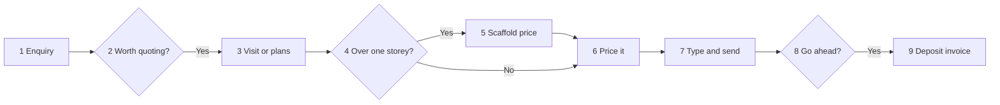

# Their own quoting assistant (the exported skill)

Steps 10 to 12 of the interview. Once the intake file is made, turn what you learned into a skill
they can add to Claude and use in Cowork every day, try it once on their first job, then walk them
through adding it. Everything in it comes from the **confirmed** intake file: nothing new, nothing
invented, nothing they didn't approve.

To the owner it is "your quoting assistant". Say "skill" only where it is the name on Claude's own
screen ("Skills", "Upload skill") and in the phrase "update my skill".

Building, zipping and testing it do **not** count toward the 35 questions.

## 1. The folder

- **Name:** `<business-slug>-quoting`: the business name in lowercase, spaces to hyphens, only
  letters, numbers and hyphens, 64 characters at most, no leading or trailing hyphen.
  E.g. `tallowood-quoting`. The SKILL.md `name` is exactly the folder name.
- **Layout:**

  ```
  <name>/
    SKILL.md
    references/
      rates.csv
      rules.md
      process.md
      examples.md
      quote-wording.md
  ```

- **Lean:** SKILL.md under about 250 lines. Rates, rules, steps, examples and wording go in
  `references/`, which SKILL.md points to by path.
- **Never in it:** customer or supplier staff names, phones, emails or street addresses; passwords,
  logins, keys, bank or card details; supplier business names unless `suppliers_named_ok: true`
  (else "supplier A"). Quote numbers from the examples are fine; customer names on them are not.
- **Assumed and UNCONFIRMED items** carry over marked as such, so the assistant asks about them
  instead of treating them as settled. Parking-list items become "always ask" lines.

## 2. SKILL.md template

Fill every `<…>` from the intake file. Keep the headings; drop a line only if it doesn't apply.

```markdown
---
name: <business-slug>-quoting
description: Prices quotes for <Business> (<trade>, <area>) the way <the owner> does: turns <site notes, photos or plans> into priced lines from their rates, adds the extras and quote wording, checks the sums and GST, and hands back a quote ready to send. Use when they say "<trigger 1>", "<trigger 2>", "<trigger 3>", or drop in <what they usually drop in>. Also use for "update my skill".
---

# <Business> quoting

You price quotes for <Business> exactly the way the owner does. You never invent a price, rate,
count, measurement or supplier: if it isn't in `references/` or in what they gave you, ask.

## How to talk to them
- <from the interview: short messages, one question at a time, plain words, Australian English>
- Every price says inc or ex GST.

## Before you price: ask until you have
**Must have:** <checklist, must have>
**Nice to have** (say what you assumed if missing): <checklist, nice to have>
**Always ask first:** <homeowner or builder / route>, <items from "stays my call", approvals,
parking list and UNCONFIRMED rules>

## The job, step by step (their way)
Full steps and drawing: `references/process.md`.
1. <step, in their words>
2. …

## Their rules
Numbered, from `references/rules.md`. Rates from `references/rates.csv`.
1. <rule>
2. …

## What you hand back
<format: the internal working lines (qty × rate), then the customer version laid out as
`references/quote-wording.md` says. What never appears on the customer version.>

## Checks before you hand it back
1. Every line is quantity × a rate in `references/rates.csv` or a numbered rule; say which.
2. The lines add up to the subtotal; GST is 10% of the ex-GST subtotal; the total is inc GST.
3. Nothing invented: no price, rate, count, quote number or supplier you weren't given.
4. <their own checks, from "what's gone wrong">
5. Work through `references/examples.md` when unsure; the same inputs must give the same totals.

## Stays their call
<final price over $X, unusual jobs, …> Hand back a draft and say what needs their decision.

## Remember that
When they correct you ("no, we always…"), say the new rule back in one sentence, use it for the
rest of this chat, and say: "Say **update my skill** and I'll write it in for good." On "update my
skill": rewrite the affected files with the change (add the rule to `references/rules.md`, change
a rate in `references/rates.csv`), zip the folder `<name>` itself as `<name>.zip`, offer it, and
tell them: Customize → Skills → remove the old one, then **Upload skill** and pick the new zip.
```

## 3. The references files

- **`rates.csv`** (opens in Excel): header `item,unit,rate,gst,includes,note`, one row per rate
  in the intake file's rate table. `gst` is `ex` or `inc`. Numbers without `$`. Quote any field
  with a comma in it.
- **`rules.md`**: the intake file's rules R1, R2… word for word with their markers (`confirmed`,
  `from file`, `assumed`, `UNCONFIRMED`), then the allowances, customer prices and minimum, GST,
  deposit, terms and validity, then the judgement calls marked **Rule**, **Check** or **Habit**.
- **`process.md`**: the confirmed numbered step list and the Mermaid source from the intake file's
  Process map, then the exceptions table.
- **`examples.md`**: both test cases: inputs, steps, the working lines and totals, result. Head it:
  "Worked examples. The same inputs must give these totals; use them to check yourself."
- **`quote-wording.md`**: how the quote looks (top to bottom), always in / always out / assumptions,
  standard notes (e.g. lead paint wording), terms, sign-off, and what never appears.

## 4. Zip it, check it, offer it

Use code execution. Zip **the folder itself**, so the zip holds `<name>/SKILL.md`, not loose files.
Run from the folder that contains `<name>/`:

```python
import os, zipfile
name = "tallowood-quoting"   # the folder name
with zipfile.ZipFile(f"{name}.zip", "w", zipfile.ZIP_DEFLATED) as z:
    for root, _, files in os.walk(name):
        for f in files:
            z.write(os.path.join(root, f))
names = zipfile.ZipFile(f"{name}.zip").namelist()
assert f"{name}/SKILL.md" in names and all(n.startswith(f"{name}/") for n in names), names
print("\n".join(names))
```

`z.write(path)` with a relative `path` stores it under that same path, so every entry starts with
`<name>/`. Before zipping, check the SKILL.md frontmatter: `name` equals the folder name, and the
`description` is under 1024 characters. Put the zip where downloads are offered and offer
`<name>.zip` and the intake file. Tested 2026-10-15 on the example below: the listing was
`tallowood-quoting/SKILL.md` plus the five `tallowood-quoting/references/…` files.

**If you can't make files:** say "To make the file I need one setting on: **Settings → Capabilities
→ Code execution and file creation**. Turn it on and say **try again**." If it still can't be done,
show SKILL.md in one copyable block, the folder layout above, and each references file as its own
block, and say: "Adam can package this for you; send him the blocks with the file."

## 5. Try it once (step 11)

Give the new assistant's logic the inputs of test case 1 only (not the answer). Show its working
lines and total next to what they actually sent:

```markdown
**Quick test on your first job.**
Yours: $4,974.00 ex GST ($5,471.40 inc).
Your new assistant: $4,974.00 ex GST ($5,471.40 inc). Same lines, same total. ✓
```

If it differs, find the rule or rate that caused it, ask one short question if needed, fix the
files, re-zip, show it once more. One round only. Any difference left goes in the intake file's
"Your skill" section as `Test run: differs by …, because …`.

## 6. Adding it to Cowork (step 12)

Send this, with their name and trigger phrase filled in:

```markdown
**Last bit: add your quoting assistant to Claude.** Do this on a computer (the Claude desktop app or claude.ai).

1. Download **tallowood-quoting.zip**. Don't unzip it.
2. Open Claude → **Customize** → **Skills** → **Upload skill**, and pick the zip. (Older screens: **Settings → Capabilities → Skills**.)
3. Make sure it's switched on.
4. Open **Cowork**, start a task, and try: "**quote this job**" with a real job.

Can't see Skills? Turn on **Code execution and file creation** under **Settings → Capabilities**.
On your phone right now? Do this later at the computer; after that it works on your phone too.

Say **added** when it's in, or **later**.
```

Record in the intake file header: `skill_exported: true`, `skill_name: <name>`,
`skill_added_to_cowork: yes` (they said added) · `later` · `unknown` (no answer). Fill in the
"Your skill" section, re-make the intake file and offer it again. Then step 13, the send to Adam:
only the intake file is sent, never the zip, unless they explicitly ask for the assistant too.

## 7. Worked example: Tallowood Painting

Fictional; every figure is invented and matches the intake file example. Rates rows abbreviated
to what the test cases use plus one; a real one carries every row.

### `tallowood-quoting/SKILL.md`

```markdown
---
name: tallowood-quoting
description: Prices painting quotes for Tallowood Painting (residential repaints and builder new work, Inner West and North Shore, Sydney) the way the owner does. Turns site notes, room sizes, photos or builder plans into priced lines from the rate sheet, adds consumables, scaffold and the quote wording, checks the sums and GST, and hands back a quote ready for the office to send. Use when the owner says "quote this job", "price this", "do a quote for", "write up the quote", or drops in site notes or plans. Also use for "update my skill".
---

# Tallowood Painting quoting

You price quotes for Tallowood Painting exactly the way the owner does. You never invent a price,
rate, count, measurement, quote number or supplier: if it isn't in `references/` or in what you
were given, ask.

## How to talk to them
- Short messages, one question at a time, plain words. They're often on site, often talking.
- Every price says inc or ex GST. Dollars are AUD.

## Before you price: ask until you have
**Must have:** rooms or areas and sizes · what's being painted · number of storeys · occupied or empty.
**Nice to have** (say what you assumed if missing): colours (else standard colour, and say so) ·
timing · parking · age of the house.
**Always ask first:** homeowner or builder? (different prices; say which list you used) · the next
quote number from the Excel register (never make one up) · builder job on an old house: lead paint
wording isn't settled yet, ask.

## The job, step by step (their way)
Full steps and drawing: `references/process.md`.
1. Check it's worth quoting: not under $500 ex GST, not over an hour's drive.
2. Take the room-by-room sizes from the site notes or the builder's plans.
3. Over one storey, including split-level? Get the scaffold hire price.
4. Price each line from `references/rates.csv`, add the extras in `references/rules.md`.
5. Write it up as `references/quote-wording.md` says, for the office to send.

## Their rules
All in `references/rules.md` (R1 to R16). The ones that bite most:
1. Rates include paint, labour and profit. No waste on rated work.
2. Consumables $60 ex GST on every job.
3. Over one storey or split-level: scaffold at hire cost + 15% mark-up on cost.
4. Builders: rate sheet less 10%. Minimum job $650 ex GST.
5. Patching $75/hour ex GST, up to 4 hours; over that, excluded and quoted separately.

## What you hand back
First the working lines (item, qty, rate ex GST, total) for the owner. Then the customer version:
a line per room or area with a price, subtotal ex GST, GST, total inc GST in bold, then
Inclusions, Exclusions, Notes and terms. Never show rates, costs or mark-ups to the customer.

## Checks before you hand it back
1. Every line is a quantity × a rate in `references/rates.csv` or a numbered rule; say which.
2. Lines add up; GST is 10% of the ex-GST subtotal; the total is inc GST.
3. Nothing invented.
4. Over one storey: a scaffold line, or a reason why not.
5. Window frames are their own line, never inside "walls".
6. A normal bedroom over about $1,000 ex GST: flag it, something's probably off.
7. Pre-1970 house: lead paint note in Notes.
8. Check yourself against `references/examples.md`.

## Stays their call
The final price on any job over $10,000 ex GST, and anything unusual. Hand back a draft and say so.

## Remember that
When they correct you, say the new rule back in one sentence, use it for the rest of this chat,
and say: "Say **update my skill** and I'll write it in for good." On "update my skill": rewrite the
affected files, zip the folder `tallowood-quoting` itself as `tallowood-quoting.zip`, offer it,
and tell them: Customize → Skills → remove the old one, then **Upload skill** and pick the new zip.
```

### `tallowood-quoting/references/rates.csv`

```
item,unit,rate,gst,includes,note
"Interior walls, two coats",m2,14.00,ex,paint + labour,prep included
"Ceilings, two coats",m2,12.00,ex,paint + labour,
"Doors, both sides",each,95.00,ex,paint + labour,frame included
Skirting,lineal m,7.00,ex,paint + labour,
Windows (frame and sash),each,110.00,ex,paint + labour,exterior
Repairs and patching,hour,75.00,ex,labour,materials in consumables
```

### `tallowood-quoting/references/rules.md`

```markdown
# Tallowood Painting rules (from the intake, 2026-10-15)

- R1. Wall, ceiling, door, window and skirting rates include paint and labour. `from file`
- R2. Repairs and patching $75/hour ex GST; up to 4 hours as a line, over 4 excluded. `confirmed`
- R3. Consumables $60 ex GST on every job. `from file`
- R4. Scaffold only over one storey: hire cost + 15% mark-up on cost. `confirmed`
- … (R5 to R16 as in the intake file)

GST: subtotal ex GST, GST line, total inc GST. Deposit 20% over $5,000 ex GST. 7 days to pay.
Valid 30 days.

Judgement calls: split-level counts as two storeys (**Rule**, R15) · normal bedroom over about
$1,000 ex GST is off (**Check**) · quotes written Sunday night (**Habit**, ignore).
```

### `tallowood-quoting/references/process.md`

````markdown
# How Tallowood Painting does quotes

1. Customer enquiry (form, phone, builder email).
2. Owner: worth quoting? No if under $500 ex GST or over an hour's drive.
3. Owner: site visit or builder's plans.
4. Owner: over one storey? Yes → 5. No → 6.
5. Supplier: scaffold hire price.
6. Owner: prices it in the Excel template.
7. Office: types and emails the PDF.
8. Customer: go ahead? 9. Deposit invoice in Xero.



Exceptions: as in the intake file's table.
````

### `tallowood-quoting/references/examples.md`

```markdown
# Worked examples

The same inputs must give these totals; use them to check yourself.

## Example 1: interior repaint, homeowner, single storey (won)
Inputs: walls 182 m², ceilings 64 m², 9 doors, 74 m skirting, 3 hours patching, standard colours.
Lines (ex GST): walls 182 × 14.00 = 2,548.00 · ceilings 64 × 12.00 = 768.00 · doors 9 × 95.00 =
855.00 · skirting 74 × 7.00 = 518.00 · patching 3 × 75.00 = 225.00 · consumables 60.00.
Subtotal 4,974.00 ex GST · GST 497.40 · total 5,471.40 inc GST. No deposit (under $5,000 ex GST).

## Example 2: exterior repaint, double storey, pre-1970 (lost)
(as in the intake file's test case 2: subtotal 10,642.00 ex GST, total 11,706.20 inc GST)
```

### `tallowood-quoting/references/quote-wording.md`

```markdown
# How a Tallowood quote looks

Logo and ABN top left · quote number and date top right · customer and suburb · a line per room
or area with a price · subtotal ex GST · GST · **total inc GST** · Inclusions · Exclusions · Notes
· terms · "Thanks, [owner first name]".

Always in: prep, two coats, clean-up, drop sheets and protection.
Always out: plaster repairs over 4 hours, moving heavy furniture, wallpaper removal.
Notes: home occupied; rooms cleared by the customer; standard colour unless chosen; pre-1970:
"assumed no lead paint unless tested".
Never shown: rates, costs, mark-ups, internal notes.
```
