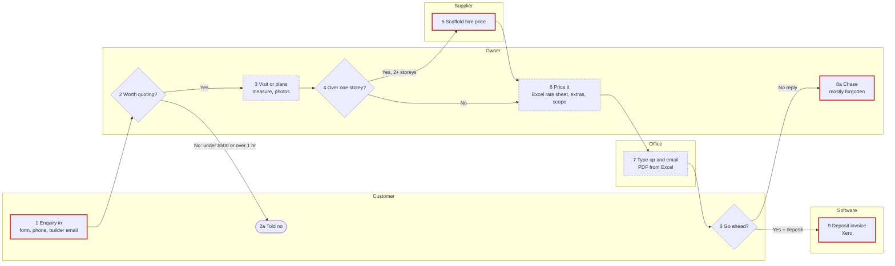

# The quoting intake file

One Markdown file, named `map-quoting-<business-name>-<YYYY-MM-DD>.md`. The block at the top is
for Adam's build; the sections below it are for a person. Write every section, in this order.

- Anything not given: `not given`.
- A default you applied: the value followed by `(assumed)`, and listed in `assumed`.
- Something they weren't sure of: `UNCONFIRMED`, and listed in `unconfirmed`.
- Every rule is numbered (R1, R2…) and marked `confirmed`, `from file`, `assumed` or `UNCONFIRMED`.
- No customer or supplier staff names, phones, emails or street addresses anywhere. Suburbs are fine.
  Supplier business names only if `suppliers_named_ok: true`; otherwise "supplier A".
- No passwords, logins, keys, bank or card details, ever.
- Every price says inc or ex GST.
- Step numbers are the same everywhere: the drawing, the Process map, the step table and the
  exceptions table.
- `consent_to_send` and `sent_via` are written as `not asked` and `not sent` when the file is made,
  then changed (and nothing else) after the send question in step 13 of the skill:
  - `consent_to_send`: `yes` (they said yes to sending it to Adam) · `no` · `not asked` (no send
    tool here, or they stopped before it)
  - `sent_via`: `submit_intake` (sent by the tool after a yes) · `owner (download and share)` ·
    `not sent`
- `skill_exported: false`, `skill_name: not made` and `skill_added_to_cowork: unknown` are written
  when the file is made, then set after step 12 (their quoting assistant):
  - `skill_exported`: `true` once the zip was made (or the copyable fallback shown) · `false`
  - `skill_name`: the folder name, e.g. `tallowood-quoting` · `not made`
  - `skill_added_to_cowork`: `yes` (they said added) · `later` · `unknown` (no answer)

Below is a complete worked example for the made-up business used in the questions. Tallowood
Painting is fictional; every figure is invented for illustration.

````markdown
---
intake: quote
intake_version: 0.4.0
status: complete            # complete | incomplete
date: 2026-10-15
consent_to_send: yes        # yes | no | not asked
sent_via: submit_intake      # submit_intake | owner (download and share) | not sent
diagram_confirmed: true      # true once they said the drawing is right; false if draft
skill_exported: true         # true | false
skill_name: tallowood-quoting  # folder and zip name | not made
skill_added_to_cowork: yes   # yes | later | unknown
business: Tallowood Painting
trade: Painting (residential repaints and builder new work)
area: Inner West and North Shore, Sydney
website: https://tallowoodpainting.example
licence: not given
routes:
  - { name: homeowner repaint, share: "about two thirds", input: "site visit" }
  - { name: builder new work, share: "about one third", input: "plans by email" }
enquiry_channels: [website form, phone, builder email]
first_seen_by: owner
skip_rules: ["under $500 ex GST", "more than an hour's drive"]
volume:
  quotes_per_week: 8
  site_visit_minutes: 40
  write_up_minutes: 45
  enquiry_to_sent_days: "4 to 5"
  win_rate: "about 1 in 3"
people:
  - { role: owner, does: "site visit, measure, price, final price" }
  - { role: office (partner, part time), does: "types quote, emails PDF" }
software:
  enquiries: phone notes
  quote_built_in: Excel template
  sent_as: PDF by email
  jobs_and_invoices: Xero
quote_number: "next number in the Excel register; tool never invents one"
site_visit: always for homeowners; plans for builders
labour_method: rate per m2 / item / metre including paint and labour; hourly for repairs
rates_source: owner's rate sheet (dropped in), dated 2026-07
materials_source: supplier price list, updated about twice a year
suppliers_named_ok: false
waste: none on rated work; specialty coatings rounded up to whole 4 L tins
allowances:
  - { item: consumables, rule: "$60 ex GST every job", automatic: true }
  - { item: scaffold, rule: "hire cost + 15%, over one storey only", automatic: false }
  - { item: parking, rule: "at cost, city jobs only", automatic: false }
customer_pricing: { builders: "10% off rate sheet", minimum_job_ex_gst: 650 }
final_price: rates include profit; specialty materials cost + 20% mark-up
markup_basis: cost
gst_display: ex, GST line, inc total
deposit: "20% on jobs over $5,000 ex GST"
payment_terms_days: 7
quote_valid_days: 30
customer_sees: a line per room or area with a price, then the total
never_on_quote: [rates, costs, mark-up, internal notes]
review_rule: "only the owner prices and approves; nobody covers when away, quotes wait"
sent_by: office emails PDF
follow_up: "3 and 10 days, then lost (assumed)"
win_signal: { homeowner: "text or email yes plus deposit", builder: "purchase order" }
test_cases: 2
revisions: "same quote number with rev B, rev C"
late_acceptance: "over 30 days, re-check material prices before confirming"
success:
  write_up_minutes: { now: 45, target: 15 }
  enquiry_to_sent: { now: "4 to 5 days", target: "within 1 day of the visit" }
  win_rate: { now: "about 1 in 3", target: "better than 1 in 3" }
questions_asked: 28
assumed: [follow_up]
unconfirmed: [lead paint wording on builder jobs, retention on builder jobs]
open_items: 3
---

# How Tallowood Painting quotes

## The business
Owner-run painting business in Sydney's Inner West and North Shore, with three painters and a
part-time office person. About two thirds of work is homeowner repaints (interior and exterior);
about a third is builders sending plans for new homes and extensions. The owner does every
quote; the office person types it up and sends it.

## Process map

Confirmed with the owner in the drawing, step by step, on 2026-10-15. Paste the block into
mermaid.live to see it drawn.



**The steps, in order** (! = where it goes wrong, ◷ = slow or waiting):

1. **Customer:** sends an enquiry by website form, phone or builder email. ! Phone enquiries get
   lost if not written down that day.
2. **Owner, decision:** worth quoting? No if under $500 ex GST or over an hour's drive → **2a**
   customer told no. Yes → 3.
3. **Owner:** site visit for homeowners (measure room by room, photos) or opens the builder's plans.
   ◷ 40 min + travel. ! Builders' plans arrive over several emails.
4. **Owner, decision:** over one storey (including split-level)? Yes → 5. No → 6.
5. **Supplier:** gives the scaffold hire price. ! Scaffold left off once on a double storey.
6. **Owner:** prices it in the Excel template from the rate sheet, adds extras and the scope words,
   takes the next quote number from the Excel register. ◷ 30 min. ! Pad notes retyped.
7. **Office:** types the customer quote, saves the PDF, emails it. ◷ Waits for the office day: 4 to
   5 days enquiry to sent. ! Typos.
8. **Customer, decision:** go ahead? Yes, plus deposit (homeowner) or a purchase order (builder) →
   9. No reply → **8a** owner chases. ! Chasing mostly doesn't happen.
9. **Software:** deposit invoice in Xero; painters get the room list. ! Colours and access asked
   again after the win.

## Each step in detail

| # | Step | Who | Software or paper | Time | Where it goes wrong |
|---|---|---|---|---|---|
| 1 | Enquiry arrives (website form, phone, builder email) | Customer → owner | Phone notes | 5 min | Phone enquiries get lost if not written down that day |
| 2 | Decide whether to quote (skip under $500 ex GST or over an hour away) | Owner | In head | 1 min | — |
| 3 | Site visit: measure room by room, photograph, note condition; or open the builder's plans | Owner | Paper pad, laser measure, phone camera | 40 min + travel | Notes hard to read later; cornices and frames forgotten; plans in several emails |
| 4 | Over one storey? | Owner | In head | — | Split-levels missed |
| 5 | Scaffold hire price | Supplier | Phone | same day | Scaffold forgotten once |
| 6 | Quantities, price lines, extras, scope, quote number | Owner | Excel template | 30 min | Retyping pad notes; extras done from memory |
| 7 | Type the customer quote, save PDF, email | Office | Excel, email | 15 min | Typos; waits until the office day |
| 8 / 8a | Customer decides; owner chases if no reply | Customer, owner | — | — | Chasing mostly doesn't happen |
| 9 | Deposit invoice; hand over to the painters | Owner | Xero | 10 min | Colours and access re-asked because not captured at quote time |

Enquiry to sent: usually 4 to 5 days, mostly waiting for the owner's evening and the office day.

## Routes
- **Homeowner repaint:** always a site visit. Full rate sheet. Deposit over $5,000 ex GST.
- **Builder new work:** priced from floor plans and the finishes schedule, no visit. Rate sheet less
  10%. Win comes as a purchase order. Same job sometimes quoted to two or three builders, same price,
  builder's name on each copy.

## What's needed before pricing (the per-job form)
**Must have:** rooms or areas and their sizes · what's being painted (walls, ceilings, doors,
frames, skirting, exterior surfaces) · number of storeys · occupied or empty.
**Nice to have:** colours (else standard colour priced, and said so) · customer timing · parking ·
age of the house (lead paint risk).
**When something's missing:** chase it first; if the customer is in a hurry, price what's known and
state the limit on the quote. About one quote in four has something missing; usually colours.

## Measuring and takeoff
- **Site:** room by room, wall length × ceiling height for wall area, ceiling area, doors counted
  (both sides as one), windows counted, skirting and cornice in metres. Measured sizes recorded, not
  order amounts. Photos of every room and any damage. Patching estimated in hours.
- **Plans:** floor plans and the finishes schedule. Wall area = plan wall length × ceiling height;
  doors from the door schedule; skirting in metres. Wet areas ignored (tiled by others). On a new
  revision, re-measure the changed rooms only. If the plan's door schedule and the count disagree,
  ask the builder.

## Pricing rules
- R1. Wall, ceiling, door, window and skirting rates include paint and labour. `from file`
- R2. Repairs and patching at $75/hour ex GST; up to 4 hours included as a line, over 4 hours excluded and quoted separately. `confirmed`
- R3. Consumables $60 ex GST on every job. `from file`
- R4. Scaffold only over one storey: supplier hire cost + 15% mark-up on cost. `confirmed`
- R5. Parking at cost, city jobs only. `confirmed`
- R6. Specialty coatings bought per job: rounded up to whole 4 L tins, cost + 20% mark-up on cost. `confirmed`
- R7. No waste added on rated work (paint is inside the rate). `confirmed`
- R8. Builders: rate sheet less 10%. `confirmed`
- R9. Minimum job $650 ex GST. `confirmed`
- R10. Rates already include profit; the owner sets the final price on any job over $10,000 ex GST. `confirmed`
- R11. Mark-up is on cost, not margin on the selling price (checked with the $1,000 example). `confirmed`
- R12. Only the owner prices and approves; when away, quotes wait. `confirmed`
- R13. A revised quote keeps its number with rev B, rev C. `confirmed`
- R14. Accepted after 30 days: re-check material prices before confirming the price. `confirmed`
- R15. Any part of the house over one storey, including split-levels, gets the scaffold rule (R4). `confirmed`
- R16. Pre-1970 house: "assumed no lead paint unless tested" goes in Notes. `confirmed` (wording on builder jobs UNCONFIRMED)

## Rates (from the rate sheet, dated 2026-07)

| Item | Unit | Rate | Inc/ex GST | Includes | Note |
|---|---|---|---|---|---|
| Interior walls, two coats | m² | 14.00 | ex | paint + labour | prep included |
| Ceilings, two coats | m² | 12.00 | ex | paint + labour | |
| Doors, both sides | each | 95.00 | ex | paint + labour | frame included |
| Skirting | lineal m | 7.00 | ex | paint + labour | |
| Windows (frame and sash) | each | 110.00 | ex | paint + labour | exterior |
| Weatherboard walls, prep and two coats | m² | 26.00 | ex | paint + labour | exterior |
| Eaves | m² | 16.00 | ex | paint + labour | exterior |
| Fascia and barge | lineal m | 12.00 | ex | paint + labour | exterior |
| Repairs and patching | hour | 75.00 | ex | labour | materials in consumables |

## Final price, GST and terms
Rates include profit, so most quotes are the sum of the lines. Specialty materials and scaffold carry
a mark-up on cost. Quote shows subtotal ex GST, GST, then total inc GST. Deposit 20% on jobs over
$5,000 ex GST; balance on completion; 7 days to pay; valid 30 days.

## Scope wording
- **Always in:** prep, two coats, clean-up, drop sheets and protection.
- **Always out:** plaster repairs over 4 hours, moving heavy furniture, wallpaper removal.
- **Assumptions (Notes, not exclusions):** home occupied; rooms cleared by the customer; standard
  colour unless chosen; assumed no lead paint unless tested (wording for builder jobs UNCONFIRMED).
- **Learned the hard way:** window frames are listed as their own line, since a customer once read
  "walls" as including them.

## How the quote looks
From the two quotes dropped in: logo and ABN top left, quote number and date top right, customer
and suburb, then a line per room or area with a price, subtotal ex GST, GST, total inc GST, then
Inclusions, Exclusions, Notes, terms, and "Thanks, [owner first name]". Customer never sees rates,
costs or mark-ups. Options not offered today.

## Checking, sending and following up
No one checks today besides the owner. The worst miss was scaffold left off a double storey. Office emails the PDF;
"sent" written in the owner's notes. Follow-up rarely happens. Changes mean redoing the Excel and
re-sending, a day or two later. Wanted: chase at 3 and 10 days (assumed), changes out the same day.

## Winning and handover
Homeowners text or email "go ahead" and pay the deposit (Xero invoice). Builders send a purchase
order. The painters need: room list, colour schedule, access times, parking, anything excluded.
Today those are re-asked after the win; the tool should capture them on the quote.

## Test case 1: interior repaint (won)
**Inputs:** phone enquiry then a text with photos. Interior repaint of living, hall and three
bedrooms, ceilings included, single storey, occupied. Site visit: walls 182 m², ceilings 64 m²,
9 doors, 74 m skirting, about 3 hours patching in the hall. Standard colours.
**Steps:** visit and measure (40 min) → rates off the sheet → patching as hours → consumables →
scope and terms → office types and sends.
**Output:**

| Line | Qty | Rate (ex GST) | Total (ex GST) |
|---|---|---|---|
| Walls, two coats | 182 m² | 14.00 | 2,548.00 |
| Ceilings, two coats | 64 m² | 12.00 | 768.00 |
| Doors, both sides | 9 | 95.00 | 855.00 |
| Skirting | 74 m | 7.00 | 518.00 |
| Patching | 3 h | 75.00 | 225.00 |
| Consumables | 1 | 60.00 | 60.00 |
| **Subtotal** | | | **4,974.00** |
| GST | | | 497.40 |
| **Total inc GST** | | | **5,471.40** |

Customer saw a line per room, not these lines. No deposit (under $5,000 ex GST). **Result:** won.

## Test case 2: exterior repaint (lost)
**Inputs:** website form. Exterior repaint, double-storey weatherboard house. Site visit:
weatherboard 210 m², eaves 48 m², fascia and barge 62 m, 14 windows. Scaffold needed (two
storeys); hire quoted at $1,800 ex GST. House built before 1970.
**Steps:** visit and measure → exterior rates → scaffold rule (R4) → consumables → lead paint
assumption added to Notes → sent.
**Output:**

| Line | Qty | Rate (ex GST) | Total (ex GST) |
|---|---|---|---|
| Weatherboard, prep and two coats | 210 m² | 26.00 | 5,460.00 |
| Eaves | 48 m² | 16.00 | 768.00 |
| Fascia and barge | 62 m | 12.00 | 744.00 |
| Windows | 14 | 110.00 | 1,540.00 |
| Scaffold (hire 1,800 + 15%) | 1 | 2,070.00 | 2,070.00 |
| Consumables | 1 | 60.00 | 60.00 |
| **Subtotal** | | | **10,642.00** |
| GST | | | 1,064.20 |
| **Total inc GST** | | | **11,706.20** |

Deposit 20% (2,128.40 ex GST). The owner set the final price (over $10,000, R10) and left it as
calculated. **Result:** lost; customer said another quote was cheaper. Owner thinks the scaffold
line made the difference.

## Exceptions and edge cases

From Q27 and the quick-fire sweep (Q28 to Q31). Step = the step number on the drawing.

| Case | Step | What happens now | Rule | Source |
|---|---|---|---|---|
| Strata jobs: manager sends photos, no visit | 3 | Priced off photos, limit stated on the quote | — | Q27 |
| Same job to two or three builders | 7 | Same price, builder's name on each copy | — | sweep 1 |
| Occupied units: work weekdays 8 to 4 only | 6 | Written in Notes; no extra charge | — | sweep 1 |
| Extra work after a yes | after 9 | Price texted to the customer, added to the invoice, nothing written | — | sweep 1 |
| Flat out in spring | 2, 8a | Small jobs don't get quoted; follow-ups stop | — | sweep 1 |
| Plans say 2.4 m ceilings, house is 2.7 m | 3 | Owner's measurements win | — | sweep 2 |
| Old house, can't see under the paint | 6 | Lead paint assumption in Notes | R16 | sweep 2 |
| Customer changes the scope | 6, 7 | Same number, rev B, out in a day or two | R13 | sweep 2 |
| Accepted after the quote expired | 8 | Material prices re-checked first | R14 | sweep 2 |
| Builder deadlines (5 working days) | 7 | Quotes written Sunday night | — | sweep 2 |
| Homeowners compare ex GST with others' inc GST | 7 | Inc GST total now in bold | — | sweep 3 |
| Builder jobs: progress claims monthly; retention | 9 | Claims monthly; retention not known | — | sweep 3, parking list |
| Owner away | all | Nobody quotes; enquiries wait | R12 | sweep 3 |
| Numbers typed twice | 3 → 6 → 9 | Room sizes pad → Excel; total Excel → Xero | — | sweep 4 |
| Template only on the owner's laptop | 6 | No backup | — | sweep 4 |
| Rates checked against real costs | — | Only after one goes badly | — | sweep 4 |
| Who's told | 9 | Win: owner texts the leading hand. Lost: no one | — | sweep 4 |

Didn't apply: insurance work, rush fees, one-off deals, supplier terms, rounding the total,
messy customer records.

## Judgement calls (rules of thumb)

- **Split-level counts as two storeys** for scaffold. Why: the high side needs scaffold all the
  same. **Rule** (R15).
- **Pre-1970 house gets the lead paint note.** Why: if lead is found, the job changes and the
  price with it. **Rule** (R16).
- **A normal bedroom (walls, ceiling, door, skirting) over about $1,000 ex GST means something's
  off.** Why: "it's never been more than that". **Check** for the tool to flag, not a price rule.
- **Writing quotes on Sunday night.** Why: "that's when I get time". **Habit**, not a rule.

## What's gone wrong (and what the tool must check)

- **Last one that went wrong:** scaffold left off a double-storey quote; won the job and lost the
  profit. Found out when the hire invoice came. → The tool never finishes a quote over one storey
  without a scaffold line or a reason.
- **Customer argument:** "walls" read as including the window frames. → Frames always their own line.
- **If the tool got one wrong (owner's guess):** pricing a builder job at homeowner rates, or the
  other way round. → The tool asks homeowner or builder first and shows which price list it used.

## What they want the tool to do
- **Must:** turn site notes (typed or spoken) into a finished quote the same night, using the rate
  sheet and rules above; never leave off scaffold on a double storey or split-level.
- **Checks it runs** (from what's gone wrong): scaffold line or a reason on anything over one
  storey; homeowner or builder asked first, and the price list used shown; frames as their own
  line; flag a normal bedroom over about $1,000 ex GST; lead paint note on pre-1970 houses.
- **Should:** chase sent quotes at 3 and 10 days; capture colours, access and room list for the
  painters at quote time; write extras after a yes down as a priced change the customer okays.
- **Stays the owner's call:** the final price on jobs over $10,000 ex GST; anything unusual.
- **Finished quote goes to:** PDF to the owner's email, then the deposit invoice into Xero.

## Success measures
| Measure | Now | Target |
|---|---|---|
| Write-up time per quote | 45 min | 15 min |
| Enquiry to sent | 4 to 5 days | within 1 day of the visit |
| Quotes per week | 8 | 8 (same volume, less time) |
| Win rate | about 1 in 3 | better than 1 in 3 |

## Your skill

Their own quoting assistant, built from this file after it was approved, tried on test case 1,
and given to them as `tallowood-quoting.zip` to add to Claude (Customize → Skills → Upload skill).
Not sent to Adam (only this file was).

- **Folder:** `tallowood-quoting/`
- **Files:** `SKILL.md` · `references/rates.csv` · `references/rules.md` · `references/process.md`
  · `references/examples.md` · `references/quote-wording.md`
- **Trigger phrases:** "quote this job", "price this", "do a quote for", "write up the quote"; and
  "update my skill" to write in a correction.
- **Test run (test case 1):** $4,974.00 ex GST, same as the quote they sent. Match.
- **Added to Cowork:** yes, tried with "quote this job".

## Files they showed
- `quote-1042.pdf`: test case 1, won, interior repaint
- `quote-1047.pdf`: test case 2, lost, exterior repaint
- `rate-sheet-2026-07.xlsx`: the rate table above
- `site-notes-photo.jpg`: the pad notes for test case 1
They said they'll send all four to Adam.

## Parking list (open items)

| # | Item | Who can answer | Status |
|---|---|---|---|
| 1 | Lead paint wording on builder jobs | Owner, after checking with builder A | open |
| 2 | Whether builder copies of the same quote get their own quote numbers | Adam to suggest | open |
| 3 | Retention on builder jobs: percentage and when released | Owner's accountant | open |

## Still to ask
None (status complete). If unfinished, list each unasked question number and topic here.

## Questions log

| Q | Topic | Answer (short) | Source |
|---|---|---|---|
| 1 | Business and website | Tallowood Painting, website read | answered |
| 2 | Kinds of jobs and routes | Homeowner repaints, builder new work | answered |
| 3 | What starts a quote | Form, phone, builder email; owner first; skip rules | answered |
| 4 | Before you price | Checklist above | answered |
| 5 | What comes out the end | PDF by email, line per room, never rates | read from file, confirmed |
| 6 | Who, software, numbering | Owner prices, office types; Excel, Xero | answered |
| 7 | Volume and time | 8 a week; 40 + 45 min; 4 to 5 days | answered |
| 8–10 | Test case 1 | Interior repaint, won | read from file, confirmed |
| 11–13 | Test case 2 | Exterior repaint, lost | read from file, confirmed |
| 14 | Site visit | Always for homeowners; plans for builders | answered |
| 15–16 | Measuring, extras, plans | As above | answered |
| 17 | Labour method | Rate per unit including labour | read from file |
| 18 | Rates | Rate sheet | read from file |
| 19 | Material costs | Supplier list; names not to be shared | answered |
| 20 | Waste and rounding | None on rates; 4 L tins | answered |
| 21 | Extras | Consumables, scaffold, parking | answered |
| 22 | Customer prices and minimum | Builders −10%, minimum $650 ex | answered |
| 23 + ↳ | Final price and mark-up basis | Rates include profit; mark-up on cost | answered |
| 24 | GST and terms | Ex + GST + inc; 20% over $5k; 7 days; 30 days | read from file |
| 25 | In, out, assumed | As above | answered |
| 26 | Winning and handover | Text plus deposit; PO for builders | answered |
| 27 | Is it always like this? | Strata by photos | answered |
| 28–31 | Quick-fire sweep, 4 rounds | See exceptions table | answered; chase cadence assumed |
| 32 + why | Judgement calls | Split-level, pre-1970, $1,000 bedroom check | answered |
| 33 + ↳ | What's gone wrong | Scaffold miss; frames; builder vs homeowner rates | answered |
| 34 | What they want | Notes to quote same night | answered |
| 35 | Success | 15 min, within a day | answered |
````
