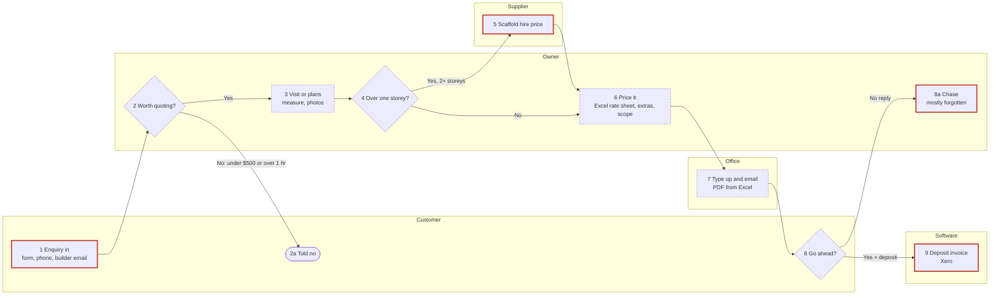

# See it and confirm it: drawing their process

Step 7 of the interview. The owner must **see** how they quote, drawn out, and confirm it step by
step before the summary and the file. People spot a missing step in a drawing that they'd nod
through in a list.

Build it from the running step list (Parts 1 and 2), the exceptions (Q27 and the sweep) and the
slow or broken steps they mentioned. Use their words on the boxes.

## 1. What to build

One **self-contained HTML page with an inline SVG drawing**, shown as an artifact. No external
scripts, libraries, fonts or images: everything inline, so it works offline and on any plan.

- **Title:** `How [Business] does quotes` (e.g. "How Tallowood Painting does quotes"), and one line
  under it: "Check each step. Tell me what's wrong or missing."
- **Swimlanes, one per who:** customer, owner, office (or partner, estimator), supplier, software.
  Only lanes that are used. Software is its own lane for steps the software does or where the
  numbers land (Xero, the job software).
- **Numbered steps** matching the step list and the file. Exceptions and side branches get a letter
  (2a, 8a). Keep the box text short: the step on line one, the how or where on line two.
- **Decisions as diamonds**, with **both branches labelled** ("Yes", "No: under $500").
- **Red markers** (a red circle with "!") on every step where it goes wrong or has an exception,
  each explained in a short "Where it goes wrong" list under the drawing, keyed by step number.
- **A clock note** under slow steps or waits ("40 min + travel", "waits for office day").
- **A legend:** box = step, diamond = decision, red ! = where it goes wrong, clock = slow or waiting.
- **Phone-friendly.** On a narrow screen, show the steps stacked top to bottom as cards (lane name,
  step, decision branches, red and clock notes), with the full drawing below in a box that scrolls
  sideways. No sideways scroll on the page itself.
- **Light and dark.** Colours as variables with a dark set; the page has its own background.
- **No customer or supplier staff names, phones, emails or addresses** on the drawing. "Customer",
  "supplier A". Supplier business names only if they said that's OK.
- **About 12 steps at most.** More than that: group the small ones ("6 Price it" covers lines,
  extras and scope) or split into two drawings ("Getting the job in" and "Pricing and sending").

## 2. How to show it and confirm it

1. Publish the page as an artifact, then say:
   "Here's your process drawn out. Have a look (on your phone it's in the Artifacts tab)."
2. Confirm **step by step**, two or three steps per message, never "looks good?":
   - "Steps 1 to 3: the enquiry comes in, you decide if it's worth it, then you visit or open the
     plans. Is that right?"
   - "Anything missing between 3 and 4?"
   - At each diamond: "At step 4, is 'more than one storey' really what decides it?"
   - At each red marker: "Step 5, scaffold gets forgotten. Is that the main thing that goes wrong
     there?"
   - Last: "Anyone or anything missing from the lanes?"
3. **After every change, redraw** (update the same artifact, don't start a new one) and say what
   changed in one line: "Redrawn: step 6 now says the office checks the total." Then carry on from
   where you were.
4. **Nothing is final until they say the drawing is right.** Ask plainly at the end: "Is this how
   [Business] does quotes?" (Yes, that's it · Something's still wrong).
5. These confirmations don't count toward the 35 questions.

## 3. If you can't make an artifact

Send the steps as plain text, **grouped by who does them**, every decision and exception spelled
out, then the Mermaid source in a block:

```text
How Tallowood Painting does quotes

CUSTOMER
1. Sends an enquiry: website form, phone or builder email. (! phone ones get lost if not written down that day)
2a. Told no, if not worth quoting.
8. Decides: go ahead or not.

OWNER
2. Decides if it's worth quoting. No if under $500 ex GST or over an hour's drive -> 2a. Yes -> 3.
3. Site visit (homeowner) or opens the plans (builder): measures, photos. (clock: 40 min + travel)
4. Over one storey? Yes -> 5. No -> 6.
6. Prices it in the Excel rate sheet, adds extras and scope. (clock: 30 min)
8a. Chases if no reply. (! mostly forgotten)

SUPPLIER
5. Gives the scaffold hire price. (! scaffold left off once on a double storey)

OFFICE
7. Types it up, saves the PDF, emails it. (clock: waits for the office day; 4 to 5 days enquiry to sent)

SOFTWARE
9. Xero: deposit invoice once they say yes. (! colours and access re-asked after the win)
```

Then: "To see it drawn, copy this and paste it into mermaid.live." and the Mermaid block. Confirm
the same way, step by step.

## 4. Mermaid source rules

- `flowchart LR`, one `subgraph` per lane, steps `S1`, `S2a` and so on, labels in double quotes,
  `<br>` for a second line.
- Diamonds `{"..."}` for decisions; every branch labelled with `-->|"..."|`.
- `classDef risk` with a red border for the red-marker steps; `classDef slow` with a dashed border
  for the clock steps.
- Keep it exactly in step with the drawing. The final version goes in the file's "Process map".

## 5. Worked example (Tallowood Painting, made up)

### Mermaid



### The HTML page

Copy this shape. Change the lanes, boxes, arrows and notes to fit their process; keep the CSS,
legend, phone layout and colour variables.

```html
<!doctype html>
<html lang="en-AU">
<head>
<meta charset="utf-8">
<meta name="viewport" content="width=device-width, initial-scale=1">
<title>Tallowood quoting map</title>
<style>
  :root { --bg:#fbfaf7; --ink:#1d1d1b; --muted:#5f5e58; --line:#4a4a45; --lane-a:#f1efe8;
          --lane-b:#e7e4da; --box:#ffffff; --box-line:#8a877c; --risk:#c0392b; --risk-ink:#fff; }
  @media (prefers-color-scheme: dark) {
    :root:not([data-theme="light"]) { --bg:#171716; --ink:#ecebe6; --muted:#a8a69e; --line:#c9c7bf;
          --lane-a:#22221f; --lane-b:#2b2b27; --box:#1d1d1b; --box-line:#77756c; --risk:#e5675a; --risk-ink:#171716; }
  }
  :root[data-theme="dark"] { --bg:#171716; --ink:#ecebe6; --muted:#a8a69e; --line:#c9c7bf;
          --lane-a:#22221f; --lane-b:#2b2b27; --box:#1d1d1b; --box-line:#77756c; --risk:#e5675a; --risk-ink:#171716; }
  body { margin:0; background:var(--bg); color:var(--ink); font:15px/1.45 system-ui, sans-serif; }
  main { max-width:1160px; margin:0 auto; padding:20px 16px 40px; }
  h1 { font-size:22px; margin:0 0 4px; } p.sub { margin:0 0 16px; color:var(--muted); }
  .drawing svg { width:100%; height:auto; display:block; }
  .lane-a { fill:var(--lane-a); } .lane-b { fill:var(--lane-b); }
  .lane-name { font:600 13px system-ui, sans-serif; fill:var(--ink); }
  .box { fill:var(--box); stroke:var(--box-line); stroke-width:1.5; }
  .t { font:600 12px system-ui, sans-serif; fill:var(--ink); }
  .s { font:11px system-ui, sans-serif; fill:var(--muted); }
  .arrow { fill:none; stroke:var(--line); stroke-width:1.5; }
  .head { fill:var(--line); }
  .branch { font:italic 11px system-ui, sans-serif; fill:var(--ink); }
  .risk { fill:var(--risk); } .risk-t { font:700 12px system-ui, sans-serif; fill:var(--risk-ink); }
  .clock { fill:none; stroke:var(--muted); stroke-width:1.2; }
  .stack { display:none; padding:0; list-style:none; }
  .stack li { background:var(--box); border:1px solid var(--box-line); border-radius:8px;
              padding:10px 12px; margin:0 0 8px; }
  .stack .who { font-size:12px; color:var(--muted); text-transform:uppercase; letter-spacing:.04em; }
  .stack .bad { color:var(--risk); } .stack .slow { color:var(--muted); }
  .legend, .notes { margin-top:16px; } .legend span { margin-right:16px; white-space:nowrap; }
  .bang { color:var(--risk); font-weight:700; }
  @media (max-width:720px) {
    .stack { display:block; }
    .drawing { overflow-x:auto; border:1px solid var(--box-line); border-radius:8px; }
    .drawing svg { width:900px; }
    .drawing-title { display:block; }
  }
  .drawing-title { display:none; font-weight:600; margin:16px 0 6px; }
</style>
</head>
<body>
<main>
  <h1>How Tallowood Painting does quotes</h1>
  <p class="sub">Check each step. Tell me what's wrong or missing.</p>

  <!-- Phone view: steps stacked top to bottom -->
  <ol class="stack">
    <li><div class="who">Customer</div><b>1 Enquiry in</b>: form, phone or builder email
      <div class="bad">! Phone enquiries get lost if not written down that day</div></li>
    <li><div class="who">Owner · decision</div><b>2 Worth quoting?</b>
      <div>Yes → 3 · No (under $500 ex GST or over an hour away) → 2a, customer told no</div></li>
    <li><div class="who">Owner</div><b>3 Visit or plans</b>: measure, photos
      <div class="slow">◷ 40 min + travel</div></li>
    <li><div class="who">Owner · decision</div><b>4 Over one storey?</b>
      <div>Yes → 5 · No → 6</div></li>
    <li><div class="who">Supplier</div><b>5 Scaffold hire price</b>
      <div class="bad">! Scaffold left off once on a double storey</div></li>
    <li><div class="who">Owner</div><b>6 Price it</b>: Excel rate sheet, extras, scope
      <div class="slow">◷ 30 min</div></li>
    <li><div class="who">Office</div><b>7 Type up and email</b>: PDF from Excel
      <div class="slow">◷ Waits for the office day: 4 to 5 days enquiry to sent</div></li>
    <li><div class="who">Customer · decision</div><b>8 Go ahead?</b>
      <div>Yes + deposit → 9 · No reply → 8a, owner chases <span class="bad">! mostly forgotten</span></div></li>
    <li><div class="who">Software</div><b>9 Deposit invoice</b>: Xero
      <div class="bad">! Colours and access re-asked after the win</div></li>
  </ol>

  <div class="drawing-title">Full drawing (scroll sideways)</div>
  <div class="drawing">
  <svg viewBox="0 0 1120 500" role="img" aria-label="Swimlane drawing of how Tallowood Painting does quotes">
    <defs>
      <marker id="ah" viewBox="0 0 10 10" refX="9" refY="5" markerWidth="7" markerHeight="7" orient="auto-start-reverse">
        <path class="head" d="M0,0 L10,5 L0,10 z"/>
      </marker>
    </defs>
    <!-- lanes -->
    <rect class="lane-a" x="0" y="0"   width="1120" height="100"/>
    <rect class="lane-b" x="0" y="100" width="1120" height="100"/>
    <rect class="lane-a" x="0" y="200" width="1120" height="100"/>
    <rect class="lane-b" x="0" y="300" width="1120" height="100"/>
    <rect class="lane-a" x="0" y="400" width="1120" height="100"/>
    <text class="lane-name" x="14" y="55">Customer</text>
    <text class="lane-name" x="14" y="155">Owner</text>
    <text class="lane-name" x="14" y="255">Office</text>
    <text class="lane-name" x="14" y="355">Supplier</text>
    <text class="lane-name" x="14" y="455">Software</text>

    <!-- arrows (drawn first so boxes sit on top) -->
    <path class="arrow" marker-end="url(#ah)" d="M190,77 V150 H262"/>
    <path class="arrow" marker-end="url(#ah)" d="M300,116 V79"/>
    <text class="branch" x="306" y="102">No</text>
    <path class="arrow" marker-end="url(#ah)" d="M338,150 H363"/>
    <text class="branch" x="340" y="142">Yes</text>
    <path class="arrow" marker-end="url(#ah)" d="M475,150 H500"/>
    <path class="arrow" marker-end="url(#ah)" d="M540,184 V321"/>
    <text class="branch" x="546" y="268">Yes, 2+ storeys</text>
    <path class="arrow" marker-end="url(#ah)" d="M595,350 H660 V179"/>
    <path class="arrow" marker-end="url(#ah)" d="M578,150 H603"/>
    <text class="branch" x="582" y="142">No</text>
    <path class="arrow" marker-end="url(#ah)" d="M715,150 H780 V221"/>
    <path class="arrow" marker-end="url(#ah)" d="M835,250 H842 V50 H860"/>
    <path class="arrow" marker-end="url(#ah)" d="M900,84 V121"/>
    <text class="branch" x="906" y="106">No reply</text>
    <path class="arrow" marker-end="url(#ah)" d="M938,50 H1020 V421"/>
    <text class="branch" x="944" y="42">Yes + deposit</text>

    <!-- 1 -->
    <rect class="box" x="140" y="23" width="100" height="54" rx="6"/>
    <text class="t" x="190" y="46" text-anchor="middle">1 Enquiry in</text>
    <text class="s" x="190" y="62" text-anchor="middle">form, phone, email</text>
    <circle class="risk" cx="236" cy="25" r="9"/><text class="risk-t" x="236" y="29" text-anchor="middle">!</text>
    <!-- 2a -->
    <rect class="box" x="255" y="27" width="90" height="50" rx="25"/>
    <text class="t" x="300" y="56" text-anchor="middle">2a Told no</text>
    <!-- 2 decision -->
    <polygon class="box" points="300,116 338,150 300,184 262,150"/>
    <text class="t" x="300" y="148" text-anchor="middle">2 Worth</text>
    <text class="t" x="300" y="162" text-anchor="middle">quoting?</text>
    <!-- 3 -->
    <rect class="box" x="365" y="123" width="110" height="54" rx="6"/>
    <text class="t" x="420" y="146" text-anchor="middle">3 Visit or plans</text>
    <text class="s" x="420" y="162" text-anchor="middle">measure, photos</text>
    <circle class="clock" cx="384" cy="190" r="5"/><path class="clock" d="M384,187 V190 H387"/>
    <text class="s" x="393" y="194">40 min + travel</text>
    <!-- 4 decision -->
    <polygon class="box" points="540,116 578,150 540,184 502,150"/>
    <text class="t" x="540" y="148" text-anchor="middle">4 Over one</text>
    <text class="t" x="540" y="162" text-anchor="middle">storey?</text>
    <!-- 5 -->
    <rect class="box" x="485" y="323" width="110" height="54" rx="6"/>
    <text class="t" x="540" y="346" text-anchor="middle">5 Scaffold price</text>
    <text class="s" x="540" y="362" text-anchor="middle">hire quote</text>
    <circle class="risk" cx="591" cy="325" r="9"/><text class="risk-t" x="591" y="329" text-anchor="middle">!</text>
    <!-- 6 -->
    <rect class="box" x="605" y="123" width="110" height="54" rx="6"/>
    <text class="t" x="660" y="146" text-anchor="middle">6 Price it</text>
    <text class="s" x="660" y="162" text-anchor="middle">Excel rate sheet</text>
    <circle class="clock" cx="624" cy="190" r="5"/><path class="clock" d="M624,187 V190 H627"/>
    <text class="s" x="633" y="194">30 min</text>
    <!-- 7 -->
    <rect class="box" x="725" y="223" width="110" height="54" rx="6"/>
    <text class="t" x="780" y="246" text-anchor="middle">7 Type up, email</text>
    <text class="s" x="780" y="262" text-anchor="middle">PDF from Excel</text>
    <circle class="clock" cx="744" cy="290" r="5"/><path class="clock" d="M744,287 V290 H747"/>
    <text class="s" x="753" y="294">waits for office day</text>
    <!-- 8 decision -->
    <polygon class="box" points="900,16 938,50 900,84 862,50"/>
    <text class="t" x="900" y="48" text-anchor="middle">8 Go</text>
    <text class="t" x="900" y="62" text-anchor="middle">ahead?</text>
    <!-- 8a -->
    <rect class="box" x="850" y="123" width="100" height="54" rx="6"/>
    <text class="t" x="900" y="146" text-anchor="middle">8a Chase</text>
    <text class="s" x="900" y="162" text-anchor="middle">mostly forgotten</text>
    <circle class="risk" cx="946" cy="125" r="9"/><text class="risk-t" x="946" y="129" text-anchor="middle">!</text>
    <!-- 9 -->
    <rect class="box" x="960" y="423" width="120" height="54" rx="6"/>
    <text class="t" x="1020" y="446" text-anchor="middle">9 Deposit invoice</text>
    <text class="s" x="1020" y="462" text-anchor="middle">Xero</text>
    <circle class="risk" cx="1076" cy="425" r="9"/><text class="risk-t" x="1076" y="429" text-anchor="middle">!</text>
  </svg>
  </div>

  <div class="legend">
    <span>▭ step</span><span>◇ decision</span><span><span class="bang">!</span> where it goes wrong</span><span>◷ slow or waiting</span>
  </div>
  <div class="notes">
    <b>Where it goes wrong</b>
    <ul>
      <li><b>1</b> Phone enquiries get lost if not written down that day.</li>
      <li><b>5</b> Scaffold was left off once on a double storey; it cost the profit.</li>
      <li><b>8a</b> Chasing mostly doesn't happen.</li>
      <li><b>9</b> Colours, access and the room list are asked again after the win.</li>
    </ul>
  </div>
</main>
</body>
</html>
```

The numbers on the drawing are the step numbers in the file. In a real interview, every red marker
and clock note comes from something the owner said; never add one they didn't.
