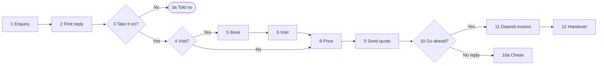

# Their own enquiries assistant (the exported skill)

Steps 10 to 12 of the interview. Once the intake file is made, turn what you learned into a skill
they can add to Claude and use in Cowork every day, try it once on their first enquiry, then walk
them through adding it. Everything in it comes from the **confirmed** intake file: nothing new,
nothing invented, nothing they didn't approve.

To the owner it is "your enquiries assistant". Say "skill" only where it is the name on Claude's
own screen ("Skills", "Upload skill") and in the phrase "update my skill".

Building, zipping and testing it do **not** count toward the 35 questions.

What it does for them, day to day: takes a new enquiry from any channel and drafts the first reply
in their words; checks it against their say-no rules and before-visit checklist; says whether it
needs a visit and drafts the booking and reminder; keeps a chase list with draft follow-ups at
their days; records won and lost (with the reason); and builds the handover for the crew. It
**drafts and a person sends**, unless the intake file says otherwise in a read-back rule. It does
not price jobs (that's for the quoting questions).

## 1. The folder

- **Name:** `<business-slug>-enquiries`: the business name in lowercase, spaces to hyphens, only
  letters, numbers and hyphens, 64 characters at most, no leading or trailing hyphen.
  E.g. `banksia-enquiries`. The SKILL.md `name` is exactly the folder name.
- **Layout:**

  ```
  <name>/
    SKILL.md
    references/
      follow-up.csv
      rules.md
      process.md
      examples.md
      reply-templates.md
  ```

- **Lean:** SKILL.md under about 250 lines. Cadence, rules, steps, examples and wording go in
  `references/`, which SKILL.md points to by path.
- **Never in it:** customer, builder or supplier staff names, phones, emails or street addresses
  (suburbs are fine); passwords, logins, keys, bank or card details; builder and supplier business
  names unless `business_names_ok: true` (else "builder A", "supplier A"). Quote numbers and
  prices from the examples are fine; customer names on them are not.
- **Assumed and UNCONFIRMED items** carry over marked as such, so the assistant asks about them
  instead of treating them as settled. Parking-list items become "always ask" lines.

## 2. SKILL.md template

Fill every `<…>` from the intake file. Keep the headings; drop a line only if it doesn't apply.

```markdown
---
name: <business-slug>-enquiries
description: Handles new enquiries for <Business> (<trade>, <area>) the way <the owner> does: drafts the first reply in their words, checks the say-no rules and the before-visit checklist, books visits, keeps the chase list with draft follow-ups, records wins and losses, and writes the handover to the crew. Drafts only; a person sends. Use when they say "<trigger 1>", "<trigger 2>", "<trigger 3>", or drop in an enquiry, a quote or a customer's reply. Also use for "update my skill".
---

# <Business> enquiries

You handle new work for <Business> exactly the way the owner does. You draft; a person sends. You
never invent a price, quote number, date, customer's words, reason for losing, or anything a
customer said: if it isn't in `references/` or in what they gave you, ask.

## How to talk to them
- <from the interview: short messages, one question at a time, plain words, Australian English>
- Any price you mention says inc or ex GST.

## When a new enquiry comes in: ask until you have
**Must have before a visit or quote:** <must-have checklist>
**Nice to have** (say what's missing): <nice-to-have checklist>
**Always ask first:** <who pays if not the asker>, <items from "stays my call", approvals,
parking list and UNCONFIRMED rules>

## The job, step by step (their way)
Full steps and drawing: `references/process.md`.
1. <step, in their words>
2. …

## Their rules
Numbered, from `references/rules.md`. Chase days from `references/follow-up.csv`.
1. <rule>
2. …

## What you hand back
<for each moment: the first reply draft (from `references/reply-templates.md`), the say-no or
take-it-on call with the rule behind it, the visit booking and reminder, the chase list (oldest
first, with the draft text), the won or lost record, the handover message. Where drafts land.>

## Your list of jobs
<where their list lives (job software, spreadsheet). If they want one here: `enquiries.csv` in the
folder they work in (Cowork), one row per enquiry: date in, channel, suburb, stage, next step,
next date, chances, quote number, outcome, reason. Stages: <their stages>.>

## Checks before you hand it back
1. Every step, draft and date traces to a numbered rule, `references/follow-up.csv`, or what they
   gave you; say which.
2. Dates add up: chase days counted from the day the quote went out; nothing due on a day already
   gone without saying so.
3. Any price is copied from their quote, never worked out, and says inc or ex GST.
4. Nothing invented: no quote number, price, customer's words or lost reason you weren't given.
5. <their own checks, from "what's gone wrong">
6. Work through `references/examples.md` when unsure; the same enquiry must get the same handling.

## Stays their call
<saying no, the final price, marking a job dead, …> Hand back a draft and say what needs their
decision.

## Remember that
When they correct you ("no, we always…"), say the new rule back in one sentence, use it for the
rest of this chat, and say: "Say **update my skill** and I'll write it in for good." On "update my
skill": rewrite the affected files with the change (add the rule to `references/rules.md`, change
a chase day in `references/follow-up.csv`, a wording in `references/reply-templates.md`), zip the
folder `<name>` itself as `<name>.zip`, offer it, and tell them: Customize → Skills → remove the
old one, then **Upload skill** and pick the new zip.
```

## 3. The references files

- **`follow-up.csv`** (opens in Excel): header `when,after,channel,send_mode,message,stop_if`. One
  row per timed message from the intake file: the first reply, the visit confirmation and reminder,
  each quote chase, the ask-the-owner point, the review or referral ask. `after` is the event it
  counts from (`enquiry`, `visit booked`, `quote sent`, `job finished`). `send_mode` is `draft` or
  `send` (only `send` if a read-back rule says so). Quote any field with a comma in it.
- **`rules.md`**: the intake file's rules R1, R2… word for word with their markers (`confirmed`,
  `from file`, `assumed`, `UNCONFIRMED`), then who asks and who pays, won-when, lost reasons,
  stages, then the judgement calls marked **Rule**, **Check** or **Habit**.
- **`process.md`**: the confirmed numbered step list and the Mermaid source from the intake file's
  Process map, then the exceptions table.
- **`examples.md`**: both test cases: the enquiry as it came in (no names or contact details),
  what happened, and what the assistant should do at each step. Head it: "Worked examples. The same
  enquiry must get the same handling; use them to check yourself."
- **`reply-templates.md`**: the first reply in their words, the chase texts, the "not for us" reply
  (if they want one), the visit reminder, and the handover message layout with every field.

## 4. Zip it, check it, offer it

Use code execution. Zip **the folder itself**, so the zip holds `<name>/SKILL.md`, not loose files.
Run from the folder that contains `<name>/`:

```python
import os, zipfile
name = "banksia-enquiries"   # the folder name
with zipfile.ZipFile(f"{name}.zip", "w", zipfile.ZIP_DEFLATED) as z:
    for root, _, files in os.walk(name):
        for f in files:
            z.write(os.path.join(root, f))
names = zipfile.ZipFile(f"{name}.zip").namelist()
assert f"{name}/SKILL.md" in names and all(n.startswith(f"{name}/") for n in names), names
print("\n".join(names))
```

`z.write(path)` with a relative `path` stores it under that same path, so every entry starts with
`<name>/`. Before zipping, check the SKILL.md frontmatter: `name` equals the folder name, and the
`description` is under 1024 characters. Put the zip where downloads are offered and offer
`<name>.zip` and the intake file. Tested 2026-10-15 on the example below: the listing was
`banksia-enquiries/SKILL.md` plus the five `banksia-enquiries/references/…` files.

**If you can't make files:** say "To make the file I need one setting on: **Settings → Capabilities
→ Code execution and file creation**. Turn it on and say **try again**." If it still can't be done,
show SKILL.md in one copyable block, the folder layout above, and each references file as its own
block, and say: "Adam can package this for you; send him the blocks with the file."

## 5. Try it once (step 11)

Give the new assistant test case 1's enquiry only (not what happened). Show what it does next to
what they actually did:

```markdown
**Quick test on your first enquiry.**
You: rang back Tuesday 10am, visit Thursday, quote out 6 days after the visit, chased once at day 8.
Your new assistant: first reply drafted Monday night for Tuesday morning, asking roof age and storeys (R3); takes it on (Strathpine, not asbestos); visit with a reminder the day before; quote due 3 days after the visit; chase texts drafted for day 2, 7 and 14. ✓ Same as the file says it should.
```

If it differs from what the file says it should have done, find the rule or row that caused it,
ask one short question if needed, fix the files, re-zip, show it once more. One round only. Any
difference left goes in the intake file's "Your skill" section as `Test run: differs: …, because …`.

## 6. Adding it to Cowork (step 12)

Send this, with their name and trigger phrase filled in:

```markdown
**Last bit: add your enquiries assistant to Claude.** Do this on a computer (the Claude desktop app or claude.ai).

1. Download **banksia-enquiries.zip**. Don't unzip it.
2. Open Claude → **Customize** → **Skills** → **Upload skill**, and pick the zip. (Older screens: **Settings → Capabilities → Skills**.)
3. Make sure it's switched on.
4. Open **Cowork**, start a task, and try: "**new enquiry**" with a real one.

Can't see Skills? Turn on **Code execution and file creation** under **Settings → Capabilities**.
On your phone right now? Do this later at the computer; after that it works on your phone too.

Say **added** when it's in, or **later**.
```

Record in the intake file header: `skill_exported: true`, `skill_name: <name>`,
`skill_added_to_cowork: yes` (they said added) · `later` · `unknown` (no answer). Fill in the
"Your skill" section, re-make the intake file and offer it again. Then step 13, the send to Adam:
only the intake file is sent, never the zip, unless they explicitly ask for the assistant too.

## 7. Worked example: Banksia Roofing

Fictional; every figure is invented and matches the intake file example. Rules abbreviated to the
ones that bite most; a real one carries every rule.

### `banksia-enquiries/SKILL.md`

```markdown
---
name: banksia-enquiries
description: Handles new enquiries for Banksia Roofing (roofing and guttering, Brisbane northside and Moreton Bay) the way the owner does. Drafts the first reply, checks the say-no rules and what's needed before a visit, books visits with a reminder, keeps the chase list with draft texts at day 2, 7 and 14, records wins and losses, and writes the handover text to the leading hand. Drafts only; the owner or office sends. Use when they say "new enquiry", "reply to this", "who needs chasing", "job's won", "hand this over", or drop in an enquiry, a quote or a customer's reply. Also use for "update my skill".
---

# Banksia Roofing enquiries

You handle new work for Banksia Roofing exactly the way the owner does. You draft; the owner or the
office sends. You never invent a price, quote number, date, customer's words or lost reason: if it
isn't in `references/` or in what you were given, ask.

## How to talk to them
- Short messages, one question at a time, plain words. The owner is often on a roof.
- Any price says inc or ex GST. Dollars are AUD.

## When a new enquiry comes in: ask until you have
**Must have before a visit:** suburb and street · what's wrong · roof type · one or two storeys ·
photos.
**Nice to have:** age of the house · insurance claim or not · when they want it done.
**Always ask first:** who pays (insurance: the insurer; rentals: the owner, via the property
manager) · the roof's age on any "small leak" (R3) · pre-1990 house: asbestos check (R5) ·
insurance numbering and builder retention aren't settled yet, ask.

## The job, step by step (their way)
Full steps and drawing: `references/process.md`.
1. Draft the first reply the same business day (`references/reply-templates.md`).
2. Take it on? Check R4 to R6; if not, say which rule and let the owner decide.
3. Visit or not: gutters only from photos, builders from plans, everything else a visit (R8).
4. Draft the booking and the reminder the day before; tenanted homes through the property manager.
5. Quote due within 3 days of the visit; the owner prices it in Tradify.
6. Once it's sent: chase list per `references/follow-up.csv`; stop on any reply.
7. Won (R16): check who pays, business name and ABN (R17), then write the handover.

## Their rules
All in `references/rules.md` (R1 to R23). The ones that bite most:
1. First reply the same business day; draft only. (R1)
2. No jobs over an hour north unless a re-roof; no asbestos roofs; no builders who paid late. (R4–R6)
3. Minimum call-out $220 inc GST. Storm night or active leak: tarp first, quote later. (R7, R20)
4. Never invent a quote number; it comes from Tradify. (R10)
5. Long-shot builder jobs: quote, don't chase. (R15)
6. Never mark a quiet quote dead without asking the owner. (R18)

## What you hand back
- First reply: the draft text, and whether to send by text or email (text if they rang).
- Take it on: yes, or the rule that says no, for the owner to decide.
- Visit: draft booking text and reminder.
- Chase list: oldest first, each with the day, the draft text, and "any reply since?".
- Won: the handover text to the leading hand (address and access, site contact, scope in and out,
  colour, start date, deposit paid, anything promised on site).
- Lost: the reason from the list in `references/rules.md`, or "no reply".

## Your list of jobs
Quotes are in Tradify; enquiries aren't anywhere yet. If they say yes, keep `enquiries.csv` in the
folder they work in: date in, channel, suburb, stage, next step, next date, chances, quote number,
outcome, reason. Stages: New, Visit booked, Quoting, Quote sent, Won, Lost, On hold.

## Checks before you hand it back
1. Every draft and date traces to a rule or `references/follow-up.csv`; say which.
2. Chase days count from the day the quote went out.
3. Any price is copied from their quote and says inc or ex GST.
4. Nothing invented.
5. Before every chase: "any reply since?" (a chase after a yes on the phone went wrong before).
6. Same person by form and phone: one job, not two.
7. Insurance: no win until the insurer's approval; invoice the insurer, not the assessor.
8. Check yourself against `references/examples.md`.

## Stays their call
Saying no to a job, the final price, marking a job dead. Hand back a draft and say so.

## Remember that
When they correct you, say the new rule back in one sentence, use it for the rest of this chat,
and say: "Say **update my skill** and I'll write it in for good." On "update my skill": rewrite the
affected files, zip the folder `banksia-enquiries` itself as `banksia-enquiries.zip`, offer it,
and tell them: Customize → Skills → remove the old one, then **Upload skill** and pick the new zip.
```

### `banksia-enquiries/references/follow-up.csv`

```
when,after,channel,send_mode,message,stop_if
same business day,enquiry,text if they rang else email,draft,first reply,
when booked,visit booked,text,draft,visit confirmation,
day before,visit booked,text,draft,visit reminder,
day 2,quote sent,text,draft,chase 1,any reply
day 7,quote sent,text,draft,chase 2,any reply
day 14,quote sent,—,ask owner,keep it open?,any reply
on completion,job finished,text,draft,review and referral ask,
```

### `banksia-enquiries/references/rules.md`

```markdown
# Banksia Roofing rules (from the intake, 2026-10-15)

- R1. First reply the same business day, by the office or owner; draft only. `confirmed`
- R2. Before a visit: suburb and street, what's wrong, roof type, storeys, photos. `confirmed`
- R3. Always ask the roof's age on a "small leak". `confirmed`
- R4. No jobs over an hour north unless it's a re-roof. `confirmed`
- … (R5 to R23 as in the intake file)

Won when: homeowner deposit · builder purchase order (builder A's text accepted) · insurer approval.
Lost reasons: price, timing, went with someone else, no reply, changed their mind.

Judgement calls: "small leak" on a roof over about 25 years is usually a re-roof (**Rule**, R3) ·
wants a phone price and won't send photos: offer a range first (**Check**) · ringing back at night
(**Habit**, ignore).
```

### `banksia-enquiries/references/process.md`

````markdown
# How Banksia Roofing handles new work

1. Enquiry in (form, mobile, builder email, lead site). 2. First reply. 3. Take it on? No → 3a.
4. Need a visit? 5. Book it. 6. Site visit. 7. Special-colour sheet price. 8. Price it.
9. Send the quote. 10. Go ahead? No reply → 10a chase. 11. Deposit invoice. 12. Handover.



Exceptions: as in the intake file's table.
````

### `banksia-enquiries/references/examples.md`

```markdown
# Worked examples

The same enquiry must get the same handling; use them to check yourself.

## Example 1: leak that became a half re-roof (won)
Enquiry: website form, Monday 8pm, "roof leaking in back bedroom, gutters rusted, need quote."
Homeowner, Strathpine, two photos.
Should do: first reply drafted for Tuesday morning asking roof age and storeys (R3) · take it on ·
visit, reminder the day before · quote due 3 days after the visit · after the quote ($14,850 inc
GST, valid 30 days, 20% deposit): chase day 2 and day 7 · on deposit: handover with what was
promised on site.

## Example 2: builder new-build (lost)
Enquiry: builder A, plans for a single-storey home in Narangba, quote wanted in a week.
Should do: draft acknowledgement the same day · chances "in the pack" · chase at day 7 · ask the
owner at day 14 · lost reason recorded when it comes in (price).
```

### `banksia-enquiries/references/reply-templates.md`

```markdown
# Banksia Roofing wording

First reply: "Thanks for getting in touch. Can you send a couple of photos and the address? I'll
ring to book a time to look, usually within the week." Signed with the owner's first name.

Chase: "Hi, just checking you got the quote for the roof. Happy to answer any questions."

Visit reminder: "Just a reminder we're coming to look at the roof tomorrow at [time]."

Handover to the leading hand: address and access · site contact (role) · scope in and out ·
colour and materials · start date · deposit paid · anything promised on site.
```
