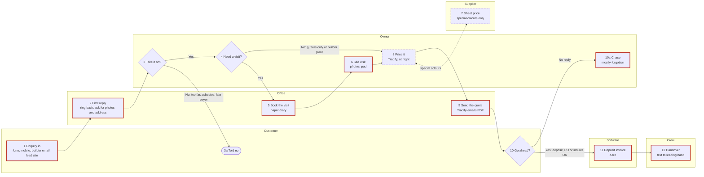

# See it and confirm it: drawing their process

Step 7 of the interview. The owner must **see** how they handle new work, drawn out, and confirm it
step by step before the summary and the file. People spot a missing step in a drawing that they'd
nod through in a list, and in sales the missing steps are usually the gaps: the reply nobody sent,
the visit nobody reminded, the quote nobody chased.

Build it from the running step list (Parts 1 to 5 and the two test enquiries), the exceptions (Q26
and the sweep) and the slow or broken steps they mentioned. Use their words on the boxes.

## 1. What to build

One **self-contained HTML page with an inline SVG drawing**, shown as an artifact. No external
scripts, libraries, fonts or images: everything inline, so it works offline and on any plan.

- **Title:** `How [Business] handles new work` (e.g. "How Banksia Roofing handles new work"), and
  one line under it: "Check each step. Tell me what's wrong or missing."
- **Swimlanes, one per who:** customer (homeowner, builder, assessor: whoever asks and decides),
  office (or partner), owner, supplier, software, crew (or leading hand). Only lanes that are used.
  Software is its own lane for steps the software does or where the job lands (Tradify, Xero).
- **Numbered steps** matching the step list and the file. Exceptions and side branches get a letter
  (3a, 10a). Keep the box text short: the step on line one, the how or where on line two.
- **Decisions as diamonds**, with **both branches labelled** ("Yes", "No: over an hour away").
  Sales always has at least three: take it on or not, visit or not, and go ahead or not.
- **Red markers** (a red circle with "!") on every step where it goes wrong or has an exception,
  each explained in a short "Where it goes wrong" list under the drawing, keyed by step number.
  Enquiries lost, replies missed, visits wasted, quotes not chased, wrong company invoiced and
  promises not passed on are the usual ones.
- **A clock note** under or over slow steps and long gaps ("up to a day", "2–4 days out", "waits on
  supplier"). In sales the gaps between steps matter as much as the steps.
- **A legend:** box = step, diamond = decision, red ! = where it goes wrong, clock = slow or waiting,
  dashed two-way line = a side check that comes back (a supplier price, a question to the builder).
- **Phone-friendly.** On a narrow screen, show the steps stacked top to bottom as cards (lane name,
  step, decision branches, red and clock notes), with the full drawing below in a box that scrolls
  sideways. No sideways scroll on the page itself.
- **Light and dark.** Colours as variables with a dark set; the page has its own background.
- **No customer, builder or supplier staff names, phones, emails or addresses** on the drawing.
  "Homeowner", "builder A", "supplier A". Business names only if they said that's OK.
- **About 12 steps at most.** More than that: group the small ones ("8 Price it" covers measuring
  up the notes and pricing) or split into two drawings ("Getting the enquiry to a quote" and
  "Chasing, winning and handing over").

## 2. How to show it and confirm it

1. Publish the page as an artifact, then say:
   "Here's your process drawn out. Have a look (on your phone it's in the Artifacts tab)."
2. Confirm **step by step**, two or three steps per message, never "looks good?":
   - "Steps 1 to 3: the enquiry comes in, the office rings back, then you decide if you'll take it
     on. Is that right?"
   - "Anything missing between 2 and 3? Does anyone write it down anywhere?"
   - At each diamond: "At step 4, is 'gutters only or builder plans' really what decides whether
     you visit?"
   - At each red marker: "Step 5, nobody home at the visit. Is that the main thing that goes wrong
     there?"
   - At each clock: "Step 5 says two to four days to get a visit. Sound right?"
   - Last: "Anyone or anything missing from the lanes? The crew, a supplier, the bookkeeper?"
3. **After every change, redraw** (update the same artifact, don't start a new one) and say what
   changed in one line: "Redrawn: step 2 now says the office texts first, then rings." Then carry
   on from where you were.
4. **Nothing is final until they say the drawing is right.** Ask plainly at the end: "Is this how
   [Business] handles new work?" (Yes, that's it · Something's still wrong).
5. These confirmations don't count toward the 35 questions.

## 3. If you can't make an artifact

Send the steps as plain text, **grouped by who does them**, every decision and exception spelled
out, then the Mermaid source in a block:

```text
How Banksia Roofing handles new work

CUSTOMER
1. Enquiry comes in: website form, mobile, builder email or lead site. (! five places; Google messages never checked)
3a. Told no.
10. Decides: go ahead or not.

OFFICE
2. First reply: rings back, asks for photos and the address. (clock: up to a day) (! missed when the owner's on a roof)
5. Books the site visit in the paper diary. (clock: 2 to 4 days out) (! no reminder; nobody home twice this month)
9. Sends the quote from Tradify. (! nobody checks it first)

OWNER
3. Takes it on? No if over an hour north (unless a re-roof), an asbestos roof, or a builder who paid late -> 3a. Yes -> 4.
4. Needs a visit? Yes -> 5. No (gutters only from photos, builder jobs from plans) -> 8.
6. Site visit: photos, measurements on a pad. (clock: 60 min with travel) (! photos not matched to the job)
8. Prices it in Tradify at night. (clock: 2 to 3 days after the visit)
10a. Chases if no reply. (! mostly forgotten; builders never chased)

SUPPLIER
7. Price for colour-matched sheets, special colours only; goes back to step 8. (clock: waits on supplier)

SOFTWARE
11. Xero: deposit invoice once they say yes. (! insurance job invoiced to the assessor once)

CREW
12. Leading hand gets the job by text. (! things promised on site get lost; customer keeps ringing the owner)
```

Then: "To see it drawn, copy this and paste it into mermaid.live." and the Mermaid block. Confirm
the same way, step by step.

## 4. Mermaid source rules

- `flowchart LR`, one `subgraph` per lane, steps `S1`, `S3a` and so on, labels in double quotes,
  `<br>` for a second line.
- Diamonds `{"..."}` for decisions; every branch labelled with `-->|"..."|`.
- A side check that comes back (a supplier price) is a dotted two-way link: `S8 <-.->|"..."| S7`.
- `classDef risk` with a red border for the red-marker steps; `classDef slow` with a dashed border
  for the clock steps.
- Keep it exactly in step with the drawing. The final version goes in the file's "Process map".

## 5. Worked example (Banksia Roofing, made up)

### Mermaid



(A step that is both slow and a red marker takes `risk`; its clock note is in the step list.)

### The HTML page

Copy this shape. Change the lanes, boxes, arrows and notes to fit their process; keep the CSS,
legend, phone layout and colour variables.

```html
<!doctype html>
<html lang="en-AU">
<head>
<meta charset="utf-8">
<meta name="viewport" content="width=device-width, initial-scale=1">
<title>Banksia new work map</title>
<style>
  :root { --bg:#fbfaf7; --ink:#1d1d1b; --muted:#5f5e58; --line:#4a4a45; --lane-a:#f1efe8;
          --lane-b:#e7e4da; --box:#ffffff; --box-line:#8a877c; --risk:#c0392b; --risk-ink:#fff; }
  @media (prefers-color-scheme: dark) {
    :root:not([data-theme="light"]) { --bg:#171716; --ink:#ecebe6; --muted:#a8a69e; --line:#c9c7bf;
          --lane-a:#22221f; --lane-b:#2b2b27; --box:#1d1d1b; --box-line:#77756c; --risk:#e5675a; --risk-ink:#171716; }
  }
  :root[data-theme="dark"] { --bg:#171716; --ink:#ecebe6; --muted:#a8a69e; --line:#c9c7bf;
          --lane-a:#22221f; --lane-b:#2b2b27; --box:#1d1d1b; --box-line:#77756c; --risk:#e5675a; --risk-ink:#171716; }
  body { margin:0; background:var(--bg); color:var(--ink); font:15px/1.45 system-ui, sans-serif; }
  main { max-width:1360px; margin:0 auto; padding:20px 16px 40px; }
  h1 { font-size:22px; margin:0 0 4px; } p.sub { margin:0 0 16px; color:var(--muted); }
  .drawing svg { width:100%; height:auto; display:block; }
  .lane-a { fill:var(--lane-a); } .lane-b { fill:var(--lane-b); }
  .lane-name { font:600 13px system-ui, sans-serif; fill:var(--ink); }
  .box { fill:var(--box); stroke:var(--box-line); stroke-width:1.5; }
  .t { font:600 12px system-ui, sans-serif; fill:var(--ink); }
  .s { font:11px system-ui, sans-serif; fill:var(--muted); }
  .arrow { fill:none; stroke:var(--line); stroke-width:1.5; }
  .side { fill:none; stroke:var(--line); stroke-width:1.5; stroke-dasharray:5 3; }
  .head { fill:var(--line); }
  .branch { font:italic 11px system-ui, sans-serif; fill:var(--ink); }
  .risk { fill:var(--risk); } .risk-t { font:700 12px system-ui, sans-serif; fill:var(--risk-ink); }
  .clock { fill:none; stroke:var(--muted); stroke-width:1.2; }
  .stack { display:none; padding:0; list-style:none; }
  .stack li { background:var(--box); border:1px solid var(--box-line); border-radius:8px;
              padding:10px 12px; margin:0 0 8px; }
  .stack .who { font-size:12px; color:var(--muted); text-transform:uppercase; letter-spacing:.04em; }
  .stack .bad { color:var(--risk); } .stack .slow { color:var(--muted); }
  .legend, .notes { margin-top:16px; } .legend span { margin-right:16px; white-space:nowrap; }
  .bang { color:var(--risk); font-weight:700; }
  .drawing-title { display:none; font-weight:600; margin:16px 0 6px; }
  @media (max-width:720px) {
    .stack { display:block; }
    .drawing { overflow-x:auto; border:1px solid var(--box-line); border-radius:8px; }
    .drawing svg { width:1000px; }
    .drawing-title { display:block; }
  }
</style>
</head>
<body>
<main>
  <h1>How Banksia Roofing handles new work</h1>
  <p class="sub">Check each step. Tell me what's wrong or missing.</p>

  <!-- Phone view: steps stacked top to bottom -->
  <ol class="stack">
    <li><div class="who">Customer</div><b>1 Enquiry in</b>: website form, mobile, builder email or lead site
      <div class="bad">! Five places; Google messages never checked; crew hand out the owner's number</div></li>
    <li><div class="who">Office</div><b>2 First reply</b>: ring back, ask for photos and the address
      <div class="slow">◷ Up to a day</div>
      <div class="bad">! Missed when the owner's on a roof all day</div></li>
    <li><div class="who">Owner · decision</div><b>3 Take it on?</b>
      <div>Yes → 4 · No (over an hour north unless a re-roof, asbestos roof, builder who paid late) → 3a, customer told no</div></li>
    <li><div class="who">Owner · decision</div><b>4 Need a visit?</b>
      <div>Yes → 5 · No (gutters only from photos, builder jobs from plans) → 8</div></li>
    <li><div class="who">Office</div><b>5 Book the visit</b>: paper diary
      <div class="slow">◷ 2 to 4 days out</div>
      <div class="bad">! No reminder; nobody home twice this month</div></li>
    <li><div class="who">Owner</div><b>6 Site visit</b>: photos, measurements on a pad
      <div class="slow">◷ 60 min with travel</div>
      <div class="bad">! Photos not matched to the job; downpipes missed once</div></li>
    <li><div class="who">Supplier · side check</div><b>7 Sheet price</b>: special colours only, back to 8
      <div class="slow">◷ Waits on the supplier</div></li>
    <li><div class="who">Owner</div><b>8 Price it</b>: Tradify, at night
      <div class="slow">◷ 2 to 3 days after the visit</div></li>
    <li><div class="who">Office</div><b>9 Send the quote</b>: Tradify emails the PDF
      <div class="bad">! Nobody checks it first</div></li>
    <li><div class="who">Customer · decision</div><b>10 Go ahead?</b>
      <div>Yes (deposit, PO or insurer OK) → 11 · No reply → 10a, owner chases <span class="bad">! mostly forgotten; builders never</span></div></li>
    <li><div class="who">Software</div><b>11 Deposit invoice</b>: Xero
      <div class="bad">! Insurance job invoiced to the assessor once</div></li>
    <li><div class="who">Crew</div><b>12 Handover</b>: text to the leading hand
      <div class="bad">! Things promised on site get lost; customer keeps ringing the owner</div></li>
  </ol>

  <div class="drawing-title">Full drawing (scroll sideways)</div>
  <div class="drawing">
  <svg viewBox="0 0 1340 600" role="img" aria-label="Swimlane drawing of how Banksia Roofing handles new work">
    <defs>
      <marker id="ah" viewBox="0 0 10 10" refX="9" refY="5" markerWidth="7" markerHeight="7" orient="auto-start-reverse">
        <path class="head" d="M0,0 L10,5 L0,10 z"/>
      </marker>
    </defs>
    <!-- lanes -->
    <rect class="lane-a" x="0" y="0"   width="1340" height="100"/>
    <rect class="lane-b" x="0" y="100" width="1340" height="100"/>
    <rect class="lane-a" x="0" y="200" width="1340" height="100"/>
    <rect class="lane-b" x="0" y="300" width="1340" height="100"/>
    <rect class="lane-a" x="0" y="400" width="1340" height="100"/>
    <rect class="lane-b" x="0" y="500" width="1340" height="100"/>
    <text class="lane-name" x="14" y="55">Customer</text>
    <text class="lane-name" x="14" y="155">Office</text>
    <text class="lane-name" x="14" y="255">Owner</text>
    <text class="lane-name" x="14" y="355">Supplier</text>
    <text class="lane-name" x="14" y="455">Software</text>
    <text class="lane-name" x="14" y="555">Crew</text>

    <!-- arrows (drawn first so boxes sit on top) -->
    <path class="arrow" marker-end="url(#ah)" d="M170,77 V150 H233"/>
    <path class="arrow" marker-end="url(#ah)" d="M290,177 V250 H360"/>
    <path class="arrow" marker-end="url(#ah)" d="M400,216 V75"/>
    <text class="branch" x="406" y="190">No</text>
    <path class="arrow" marker-end="url(#ah)" d="M438,250 H470"/>
    <text class="branch" x="441" y="242">Yes</text>
    <path class="arrow" marker-end="url(#ah)" d="M510,216 V150 H563"/>
    <text class="branch" x="516" y="195">Yes</text>
    <path class="arrow" marker-end="url(#ah)" d="M510,284 V310 H865 V279"/>
    <text class="branch" x="520" y="326">No: gutters only or builder plans</text>
    <path class="arrow" marker-end="url(#ah)" d="M620,177 V250 H673"/>
    <path class="arrow" marker-end="url(#ah)" d="M785,250 H833"/>
    <path class="side" marker-start="url(#ah)" marker-end="url(#ah)" d="M915,279 V321"/>
    <text class="branch" x="921" y="303">if special colour</text>
    <path class="arrow" marker-end="url(#ah)" d="M945,250 H1010 V179"/>
    <path class="arrow" marker-end="url(#ah)" d="M1010,123 V50 H1090"/>
    <path class="arrow" marker-end="url(#ah)" d="M1130,84 V221"/>
    <text class="branch" x="1136" y="110">No reply</text>
    <path class="arrow" marker-end="url(#ah)" d="M1168,50 H1250 V421"/>
    <text class="branch" x="1174" y="42">Yes: deposit or PO</text>
    <path class="arrow" marker-end="url(#ah)" d="M1250,477 V521"/>

    <!-- 1 -->
    <rect class="box" x="115" y="23" width="110" height="54" rx="6"/>
    <text class="t" x="170" y="46" text-anchor="middle">1 Enquiry in</text>
    <text class="s" x="170" y="62" text-anchor="middle">form, mobile, email</text>
    <circle class="risk" cx="221" cy="25" r="9"/><text class="risk-t" x="221" y="29" text-anchor="middle">!</text>
    <!-- 2 -->
    <rect class="box" x="235" y="123" width="110" height="54" rx="6"/>
    <text class="t" x="290" y="146" text-anchor="middle">2 First reply</text>
    <text class="s" x="290" y="162" text-anchor="middle">ring back, ask photos</text>
    <circle class="risk" cx="341" cy="125" r="9"/><text class="risk-t" x="341" y="129" text-anchor="middle">!</text>
    <circle class="clock" cx="244" cy="111" r="5"/><path class="clock" d="M244,108 V111 H247"/>
    <text class="s" x="253" y="115">up to a day</text>
    <!-- 3 decision -->
    <polygon class="box" points="400,216 438,250 400,284 362,250"/>
    <text class="t" x="400" y="248" text-anchor="middle">3 Take</text>
    <text class="t" x="400" y="262" text-anchor="middle">it on?</text>
    <!-- 3a -->
    <rect class="box" x="355" y="27" width="90" height="46" rx="23"/>
    <text class="t" x="400" y="55" text-anchor="middle">3a Told no</text>
    <!-- 4 decision -->
    <polygon class="box" points="510,216 548,250 510,284 472,250"/>
    <text class="t" x="510" y="248" text-anchor="middle">4 Need a</text>
    <text class="t" x="510" y="262" text-anchor="middle">visit?</text>
    <!-- 5 -->
    <rect class="box" x="565" y="123" width="110" height="54" rx="6"/>
    <text class="t" x="620" y="146" text-anchor="middle">5 Book the visit</text>
    <text class="s" x="620" y="162" text-anchor="middle">paper diary</text>
    <circle class="risk" cx="671" cy="125" r="9"/><text class="risk-t" x="671" y="129" text-anchor="middle">!</text>
    <circle class="clock" cx="574" cy="111" r="5"/><path class="clock" d="M574,108 V111 H577"/>
    <text class="s" x="583" y="115">2–4 days out</text>
    <!-- 6 -->
    <rect class="box" x="675" y="223" width="110" height="54" rx="6"/>
    <text class="t" x="730" y="246" text-anchor="middle">6 Site visit</text>
    <text class="s" x="730" y="262" text-anchor="middle">photos, pad</text>
    <circle class="risk" cx="781" cy="225" r="9"/><text class="risk-t" x="781" y="229" text-anchor="middle">!</text>
    <circle class="clock" cx="694" cy="290" r="5"/><path class="clock" d="M694,287 V290 H697"/>
    <text class="s" x="703" y="294">60 min with travel</text>
    <!-- 7 -->
    <rect class="box" x="835" y="323" width="110" height="54" rx="6"/>
    <text class="t" x="890" y="346" text-anchor="middle">7 Sheet price</text>
    <text class="s" x="890" y="362" text-anchor="middle">special colours</text>
    <circle class="clock" cx="854" cy="390" r="5"/><path class="clock" d="M854,387 V390 H857"/>
    <text class="s" x="863" y="394">waits on supplier</text>
    <!-- 8 -->
    <rect class="box" x="835" y="223" width="110" height="54" rx="6"/>
    <text class="t" x="890" y="246" text-anchor="middle">8 Price it</text>
    <text class="s" x="890" y="262" text-anchor="middle">Tradify, at night</text>
    <circle class="clock" cx="844" cy="211" r="5"/><path class="clock" d="M844,208 V211 H847"/>
    <text class="s" x="853" y="215">2–3 days</text>
    <!-- 9 -->
    <rect class="box" x="955" y="123" width="110" height="54" rx="6"/>
    <text class="t" x="1010" y="146" text-anchor="middle">9 Send the quote</text>
    <text class="s" x="1010" y="162" text-anchor="middle">Tradify emails PDF</text>
    <circle class="risk" cx="1061" cy="125" r="9"/><text class="risk-t" x="1061" y="129" text-anchor="middle">!</text>
    <!-- 10 decision -->
    <polygon class="box" points="1130,16 1168,50 1130,84 1092,50"/>
    <text class="t" x="1130" y="48" text-anchor="middle">10 Go</text>
    <text class="t" x="1130" y="62" text-anchor="middle">ahead?</text>
    <!-- 10a -->
    <rect class="box" x="1075" y="223" width="110" height="54" rx="6"/>
    <text class="t" x="1130" y="246" text-anchor="middle">10a Chase</text>
    <text class="s" x="1130" y="262" text-anchor="middle">mostly forgotten</text>
    <circle class="risk" cx="1181" cy="225" r="9"/><text class="risk-t" x="1181" y="229" text-anchor="middle">!</text>
    <!-- 11 -->
    <rect class="box" x="1190" y="423" width="120" height="54" rx="6"/>
    <text class="t" x="1250" y="446" text-anchor="middle">11 Deposit invoice</text>
    <text class="s" x="1250" y="462" text-anchor="middle">Xero</text>
    <circle class="risk" cx="1306" cy="425" r="9"/><text class="risk-t" x="1306" y="429" text-anchor="middle">!</text>
    <!-- 12 -->
    <rect class="box" x="1190" y="523" width="120" height="54" rx="6"/>
    <text class="t" x="1250" y="546" text-anchor="middle">12 Handover</text>
    <text class="s" x="1250" y="562" text-anchor="middle">text to leading hand</text>
    <circle class="risk" cx="1306" cy="525" r="9"/><text class="risk-t" x="1306" y="529" text-anchor="middle">!</text>
  </svg>
  </div>

  <div class="legend">
    <span>▭ step</span><span>◇ decision</span><span><span class="bang">!</span> where it goes wrong</span><span>◷ slow or waiting</span><span>⇣⇡ dashed: side check that comes back</span>
  </div>
  <div class="notes">
    <b>Where it goes wrong</b>
    <ul>
      <li><b>1</b> Enquiries land in five places; Google messages are never checked; the crew hand out the owner's number.</li>
      <li><b>2</b> The first reply is missed when the owner's on a roof all day.</li>
      <li><b>5</b> No reminder before visits; nobody home twice this month.</li>
      <li><b>6</b> Photos aren't matched to the job; the downpipe count was missed once.</li>
      <li><b>9</b> Nobody checks a quote before it goes.</li>
      <li><b>10a</b> Chasing mostly doesn't happen; builders are never chased.</li>
      <li><b>11</b> An insurance job was invoiced to the assessor instead of the insurer.</li>
      <li><b>12</b> Things promised on site don't reach the crew; customers keep ringing the owner.</li>
    </ul>
  </div>
</main>
</body>
</html>
```

The numbers on the drawing are the step numbers in the file. In a real interview, every red marker
and clock note comes from something the owner said; never add one they didn't.
