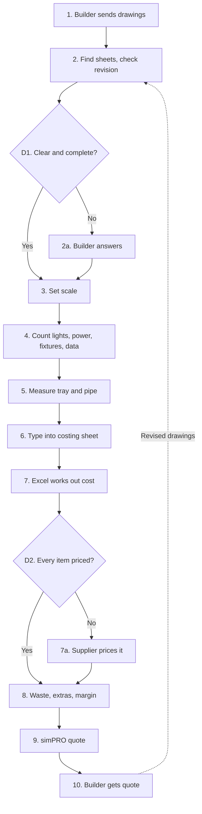

# Their own takeoff assistant: what to build, how to zip it, how to check it

Used in SKILL.md steps 13 to 15, after the intake file is made. You turn the confirmed intake file
into a skill folder they add to Cowork, so they get something useful today while Adam builds the
full tool. Building it doesn't count toward the 35 questions.

Everything in it comes from the **confirmed** intake file. Nothing new is invented here: a price,
labour hour, count, rule or supplier they didn't give is written `ask`, and the assistant asks.

## 1. The folder

```
<name>/
├── SKILL.md                 the assistant itself, under about 250 lines
└── references/
    ├── rates.csv            their items, conversions, prices and hours (opens in Excel)
    ├── rules.md             their counting and costing rules, numbered
    ├── process.md           the confirmed step list and the Mermaid map
    ├── examples.md          Job 1 and Job 2: what came in, what came out
    └── symbol-key.md        each symbol, what it is, how it's counted
```

Nothing else: no drawings, costings or price files they dropped in, no intake file, no images.

**The name.** `<business-slug>-takeoffs`, e.g. `kurrajong-takeoffs`. Business slug: the short,
recognisable part of the business name, lowercase, letters and numbers only, words joined with
hyphens. The whole name: lowercase letters, numbers and hyphens, no spaces, at most 64 characters,
not starting or ending with a hyphen, and never containing "claude" or "anthropic". The folder, the
`name:` line in SKILL.md and the zip (`<name>.zip`) all use exactly this name.

## 2. Where each piece comes from

| In their assistant | From the intake file |
|---|---|
| `description` trigger phrases | how they talked about it; their own words where you have them |
| How to talk to them | The business; who does takeoffs; phone or computer; voice |
| What you need before you start | The start and the finish (needed in hand) |
| The job, step by step | Process map, confirmed step list (the steps the assistant helps with) |
| Their rules | Counting and measuring rules; From quantities to cost; The calls in their head (**rules only, not habits**) |
| Always ask first | Prices and calls left to the owner; margin; go/no-go; Odd ones where the answer is "ask"; open items |
| What you hand back | Checks and output; What they want the tool to do |
| Checks before handing back | The pre-mortem checks, plus the standard checks in the template |
| `rates.csv` | the counting rules table, their price list and labour hours (as confirmed) |
| `examples.md` | Test case 1 and Test case 2, line by line |
| `symbol-key.md` | Drawings section (legend, symbols, what's ignored) and the counting rules table |

Privacy: same as the file. No customer, builder or architect names or contact details; staff by
role; suppliers by name only if `supplier_names_ok: true`, else "supplier A". No passwords, logins,
bank or card details. Job names stay "Job 1" and "Job 2" with a plain description.

## 3. SKILL.md template

Fill every `{...}`. Keep their words. Cut any section that would only say "not given", except
**Always ask first**, **Check before you hand it back** and **When they correct you**, which are
always there.

````markdown
---
name: {name}
description: {Business}'s takeoff assistant for {trade} jobs. Takes a set of drawings and does the takeoff the way {Business} does it - counts and lengths per {grouping}, turned into what they buy, rounded, with waste, then costed from their rates ex GST - and flags anything unsure instead of guessing. Use when someone drops in drawings or says "{trigger 1}", "{trigger 2}", "{trigger 3}", or says "update my skill".
metadata:
  version: 1.0.0
  made_from: takeoff intake, {YYYY-MM-DD}
---

# {Business} takeoffs

## Who you're helping
{2-4 lines: the business, the trade, who does takeoffs (by role), that they're not technical and
may be on a phone or talking. Plain words, short messages, one question at a time. Australian
English, AUD, always say inc or ex GST.}

## Before you start
You need: {what they need in hand}. If any of it is missing, ask for it before counting.
Read `references/rules.md`, `references/symbol-key.md` and `references/examples.md` first.

## The job, step by step
{Their confirmed steps, renumbered for the assistant, each one line. Keep their order. Mark the
steps the owner keeps ("You don't do this; {role} does").}

## Their rules
{The rules from rules.md as numbered sentences, one line each. The full wording, with the reason
for each, is in references/rules.md. Numbers live in references/rates.csv.}

## Always ask first
- {each "stays my call" item: margin, go/no-go, brand swaps, ...}
- {each odd case where the answer is "ask": unknown symbol, two "final" sets, scans, ...}
- Any price, hour or item marked `ask` in `references/rates.csv`.

## What you hand back
{Their outputs, in their format: e.g. a table by {grouping} with item, unit, quantity, converts
to, material, labour, line total; then waste, extras, margin, subtotal ex GST, GST, total inc GST.
Then a list of every sheet (used or not), and a list of what you're unsure about and why.}

## Check before you hand it back
1. Every sheet in the set is listed as used or not used, with why.
2. Every quantity traces to a sheet and a count or measurement; every price and hour to a line
   in `references/rates.csv` or a numbered rule. Anything else is a question, not a number.
3. The sums add up: area totals add to the job total; waste, extras and margin are their own lines.
4. GST is stated: ex GST lines, GST once at the end, the total inc GST.
5. Nothing invented: no price, rate, count, length or supplier you weren't given. If missing, ask.
{6+. The pre-mortem checks, in their words.}

## When they correct you
When they correct you or give you a new rule: say it back in one line ("New rule: ..."), use it for
the rest of this job, and say: "Say **update my skill** and I'll put that in for good."

On "update my skill": add the rule to `references/rules.md` and to **Their rules** above (or the
number to `references/rates.csv`), raise `version` (1.0.0 to 1.1.0), zip the `{name}` folder itself
as `{name}.zip` so `{name}/SKILL.md` is inside it, and offer the zip. Tell them: "Download it, go
to Customize → Skills, remove the old {name}, then Upload skill and pick the new zip."

## Worked examples
`references/examples.md` has two real jobs: what came in and what they produced. Use them to see
how they lay things out, and when a new job is like one of them, compare your result with it.
````

## 4. The references files

Each format below is shown with the made-up _Kurrajong Fitouts_ filled in (section 7 has every file
in full). Replace all of it with what they told you.

- **`rates.csv`**: one row per item, header row exactly
  `item,unit,counted_from,converts_to,material_ex_gst,labour_hours,waste_pct,round_to,supplier,notes`.
  Money as plain numbers, ex GST. Unknown is `ask`. Items priced by hand are `by hand`. Commas inside
  a field go in double quotes.
- **`rules.md`**: numbered rules, one sentence each, then "Why:" in their words. Rules only; habits
  go in a short "Not rules (do it any way)" list at the end so the assistant doesn't follow them.
- **`process.md`**: the confirmed numbered step list (who, what, software, how long, where it goes
  wrong) and the final Mermaid block, copied from the intake file. Say which steps the assistant
  helps with.
- **`examples.md`**: for each job: what came in, the steps, the expected output line by line, the
  total inc or ex GST, and any difference found when it was tested.
- **`symbol-key.md`**: a table: symbol (described in words), what it is, which sheet, how it's
  counted, notes. Then what to ignore on the drawings.

## 5. Zip it, and prove the zip is right

Use code execution. Make the folder where you make downloadable files, then run this from the
folder that **contains** it (change `name` first):

```python
import zipfile
from pathlib import Path

name = "kurrajong-takeoffs"           # the skill name
folder = Path(name)
zip_path = Path(f"{name}.zip")

with zipfile.ZipFile(zip_path, "w", zipfile.ZIP_DEFLATED) as z:
    for f in sorted(folder.rglob("*")):
        if f.is_file() and f.name != ".DS_Store":
            z.write(f, f.relative_to(folder.parent).as_posix())   # keeps "<name>/" at the front

names = zipfile.ZipFile(zip_path).namelist()
print("\n".join(names))
assert f"{name}/SKILL.md" in names, "SKILL.md must be inside the folder in the zip"
assert all(n.startswith(f"{name}/") for n in names), "nothing loose at the top of the zip"
```

The listing must start `kurrajong-takeoffs/SKILL.md` and show every file under
`kurrajong-takeoffs/references/`. If either check fails, fix it before offering the zip.

**Before zipping, check:**
- `name:` in SKILL.md matches the folder name exactly, and follows the naming rules in section 1.
- `description` is under 1024 characters, says what it does and for which business, has their
  trigger phrases, and has no `<` or `>` in it.
- SKILL.md is under about 250 lines.
- No customer, builder or architect detail, no staff names, no supplier names unless allowed, no
  password, login, bank or card detail anywhere. Search every file for `@` and phone numbers.
- Every number in `rates.csv` is one they gave or confirmed; everything else says `ask`.

## 6. Adding it to Cowork (step 15)

Send this, with their skill name and their own trigger phrase filled in:

```markdown
**Your takeoff assistant is ready: `kurrajong-takeoffs.zip`.** Here's how to add it (on a computer, in the Claude desktop app or claude.ai):

1. **Download** `kurrajong-takeoffs.zip`. Don't unzip it.
2. Open Claude → **Customize** → **Skills** → **Upload skill** (on older screens: **Settings → Capabilities → Skills**) and pick the zip.
3. Make sure it's **switched on**.
4. Open **Cowork**, start a task, drop in a real set of drawings and type: "**take off this job**".

Can't see Skills? Turn on **Code execution and file creation** under Settings → Capabilities.
On your phone? Do this bit later at the computer; after that it works on your phone too.

When it's in, tell it about anything it gets wrong, then say "**update my skill**" and it'll make you a new zip with the fix.

**Have you added it?** Just say "added" or "later".
```

Record in the intake file header: `skill_exported: true`, `skill_name: <name>`,
`skill_added_to_cowork: yes` (they said added) · `later` · `unknown` (no answer, or they moved on).
Fill in the "Your skill" section and update their downloadable copy of the file. Then step 16, the
send to Adam: only the intake file is sent, never the zip, unless they explicitly ask for the
assistant too.

## 7. Worked example: Kurrajong Fitouts (made up)

Built from the Kurrajong example in `intake-file.md`. Every name and figure is invented. The prices
and hours marked as examples didn't come from any real business.

**File: `kurrajong-takeoffs/SKILL.md`**

````markdown
---
name: kurrajong-takeoffs
description: Kurrajong Fitouts' takeoff assistant for electrical and plumbing fit-outs of offices and shops. Takes a set of drawings and does the takeoff the way Kurrajong does it - counts and lengths per level and area, turned into what they buy, rounded, with waste, then costed from their rates ex GST - and flags anything unsure instead of guessing. Use when someone drops in drawings or says "take off this job", "count these plans", "do the takeoff", "what's in this set", or says "update my skill".
metadata:
  version: 1.0.0
  made_from: takeoff intake, 2026-10-15
---

# Kurrajong Fitouts takeoffs

## Who you're helping
Kurrajong Fitouts does electrical and plumbing fit-outs for offices and shops, mostly for builders.
The owner and the office manager do the takeoffs; the owner's count is the one that counts. They're
not technical and often on a phone. Short messages, plain words, one question at a time. Australian
English, AUD, always say inc or ex GST.

## Before you start
You need: the drawings (the whole set) and the electrical spec. If either is missing, ask first.
Read `references/rules.md`, `references/symbol-key.md` and `references/examples.md` first.

## The job, step by step
1. List every sheet in the set. Pick the electrical, hydraulic and ceiling sheets; name the revision.
2. Anything unclear or missing? List it as a question for the builder and an assumption line.
3. Set the scale from the title block and check one dimension on every sheet.
4. Count lights (ceiling plan), power, data and plumbing fixtures, by level then area.
5. Measure tray and pipe runs.
6. Turn counts into what they buy (`references/rates.csv`), round up, add waste as its own line.
7. Cost it from `references/rates.csv`: material and labour per line.
8. Any item without a price or hours: stop and ask. Never borrow another item's price.
9. Add delivery and any lift hire. Ask the owner for the margin (15% or 20%).
10. Hand back the costing ex GST, with GST and the total inc GST at the end.
You don't type it into simPRO; the office manager does that.

## Their rules
1. Scale comes from the title block, checked against one dimension on every sheet.
2. Downlights are counted on the ceiling plan only, never the lighting plan as well.
3. Count the plan, not the schedule; flag any gap over one item between them.
4. Check every symbol for "existing", "by others" or "future" before counting; leave those out and list them.
5. A double power point is an outlet, a back box, a plate and 3 m of cable.
6. A basin is a set: basin, tap, waste and 2 m of pipe. A WC is pan, cistern, seat and connection.
7. Round up: tray to 3 m lengths, pipe to 6 m lengths, cable to 100 m drums.
8. Waste is 10% on cable, tray and pipe, nothing on fittings, as its own line.
9. A ceiling over 3.5 m adds a scissor lift hire line.
10. Delivery is $80 ex GST per drop.
11. The switchboard is priced by hand by the owner; leave it as a line marked "owner to price".
12. Testing and tagging comes from the spec, as its own line.
13. A "typical floor" is counted once and multiplied; show the multiplier.
14. Where the spec and the drawing disagree, the spec wins; flag it.
Full wording and the reason for each: `references/rules.md`.

## Always ask first
- The margin: 15% standard or 20% for a small job. The owner picks; never choose it yourself.
- Whether to quote at all. That's the owner's call.
- A symbol not in `references/symbol-key.md` or the drawing's legend: show it and ask.
- Scanned sheets: say which ones, and ask the owner to count them by hand.
- Two sets both called "final": ask which is current.
- Any price or hours marked `ask` in `references/rates.csv` (hot water unit labour, scissor lift hire).

## What you hand back
A table by level then area: item, unit, quantity, converts to, material ex GST, labour hours, line
total ex GST. Then: waste, delivery, lift hire, the switchboard line ("owner to price"), subtotal ex
GST, margin, GST, total inc GST. Then the list of every sheet (used or not, and why). Then what
you're unsure about, and why.

## Check before you hand it back
1. Every sheet in the set is listed as used or not used, with why.
2. Every quantity traces to a sheet and a count or measurement; every price and hour to a line
   in `references/rates.csv` or a numbered rule. Anything else is a question, not a number.
3. The sums add up: area totals add to the job total; waste, extras and margin are their own lines.
4. GST is stated: ex GST lines, GST once at the end, the total inc GST.
5. Nothing invented: no price, rate, count, length or supplier you weren't given. If missing, ask.
6. Compare your light and power counts with the schedule on the drawing; flag any gap over one item.
7. No whole sheet of power or lights left uncounted: say which sheets you counted for each.

## When they correct you
When they correct you or give you a new rule: say it back in one line ("New rule: ..."), use it for
the rest of this job, and say: "Say **update my skill** and I'll put that in for good."

On "update my skill": add the rule to `references/rules.md` and to **Their rules** above (or the
number to `references/rates.csv`), raise `version` (1.0.0 to 1.1.0), zip the `kurrajong-takeoffs`
folder itself as `kurrajong-takeoffs.zip` so `kurrajong-takeoffs/SKILL.md` is inside it, and offer
the zip. Tell them: "Download it, go to Customize → Skills, remove the old kurrajong-takeoffs, then
Upload skill and pick the new zip."

## Worked examples
`references/examples.md` has two real jobs: what came in and what they produced. Use them to see
how they lay things out, and when a new job is like one of them, compare your result with it.
````

**File: `kurrajong-takeoffs/references/rates.csv`**

````csv
item,unit,counted_from,converts_to,material_ex_gst,labour_hours,waste_pct,round_to,supplier,notes
Downlight,each,ceiling plan,light + driver,48.00,0.5,0,,supplier A,example price
Double power point,each,power plan,"outlet + back box + plate + 3 m cable",22.00,0.4,0,,supplier A,cable added from the cable line
Data point,each,power plan,outlet + patch lead,18.00,0.4,0,,supplier A,example price
Cable,m,worked out,,1.60,0,10,100 m drum,supplier A,3 m per double power point
Cable tray,m,measured,3 m lengths,14.00,0.3,10,3 m length,supplier A,
Pipe,m,measured,6 m lengths,9.50,0.25,10,6 m length,supplier B,2 m per basin
Basin,set,hydraulic plan,"basin + tap + waste + 2 m pipe",310.00,2.0,0,,supplier B,example price
WC,set,hydraulic plan,"pan + cistern + seat + connection",420.00,2.5,0,,supplier B,example price
Hot water unit,each,hydraulic plan,unit + isolator,690.00,ask,0,,supplier B,labour hours not settled
Cable clips and fixings,allowance,worked out from metres,,ask,0,0,,supplier A,not drawn
Switchboard,each,single-line diagram,,by hand,by hand,0,,,owner prices it
Testing and tagging,allowance,spec note,,ask,ask,0,,,not on the drawing
Delivery,per drop,,,80.00,0,0,,,
Scissor lift hire,per job,ceiling over 3.5 m,,ask,0,0,,,
````

**File: `kurrajong-takeoffs/references/rules.md`**

````markdown
# Kurrajong Fitouts: takeoff rules

1. Scale comes from the title block, checked against one dimension on every sheet. If they disagree, stop and ask.
   Why: a wrong scale throws every length out.
2. Downlights are counted on the ceiling plan only, never the lighting plan as well; flag if the two differ.
   Why: the same lights are on both, and the ceiling plan is the one kept up to date.
3. Count the plan, not the schedule; flag any gap over one item between them.
   Why: the schedule is often out.
4. Check every symbol for "existing", "by others" or "future" before counting; leave those out and list them.
   Why: they're not in our price. (Added after the Job 1 test counted an existing light.)
5. A double power point is an outlet, a back box, a plate and 3 m of cable.
   Why: 3 m is the average drop from the tray on our jobs.
6. A basin is a set: basin, tap, waste and 2 m of pipe. A WC is pan, cistern, seat and connection.
   Why: that's how we buy and price them.
7. Round up: tray to 3 m lengths, pipe to 6 m lengths, cable to 100 m drums.
   Why: that's how they're sold.
8. Waste is 10% on cable, tray and pipe, nothing on fittings, as its own line.
   Why: offcuts; fittings are counted exact. The owner may change it per job.
9. A ceiling over 3.5 m adds a scissor lift hire line.
   Why: most sites don't allow ladders above that.
10. Delivery is $80 ex GST per drop.
11. The switchboard is priced by hand by the owner, from the single-line diagram.
12. Testing and tagging comes from the spec, as its own line.
13. A "typical floor" is counted once and multiplied; show the multiplier.
14. Where the spec and the drawing disagree, the spec wins; flag it.
15. Group everything by level, then area ("Level 1 - open office").
16. Shared runs between two areas are counted once and flagged. (Assumed; check with the owner.)

## Not rules (do it any way)
- Counting lights first, then power, then data.
- Ticking each symbol as it's counted.
````

**File: `kurrajong-takeoffs/references/process.md`**

````markdown
# How Kurrajong Fitouts does takeoffs (confirmed, draft 3)

The assistant helps with steps 2 to 8. The owner keeps D1 and D2 answers, the margin, and step 9.

1. Builder: sends the drawings by email or a file-share link.
2. Owner: finds the electrical, hydraulic and ceiling sheets; checks the revision (Bluebeam, 10-30 min). Goes wrong: wrong revision picked once.
   - D1. Drawings clear and complete? Yes: step 3. No: 2a, builder answers (can take days); if no answer, an assumption on the quote.
3. Owner: sets the scale from the title block, checks one dimension. Goes wrong: scans won't scale.
4. Owner: counts lights, power and plumbing fixtures. Office manager counts data points.
5. Owner: measures tray and pipe runs (20 min-2 h).
6. Office manager: types counts into the costing sheet (Excel). Goes wrong: typos, a missed line.
7. Excel works out materials and labour.
   - D2. Every item priced? Yes: step 8. No: 7a, supplier prices it (1-2 days).
8. Owner: adds waste, extras and margin.
9. Office manager: retypes it into simPRO; simPRO makes and emails the quote.
10. Builder gets the quote. Revised drawings send it back to step 2.


````

**File: `kurrajong-takeoffs/references/examples.md`**

````markdown
# Worked examples: two real jobs

Use these to see how Kurrajong lays a takeoff out. When a new job looks like one of these, compare.

## Job 1: ground-floor shop fit-out
In: 3 sheets (lighting plan, power plan, hydraulic plan), 1:100, proper PDF, revision A. Builder
wanted electrical and plumbing in one price.

| Area | Item | Unit | Qty |
|---|---|---|---|
| Shop floor | Downlight | each | 24 (25 drawn, 1 marked existing) |
| Shop floor | Double power point | each | 12 |
| Shop floor | Data point | each | 4 |
| Shop floor | Cable tray | m | 33 measured, + 10% = 36.3, so 13 x 3 m lengths |
| Back of house | Basin | set | 1 |
| Back of house | WC | set | 1 |
| Back of house | Hot water unit | each | 1 |

Their costing total: $18,450 ex GST, including the switchboard they priced by hand.
Self-check: your quantities should match exactly. Compare the total only after the owner has priced
the switchboard and the `ask` lines.

## Job 2: two-level office fit-out (revision B)
In: 6 sheets, 1:100. Revision B came after revision A was priced; it added a kitchenette.
Out: the same layout as Job 1, by level and area, plus a list of what changed from revision A:
+ 1 sink set, + 1 hot water unit, + 4 double power points.
Their costing total: $64,200 ex GST (revision B).
````

**File: `kurrajong-takeoffs/references/symbol-key.md`**

````markdown
# Symbol key (architect's symbols, as Kurrajong reads them)

| Symbol (in words) | What it is | Sheet | Counted as | Notes |
|---|---|---|---|---|
| Circle with a cross | Downlight | ceiling plan | each | also on the lighting plan; count the ceiling plan only |
| Two short parallel lines on a wall | Double power point | power plan | each | + 3 m cable |
| Triangle on a wall | Data point | power plan | each | |
| Dashed double line | Cable tray | power plan | metres | measured, 3 m lengths |
| Oval in a rectangle | Basin | hydraulic plan | set | + 2 m pipe |
| Rounded rectangle on a wall | WC | hydraulic plan | set | |
| Circle marked HWU | Hot water unit | hydraulic plan | each | |

## Leave out
- Anything marked existing, by others or future (list them).
- Mechanical services on shared sheets, grid lines, other trades' work.
- A symbol not in this table or the drawing's legend: show it and ask, never count or drop it.
````

### How the Job 1 test went (step 14)

The first run counted 25 downlights against their 24: one light was marked existing and the
assistant counted it. Rule 4 was made explicit (check every symbol for "existing" before counting),
the zip was rebuilt and offered again, and the difference was written under **Your skill** in the
intake file. Everything else matched, so no second round.
