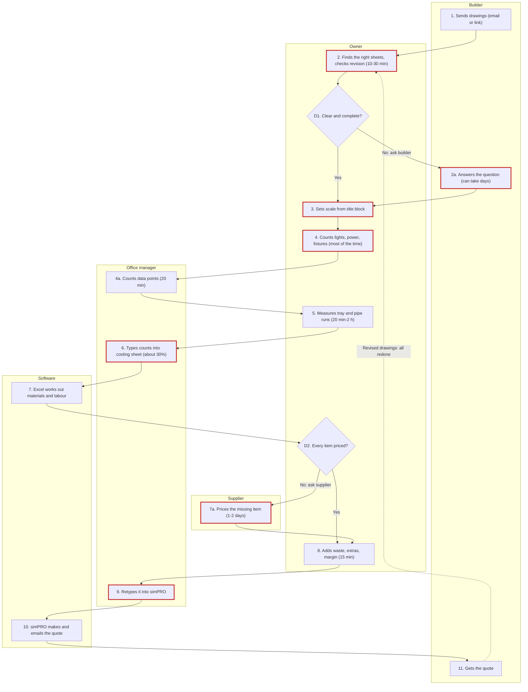

# The takeoff intake file

One Markdown file, named `map-takeoffs-<business-name>-<YYYY-MM-DD>.md`. The block at the top is
for Adam's build (and for whatever reads it later); the sections below it are for a person. Write
every section. Anything not given is written `not given`; anything defaulted is written with
`(assumed)` after it. No customer, builder or architect personal details anywhere, and staff by role,
never by name. Suppliers' business names only if the person said that's fine; otherwise
"supplier A", "supplier B". Never a password, login, bank detail or card number.

`consent_to_send` and `sent_via` are written as `not asked` and `not sent` when the file is made, then
changed (and nothing else) at the send step (SKILL.md step 16). The three `skill_` fields are written
as `false`, `not made` and `unknown` when the file is made, then set in SKILL.md steps 13 to 15, when
their takeoff assistant is built and they've been walked through adding it to Cowork:

| Field | Values |
|---|---|
| `consent_to_send` | `yes` (they said yes to "Send it to Adam now?") · `no` (they said no) · `not asked` (no send tool here, or they stopped before it) |
| `sent_via` | `submit_intake` (sent by the tool after a yes) · `owner (download and share)` (they send it themselves) · `not sent` |
| `skill_exported` | `true` (the zip was made and offered) · `false` (not made: files couldn't be made, or they stopped early) |
| `skill_name` | the folder and zip name, e.g. `kurrajong-takeoffs` · `not made` |
| `skill_added_to_cowork` | `yes` (they said "added") · `later` · `unknown` |

The worked example below is for the made-up business _Kurrajong Fitouts_. Every name and figure in
it is invented. Replace all of it with what the person told you.

````markdown
---
intake: takeoff
intake_version: 0.4.0
status: complete            # complete | incomplete
date: 2026-10-15
consent_to_send: yes        # yes | no | not asked
sent_via: submit_intake     # submit_intake | owner (download and share) | not sent
skill_exported: true        # true | false
skill_name: kurrajong-takeoffs
skill_added_to_cowork: yes  # yes | later | unknown
business: Kurrajong Fitouts
trade: Electrical and plumbing fit-outs (offices and shops)
area: Ballarat and the Goldfields
website: https://kurrajongfitouts.example
licence: not given
takeoffs_per_week: 5
people_doing_takeoffs: 2
ground_truth_person: "the owner"
minutes_per_takeoff: { small: 90, large: 960 }
share_counting_vs_typing: "70 / 30"
target_minutes_per_takeoff: { small: 30, large: 240 }
trigger: "builder emails drawings or a file-share link"
hands_over: "quote to the builder, from simPRO"
drawings_from: [emailed_pdf, builder_file_share]
drawing_types: { vector_pdf: "about 90%", scans: "about 10%", cad: "rare" }
no_drawings_route: "site measure on small jobs"
measure_types: [count, length]
scale_source: "title block, checked against one dimension"
schedule_rule: "count the plan; flag differences from the schedule"
unknown_symbol_rule: "show and ask; never count or drop"
grouping: [level, area]
waste: { cable: 10, pipe: 10, fittings: 0 }   # percent
rounding: "pipe to 6 m lengths, cable to 100 m drums, always up"
costing_sheet: "Excel, tab 'Takeoff', columns A-E; 'Summary' is formulas, never touch"
prices_from: "one price list (Excel), updated quarterly"
supplier_names_ok: false
labour_method: "hours per item or per metre, in the costing sheet"
missing_price_rule: "highlight and ask; never borrow"
margin: "15% standard, 20% under a small-job threshold, picked per job"
gst: ex                     # ex | inc
tolerance: { counts: exact, lengths: "within 2% (assumed)" }
outputs_wanted: [marked_up_pdf, costing_sheet_filled, supplier_material_list]
current_tools: [Bluebeam, Excel, simPRO]
process_map: "confirmed (draft 3)"   # confirmed (draft N) | not confirmed
test_cases: 2
sweep_groups_asked: 8       # of 11; the rest skipped as already covered or not asked
open_items: 2
questions_asked: 31         # numbered questions + sweep groups + follow-ups
assumed: [length_tolerance, shared_runs, money_and_gst_group]
---

# How Kurrajong Fitouts does takeoffs

## The business
Kurrajong Fitouts does electrical and plumbing fit-outs for office and retail tenancies around
Ballarat and the Goldfields, mostly for builders. The owner and the office manager both do takeoffs;
the owner's count is the one that counts when they disagree.

## The numbers now (the "before")
- About 5 takeoffs a week between two people.
- Small shop: about 1.5 hours from opening the drawings to a finished costing. Two-level office:
  about 2 days.
- Roughly 70% of the time is counting and measuring, 30% is typing numbers into the costing sheet.
- They turn down some builder jobs because they can't get the takeoffs done in time.

## The start and the finish
- **What starts it:** the builder emails the drawings or a file-share link.
- **Needed in hand before starting:** the drawings and the electrical spec; a site visit only on
  small jobs with no drawings.
- **What comes out:** a quote to the builder, made in simPRO, all ex GST with GST shown.
- **How they know it's right:** the owner checks his own takeoff against the drawing before the
  office manager types it up. Nobody else checks.
- **Who uses it after:** the leading hand, for ordering cable and fittings once the job's won.

## How they do it today, step by step
Step numbers match the Process map below.

| # | Step | Who | Software | How long | Where it goes wrong |
|---|---|---|---|---|---|
| 1 | Sends drawings or a file-share link | Builder | Email | — | Revisions sometimes come by a different route |
| 2 | Finds the electrical, hydraulic and ceiling sheets; checks the revision letter | Owner | Bluebeam | 10–30 min | Wrong revision picked once |
| D1 | Drawings clear and complete? Yes: 3. No: 2a | Owner | — | — | — |
| 2a | Answers the question; if no answer, owner lists it as an assumption | Builder | Email | can take days | Quote waits |
| 3 | Sets scale from the title block, checks one dimension | Owner | Bluebeam | 5 min a sheet | Scanned sheets won't scale |
| 4 | Counts lights, power and plumbing fixtures; ticks each symbol | Owner | Bluebeam count tool | most of the time | Interrupted mid-sheet, starts the sheet again |
| 4a | Counts data points | Office manager | Bluebeam | 20 min | — |
| 5 | Measures tray and pipe runs (prints the power plan for the leading hand) | Owner | Bluebeam length tool | 20 min–2 h | Runs drawn indicatively, not to scale |
| 6 | Types every count and length into the costing sheet | Office manager | Excel | about 30% of total | Typos; a line missed |
| 7 | Costing sheet works out materials and labour | Software | Excel | — | — |
| D2 | Every item priced? Yes: 8. No: 7a | Owner | — | — | — |
| 7a | Prices the missing item | Supplier | Email | 1–2 days | Quote waits on it |
| 8 | Adds waste, extras, margin | Owner | Excel | 15 min | — |
| 9 | Retypes it into simPRO | Office manager | simPRO | 10 min | Typed a second time |
| 10 | Makes the quote and emails it | Software | simPRO | — | — |
| 11 | Gets the quote | Builder | — | — | On revised drawings: back to step 2, all redone, when only the changes are wanted |

## Process map
Confirmed with the owner step by step, draft 3. (Draft 2 split data points out to the office
manager; draft 3 added the leading-hand printout as a note on step 5.)



1. **Builder:** sends the drawings by email or a file-share link.
2. **Owner:** finds the electrical, hydraulic and ceiling sheets and checks the revision letter
   (Bluebeam, 10–30 min). *Goes wrong:* picked the wrong revision once.
   - **D1. Drawings clear and complete?** Yes: step 3. No: step 2a.
   - **2a. Builder:** answers the question (email, can take days). If no answer, the owner lists it
     as an assumption on the quote.
3. **Owner:** sets the scale from the title block and checks one dimension (Bluebeam). *Goes wrong:*
   scanned sheets won't scale; then he prints and counts by hand.
4. **Owner:** counts lights, power and plumbing fixtures (Bluebeam, most of the time). *Goes wrong:*
   interrupted mid-sheet, starts the sheet again.
   - **4a. Office manager:** counts data points (Bluebeam, 20 min).
5. **Owner:** measures tray and pipe runs (Bluebeam, 20 min–2 h). Side note: prints the power plan
   for the leading hand; nothing waits on it.
6. **Office manager:** types every count and length into the costing sheet (Excel, about 30% of the
   time). *Goes wrong:* typos, a missed line.
7. **Software:** the costing sheet works out materials and labour (Excel).
   - **D2. Every item priced?** Yes: step 8. No: step 7a.
   - **7a. Supplier:** prices the missing item (email, 1–2 days). The quote waits on it.
8. **Owner:** adds waste, extras and margin (Excel, 15 min).
9. **Office manager:** retypes it into simPRO (10 min). *Goes wrong:* typed a second time.
10. **Software:** simPRO makes the quote and emails it.
11. **Builder:** gets the quote. *Loop:* revised drawings send it back to step 2 and the whole
    takeoff is redone.

## Drawings: how they arrive and how they're read
- Mostly emailed PDFs with selectable text; about 1 in 10 is a scan. CAD files rarely.
- Typical set 40–80 sheets; they use 3–8 of them.
- Latest revision: the revision letter in the title block.
- Scale from the title block, checked against one known dimension.
- There's usually a lighting schedule with totals; they always count the plan because the schedule
  is often out. Architect's symbols, not their own.
- Ignored: anything marked existing or by others, mechanical services on shared sheets, grid lines.
- Plans for counts; elevations for heights of outlets over benches; ceiling height from the section.
- Unknown symbol: ask the builder. The tool must show it and ask, never count or drop it.
- Grouped by level, then area ("Level 1 - open office").

## Counting and measuring rules
| Item | Unit | How it's counted | Converts to | Note |
|---|---|---|---|---|
| Downlight | each | symbol on ceiling plan only (not the lighting plan too) | light + driver | |
| Double power point | each | symbol on power plan | outlet + back box + plate + 3 m cable | |
| Data point | each | symbol | outlet + patch lead | |
| Cable tray | m | measured run | 3 m lengths, rounded up | + 10% waste |
| Basin | set | symbol on hydraulic plan | basin + tap + waste + 2 m pipe | |
| WC | set | symbol | pan + cistern + seat + connection | |
| Hot water unit | each | symbol | unit + isolator | |
| Cable clips and fixings | allowance | worked out from metres | — | not drawn |
| Switchboard | manual | from the single-line diagram | priced separately | always by hand |
| Testing and tagging | manual | from spec note | — | not on the drawing |

- Rounding: pipe in 6 m lengths, cable in 100 m drums, always up.
- Waste: 10% on cable and pipe, nothing on fittings, as its own line, changeable per job.
- Shared runs between areas: count once (assumed).

## From quantities to cost
- Costing sheet: Excel, fill in tab "Takeoff", columns A–E. The "Summary" tab is all formulas and
  must never be touched.
- Prices: one Excel price list, updated quarterly. Supplier names not to be kept (supplier A, B).
- Labour: hours per item or per metre, kept in the costing sheet (e.g. 0.5 h per downlight,
  0.3 h per metre of tray).
- Missing price: highlight and ask. Never use a similar item's price.
- On top: delivery $80 per drop (ex GST); scissor lift hire when ceilings are over 3.5 m; no
  contingency line.
- Margin: 15% standard, 20% on small jobs, picked per job. All prices ex GST.

## Odd ones and exceptions
From the exceptions pass (Q24) and the quick-fire sweep (`edge-cases.md`). Only what happens to them.

| Group | What happens | What they do now | What the tool should do |
|---|---|---|---|
| Missing info | A trade's sheet is missing from the set | Price what's there, list the gap | List it as a question for the builder and an assumption line |
| Missing info | Spec and drawing disagree | Spec wins | Spec wins; flag the difference |
| The drawings | About 1 in 10 is a scan | Print and count with a highlighter | Flag scanned sheets for a hand count; never guess |
| The drawings | Two sets both called "final" | Ring the builder | Ask which is current; name the revision on the takeoff |
| Counting traps | Downlights shown on both lighting and ceiling plans | Count the ceiling plan only | Count the ceiling plan only; flag if the two differ |
| Counting traps | Items marked existing | Leave out | Leave out and list them |
| Counting traps | "Typical floor" drawn once | Multiply by hand | Multiply, show the multiplier |
| Kinds of job | Small shops (under about 20 points) | Done off the plan in his head | Same tool; skip tray measure, use an allowance (assumed) |
| Kinds of job | One regular builder wants it split by stage | Splits by hand | Group output by stage when asked |
| Prices and calls | Missing or old prices | Ring the supplier | Highlight and ask; never borrow |
| Prices and calls | Go/no-go and margin | In his head | Leave to the owner |
| Changes | Rev B nearly always comes | Redoes the whole takeoff | Fresh takeoff plus a list of what changed |
| Changes | Leading hand redoes cable for ordering | Recounts by area | Output grouped by area with cable per area |
| Typing twice | "GPO", "DPP" and "double power point" are the same | Knows by eye | One name per item, with the other names it goes by |
| Typing twice | Counts typed into Excel, then into simPRO | Office manager types both | Fill the costing sheet; simPRO is out of scope for now |
| Goes wrong | Interrupted mid-sheet | Starts the sheet again | Save progress sheet by sheet |
| Money and GST | not asked (question limit) | — | Everything ex GST, GST added once at the end (assumed) |

## The calls in their head
| Call | Rule or habit | Why |
|---|---|---|
| Scissor lift when the ceiling is over 3.5 m | Rule | Most sites don't allow ladders above that |
| Count downlights on the ceiling plan, not the lighting plan | Rule | Same lights appear on both; ceiling plan is the one that's kept up to date |
| 3 m of cable per double power point | Rule | Average drop from the tray on their jobs |
| Lights first, then power, then data | Habit | The tool can count in any order |
| Tick each symbol in Bluebeam as he counts | Habit | His way of not losing his place |

## What would go wrong (the pre-mortem)
- If the tool got one badly wrong, the owner thinks it would **miss a whole sheet**. Check: list every
  sheet in the set and say which were used and which weren't.
- **The last one that went wrong:** a sheet of power missed on an office job; three lights and a
  switchboard section short. Found out on site. Cost the margin on that job.
- Check: compare the count against the drawing's schedule and flag any gap over one item.

## Checks and output
- The owner checks his own. Counts must be exact; lengths within 2% (assumed).
- Wanted back: a marked-up PDF showing every counted symbol, the costing sheet filled in, and a
  material list per supplier.
- Unsure items: highlighted, with a list at the end saying why.

## Test case 1: ground-floor shop fit-out
**Inputs:** 3 sheets (lighting plan, power plan, hydraulic plan), 1:100, vector PDF, revision A.
Builder asked for electrical and plumbing in one price.
**Steps:** set scale from title block; count lights on ceiling plan; count power and data; measure
tray run; count hydraulic fixtures; apply conversions and waste; type into "Takeoff" tab; add
labour, delivery, 15% margin.
**Output:**
| Area | Item | Unit | Qty |
|---|---|---|---|
| Shop floor | Downlight | each | 24 |
| Shop floor | Double power point | each | 12 |
| Shop floor | Data point | each | 4 |
| Shop floor | Cable tray | m | 33 measured, + 10% waste = 36.3, ordered as 13 × 3 m lengths |
| Back of house | Basin | set | 1 |
| Back of house | WC | set | 1 |
| Back of house | Hot water unit | each | 1 |
**Costing total:** $18,450 ex GST.
**Source:** from files they dropped in (job1-drawings.pdf, job1-costing.xlsx).
**Differences found:** my count of downlights was 25; they confirmed 24 (one was existing).

## Test case 2: two-level office fit-out (revision)
**Inputs:** 6 sheets, 1:100, revision B arrived after revision A was priced; added a kitchenette.
**Steps:** as Job 1, plus compare to revision A and price only the changes.
**Output:** each item, unit and quantity per level and area, as in Job 1; the change list
(kitchenette: + 1 sink set, + 1 hot water unit, + 4 double power points).
**Costing total:** $64,200 ex GST (revision B).
**Source:** from files they dropped in.

## What they want the tool to do
"Count the symbols on every sheet and fill my costing sheet. I'll check it and add margin." Also,
if it could: a list of what changed between revisions, and the supplier material list.

## Success measure
| | Now | Target |
|---|---|---|
| Small takeoff | 1.5 h | 30 min |
| Large takeoff | 2 days | half a day |
| Takeoffs per week | 5 | more of the builder jobs they now turn down |

## Systems they use
Bluebeam (takeoff), Excel (costing sheet, price list), simPRO (quotes and jobs). Names only; no logins.

## Files they showed
- job1-drawings.pdf: shop fit-out, 3 sheets, revision A
- job1-costing.xlsx: their finished costing for Job 1
- job2-drawings-revB.pdf, job2-costing.xlsx: office fit-out, revision B
- price-list.xlsx: their price list
These were not sent with this file. They said they'd email them to Adam.

## Your skill
Their own takeoff assistant, built from this file and given to them as `kurrajong-takeoffs.zip`.
It was not sent with this file.

- **Folder:** `kurrajong-takeoffs/`
- **Files:** `SKILL.md` · `references/rates.csv` · `references/rules.md` · `references/process.md` ·
  `references/examples.md` · `references/symbol-key.md`
- **Trigger phrases (their words):** "take off this job", "count these plans", "do the takeoff",
  "what's in this set", "update my skill"
- **Added to Cowork:** yes (said "added")
- **Test on Job 1:** first run counted 25 downlights against their 24: it missed the "existing" tag
  on one light. Rule 4 in its `rules.md` now says to check every symbol for an "existing" or "by
  others" tag before counting; re-zipped. Every other quantity matched. Not run a second time (one
  round only), so the fix is untested.
- **Left as "ask":** labour hours for hot water units (open item 1), so the assistant asks each time.

## Open items (the parking list)
| # | What's not known | Who can answer |
|---|---|---|
| 1 | Labour hours for hot water units: the sheet has two different figures | Owner, after checking with the leading hand |
| 2 | Whether the regular builder's stage split needs its own totals per stage | The builder (owner to ask) |

## Questions log
| # | Question | Answer | How |
|---|---|---|---|
| 1 | Business and website | Kurrajong Fitouts, kurrajongfitouts.example | answered |
| 2 | What do you take off | Lights, power, data, tray, plumbing fixtures | answered |
| 11 | Scale source | Title block, checked against one dimension | read from file |
| 24 | Exceptions pass | Scans, missing prices, rev B | answered |
| Sweep 3 | Counting traps | Double-shown downlights, existing items, typical floors | answered |
| Sweep 3 | Shared runs | Count once | assumed |
| Sweep 10 | Money and GST | Not asked | not asked (question limit), defaults assumed |
| 27 | Length tolerance | Within 2% | assumed |
| ... | every question and sweep group asked | ... | answered / read from file / assumed |

## Still to do (only if status is incomplete)
The parts not reached and the questions left, so the next session can pick up where this stopped.
If the process map wasn't checked, say so here.
````
