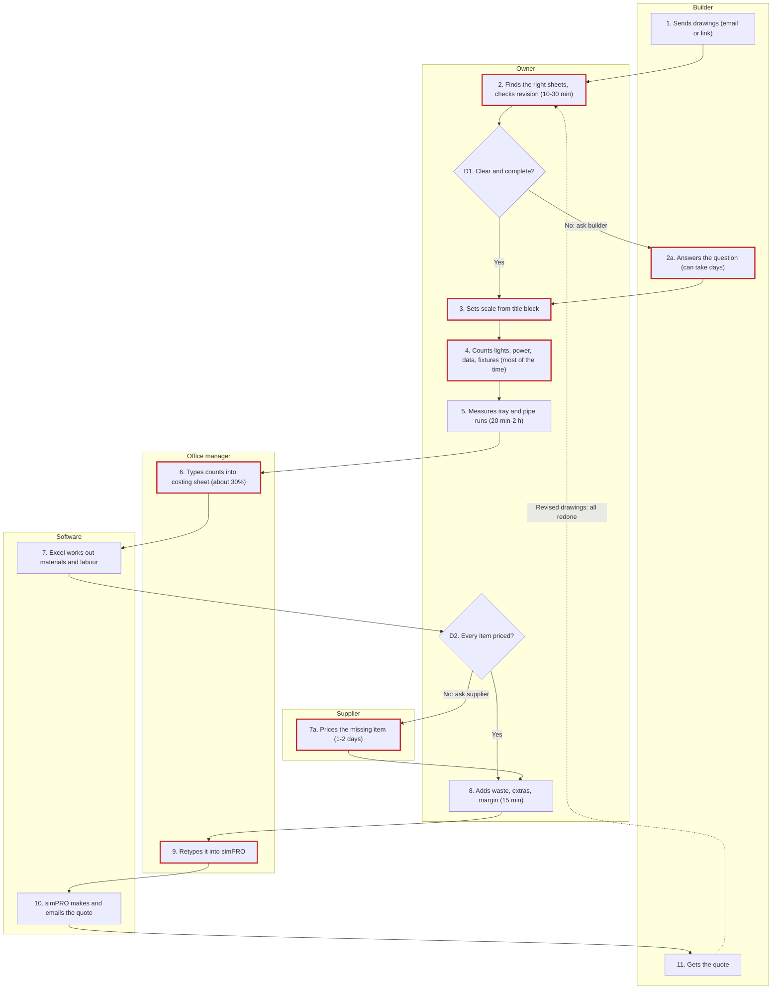

# Drawing their process, and checking it with them

Do this after Part 7 and before the summary. The person must **see** how they do a takeoff, drawn
out, and say it's right, step by step. Nothing is final until they say the drawing is right.

## 1. Get the steps straight first

You have been keeping a running list of steps since Part 1 (what starts it, what they hand over) and
Part 2 (the Job 1 walk-through). Tidy it into this shape before drawing anything:

| Field | What goes in it |
|---|---|
| Number | `1`, `2`, `3` in the order it happens. An exception off a step is `2a`, `7a`. Decisions are `D1`, `D2`. |
| Who | The lane. One lane per who: the owner, other staff **by role** ("office manager", "leading hand", never a name), the customer (usually "Builder"), "Supplier", and "Software" for anything a program does by itself (Excel formulas, simPRO emailing a quote). Only lanes that have a step. |
| What | Five or six words for the drawing ("Counts lights, power, data, fixtures"); a full sentence for the list. |
| Software | Bluebeam, Excel, simPRO, a printout and highlighter... |
| How long | Only where they told you, or a file shows it. Mark slow steps (anything they called slow, or over about 20 minutes, or a wait on someone else). |
| Waiting on | Who or what the step waits for, if anything. |
| Problem | Where it goes wrong, or the exception. These get the red marker. |

- Every decision has **both** ways labelled ("Yes" / "No: ask builder"), and every way goes somewhere.
- Loops (revised drawings, re-pricing) are a dashed line back to the step they restart.
- Keep it to about 15 boxes. If there are more, group the small ones ("Counts each trade, sheet by
  sheet") and keep the detail in the list.
- Use **their** words for steps where you can.

## 2. The drawing: what to make

Make **one self-contained HTML artifact**, titled **"How [Business] does takeoffs"**, with:

- **Inline SVG only.** No external scripts, libraries, fonts or images. Everything is in the one file.
- **A swimlane diagram.** Lanes run top to bottom as columns, one per who, the lane name at the top.
  Steps flow downwards in order, so it scrolls like a page. Each lane gets its own light tint and box
  colour.
- **Numbered steps.** A rounded box per step, its number in a coloured badge in the top-left corner.
- **Decisions as diamonds**, both branches labelled on the arrows.
- **A red marker** (a red dot with "!") on every step that goes wrong or has an exception, and a short
  "Where it goes wrong" list under the drawing, keyed by step number.
- **A clock note** on slow steps: a small clock and the time ("20 min-2 h", "can take days").
- **A legend**: step, decision, red marker, clock, dashed loop.
- **Readable on a phone.** Under about 640 px wide, hide the diagram and show the same steps as a
  single stacked list: one card per step, tagged with the lane name in that lane's colour, decisions
  and problems written out. On a wider screen the diagram sits in a box that can scroll sideways if it
  must; the page itself never scrolls sideways.
- **A white background with dark text**, set explicitly, so it looks the same in light and dark mode.
- Under the title, one line: "Draft 1: check each numbered step." Bump the draft number on every redraw.

Keep box text short (two lines of about 20 characters, plus the clock line). Use SVG `<text>` lines,
not `<foreignObject>`. Give the `<svg>` an `aria-label`.

## 3. Show it

Say:

> **Here's your process drawn out. Have a look** (on your phone it's in the Artifacts tab).
> I'll go through it with you one step at a time.

## 4. Check it step by step

Never ask "looks good?". Walk it in order, one or two steps per message:

- "**Is step 4 right?** _Counts lights, power, data and fixtures, in Bluebeam, most of the time._"
- "**Anything missing between 4 and 5?**"
- At each decision: "**At D1, is that the question you ask yourself? And if it's no, is that what happens?**"
- At each red marker: "**I've marked step 6 as where typos creep in. Fair?**"
- At each lane: "**Is it always the office manager who does 6 and 9, or sometimes you?**"
- At the end: "**Anything that happens on a takeoff that isn't on here?**"

When they change something: fix the step list, **redraw the whole artifact** (same title, next draft
number), and say "Redrawn. Step 4 now says ... Have a look." Then carry on from where you were. A
change to a step also changes the summary and the file.

The drawing is done only when they say it's right (or "yep, that's it"). These check questions do
**not** count toward the 35. If they want to stop here, the file is marked `status: incomplete` and the
process map is marked `not confirmed`.

## 5. If you can't make an artifact here

If artifacts aren't available (or it fails to show), don't stall. Send:

1. **The steps as a numbered list, grouped by who does them**, every decision and both of its ways
   spelled out, and every problem or exception written next to its step.
2. One line: "This next block is a drawing for Adam. You can ignore it, or paste it into mermaid.live
   to see it drawn." Then the Mermaid source in a code block.

Check it step by step exactly as in section 4.

Don't rely on a drawing that only shows inside the chat on a computer; the owner is probably on a
phone, and artifacts are what shows there.

## 6. Into the file

The confirmed version goes in the file's **Process map** section: the Mermaid source in a ```mermaid
block, then the numbered step list (number, who, what, software, how long, problem). The step numbers
must match the "How they do it today" table. Set `process_map: confirmed` (or `not confirmed`) in the
file's top block, and note how many drafts it took.

## 7. Worked example: Kurrajong Fitouts (made up)

Every name and figure here is invented.

### The tidied step list

| # | Who | What | Software | How long | Problem |
|---|---|---|---|---|---|
| 1 | Builder | Sends the drawings by email or file-share link | Email | — | — |
| 2 | Owner | Finds the electrical, hydraulic and ceiling sheets; checks revision letter | Bluebeam | 10-30 min | Wrong revision picked once |
| D1 | Owner | Drawings clear and complete? Yes: 3. No: 2a | — | — | — |
| 2a | Builder | Answers the question (or owner lists it as an assumption) | Email | can take days | Waits on the builder |
| 3 | Owner | Sets scale from the title block, checks one dimension | Bluebeam | 5 min a sheet | Scans won't scale |
| 4 | Owner | Counts lights, power, data, plumbing fixtures | Bluebeam | most of the time | Interrupted mid-sheet |
| 5 | Owner | Measures tray and pipe runs | Bluebeam | 20 min-2 h | — |
| 6 | Office manager | Types every count and length into the costing sheet | Excel | about 30% | Typos, missed line |
| 7 | Software | Costing sheet works out materials and labour | Excel | — | — |
| D2 | Owner | Every item priced? Yes: 8. No: 7a | — | — | — |
| 7a | Supplier | Prices the missing item | Email | 1-2 days | Quote waits on it |
| 8 | Owner | Adds waste, extras, margin | Excel | 15 min | — |
| 9 | Office manager | Retypes it into simPRO | simPRO | 10 min | Typed a second time |
| 10 | Software | simPRO makes the quote and emails it | simPRO | — | — |
| 11 | Builder | Gets the quote | — | — | Revised drawings: back to 2, all redone |

### The artifact

This is the whole file for draft 1. Copy the pattern: change the lanes, steps, coordinates and lists
to theirs. Lanes are 150 wide; rows are 92 apart; boxes are 132 by 62; diamonds are 132 by 76.

````html
<!doctype html>
<html lang="en-AU">
<head>
<meta charset="utf-8">
<meta name="viewport" content="width=device-width, initial-scale=1">
<title>How Kurrajong Fitouts does takeoffs</title>
<style>
  body { margin: 0; padding: 16px; background: #ffffff; color: #1a1a1a; font: 15px/1.45 system-ui, sans-serif; }
  h1 { font-size: 20px; margin: 0 0 4px; }
  .sub { color: #555; margin: 0 0 16px; }
  .wide { overflow-x: auto; }
  .wide svg { display: block; max-width: none; }
  .lane { font: 600 14px sans-serif; fill: #222; }
  .t { font: 12px sans-serif; fill: #1a1a1a; }
  .num { font: 700 11px sans-serif; fill: #fff; }
  .lbl { font: 11px sans-serif; fill: #333; }
  .red { fill: #c62828; }
  .slow { font: 10px sans-serif; fill: #555; }
  .bang { font: 700 12px sans-serif; fill: #fff; }
  .stack { display: none; list-style: none; padding: 0; margin: 0; }
  .stack li { border-left: 6px solid var(--c); background: #fafafa; border-radius: 6px; padding: 8px 10px; margin: 0 0 8px; }
  .stack .who { font-size: 12px; font-weight: 700; color: var(--c); text-transform: uppercase; letter-spacing: .03em; }
  .stack .dec { font-weight: 700; }
  .stack .prob { color: #c62828; }
  .stack .time { color: #555; font-size: 13px; }
  .legend, .problems { margin-top: 18px; font-size: 14px; }
  .legend span { display: inline-block; margin: 0 14px 6px 0; }
  .problems li { margin-bottom: 4px; }
  @media (max-width: 640px) { .wide { display: none; } .stack { display: block; } }
</style>
</head>
<body>
<h1>How Kurrajong Fitouts does takeoffs</h1>
<p class="sub">From the builder's drawings to the quote. Draft 1: check each numbered step.</p>

<div class="wide">
<svg viewBox="0 0 766 1250" width="766" height="1250" role="img" aria-label="Swimlane diagram of how Kurrajong Fitouts does takeoffs">
<defs><marker id="ah" viewBox="0 0 10 10" refX="9" refY="5" markerWidth="7" markerHeight="7" orient="auto-start-reverse"><path d="M0,0 L10,5 L0,10 z" fill="#444"/></marker><marker id="ahr" viewBox="0 0 10 10" refX="9" refY="5" markerWidth="7" markerHeight="7" orient="auto-start-reverse"><path d="M0,0 L10,5 L0,10 z" fill="#c62828"/></marker></defs>
<rect x="8" y="0" width="150" height="1250" fill="#eef4fb" stroke="#d0d0d0"/>
<text x="83" y="28" text-anchor="middle" class="lane">Builder</text>
<rect x="158" y="0" width="150" height="1250" fill="#f6f1e7" stroke="#d0d0d0"/>
<text x="233" y="28" text-anchor="middle" class="lane">Owner</text>
<rect x="308" y="0" width="150" height="1250" fill="#eef6ee" stroke="#d0d0d0"/>
<text x="383" y="28" text-anchor="middle" class="lane">Office manager</text>
<rect x="458" y="0" width="150" height="1250" fill="#f1eef8" stroke="#d0d0d0"/>
<text x="533" y="28" text-anchor="middle" class="lane">Software</text>
<rect x="608" y="0" width="150" height="1250" fill="#fbefef" stroke="#d0d0d0"/>
<text x="683" y="28" text-anchor="middle" class="lane">Supplier</text>
<path d="M83,121 L83,137 L233,137 L233,151" fill="none" stroke="#444" stroke-width="1.6" marker-end="url(#ah)"/>
<path d="M233,213 L233,236" fill="none" stroke="#444" stroke-width="1.6" marker-end="url(#ah)"/>
<path d="M233,312 L233,335" fill="none" stroke="#444" stroke-width="1.6" marker-end="url(#ah)"/>
<text x="239" y="328" class="lbl">Yes</text>
<path d="M167,274 L149,274" fill="none" stroke="#444" stroke-width="1.6" marker-end="url(#ah)"/>
<text x="150" y="268" class="lbl">No</text>
<path d="M83,305 L83,366 L167,366" fill="none" stroke="#444" stroke-width="1.6" marker-end="url(#ah)"/>
<path d="M233,397 L233,427" fill="none" stroke="#444" stroke-width="1.6" marker-end="url(#ah)"/>
<path d="M233,489 L233,519" fill="none" stroke="#444" stroke-width="1.6" marker-end="url(#ah)"/>
<path d="M233,581 L233,597 L383,597 L383,611" fill="none" stroke="#444" stroke-width="1.6" marker-end="url(#ah)"/>
<path d="M383,673 L383,689 L533,689 L533,703" fill="none" stroke="#444" stroke-width="1.6" marker-end="url(#ah)"/>
<path d="M533,765 L533,774 L233,774 L233,788" fill="none" stroke="#444" stroke-width="1.6" marker-end="url(#ah)"/>
<path d="M233,864 L233,887" fill="none" stroke="#444" stroke-width="1.6" marker-end="url(#ah)"/>
<text x="239" y="880" class="lbl">Yes</text>
<path d="M299,826 L617,826" fill="none" stroke="#444" stroke-width="1.6" marker-end="url(#ah)"/>
<text x="307" y="820" class="lbl">No</text>
<path d="M683,857 L683,918 L299,918" fill="none" stroke="#444" stroke-width="1.6" marker-end="url(#ah)"/>
<path d="M233,949 L233,965 L383,965 L383,979" fill="none" stroke="#444" stroke-width="1.6" marker-end="url(#ah)"/>
<path d="M383,1041 L383,1057 L533,1057 L533,1071" fill="none" stroke="#444" stroke-width="1.6" marker-end="url(#ah)"/>
<path d="M533,1133 L533,1149 L83,1149 L83,1163" fill="none" stroke="#444" stroke-width="1.6" marker-end="url(#ah)"/>
<path d="M17,1194 L18,1194 L18,182 L167,182" fill="none" stroke="#c62828" stroke-width="1.6" stroke-dasharray="6 4" marker-end="url(#ahr)"/>
<text x="24" y="726" class="lbl red">Revised</text><text x="24" y="742" class="lbl red">drawings:</text><text x="24" y="758" class="lbl red">all redone</text>
<rect x="17" y="59" width="132" height="62" rx="8" fill="#fff" stroke="#3b6ea8" stroke-width="1.6"/>
<text x="83" y="87" text-anchor="middle" class="t">Sends drawings</text>
<text x="83" y="102" text-anchor="middle" class="t">(email or link)</text>
<rect x="11" y="51" width="18" height="18" rx="9" fill="#3b6ea8"/><text x="20" y="64" text-anchor="middle" class="num">1</text>
<rect x="167" y="151" width="132" height="62" rx="8" fill="#fff" stroke="#9a6b1f" stroke-width="1.6"/>
<text x="233" y="175" text-anchor="middle" class="t">Finds the right</text>
<text x="233" y="190" text-anchor="middle" class="t">sheets, checks rev</text>
<rect x="161" y="143" width="18" height="18" rx="9" fill="#9a6b1f"/><text x="170" y="156" text-anchor="middle" class="num">2</text>
<g class="clock"><circle cx="179" cy="200" r="5" fill="none" stroke="#666"/><path d="M179,197 L179,200 L182,201" stroke="#666" fill="none"/></g><text x="188" y="204" class="slow">10-30 min</text>
<circle cx="295" cy="155" r="8" fill="#c62828"/><text x="295" y="159" text-anchor="middle" class="bang">!</text>
<polygon points="233,236 299,274 233,312 167,274" fill="#fff" stroke="#9a6b1f" stroke-width="1.6"/>
<text x="233" y="271" text-anchor="middle" class="t">Clear and</text>
<text x="233" y="286" text-anchor="middle" class="t">complete?</text>
<rect x="169" y="236" width="26" height="18" rx="9" fill="#9a6b1f"/><text x="182" y="249" text-anchor="middle" class="num">D1</text>
<rect x="17" y="243" width="132" height="62" rx="8" fill="#fff" stroke="#3b6ea8" stroke-width="1.6"/>
<text x="83" y="267" text-anchor="middle" class="t">Answers the</text>
<text x="83" y="282" text-anchor="middle" class="t">question</text>
<rect x="11" y="235" width="26" height="18" rx="9" fill="#3b6ea8"/><text x="24" y="248" text-anchor="middle" class="num">2a</text>
<g class="clock"><circle cx="29" cy="292" r="5" fill="none" stroke="#666"/><path d="M29,289 L29,292 L32,293" stroke="#666" fill="none"/></g><text x="38" y="296" class="slow">can take days</text>
<circle cx="145" cy="247" r="8" fill="#c62828"/><text x="145" y="251" text-anchor="middle" class="bang">!</text>
<rect x="167" y="335" width="132" height="62" rx="8" fill="#fff" stroke="#9a6b1f" stroke-width="1.6"/>
<text x="233" y="363" text-anchor="middle" class="t">Sets scale from</text>
<text x="233" y="378" text-anchor="middle" class="t">title block</text>
<rect x="161" y="327" width="18" height="18" rx="9" fill="#9a6b1f"/><text x="170" y="340" text-anchor="middle" class="num">3</text>
<circle cx="295" cy="339" r="8" fill="#c62828"/><text x="295" y="343" text-anchor="middle" class="bang">!</text>
<rect x="167" y="427" width="132" height="62" rx="8" fill="#fff" stroke="#9a6b1f" stroke-width="1.6"/>
<text x="233" y="451" text-anchor="middle" class="t">Counts lights,</text>
<text x="233" y="466" text-anchor="middle" class="t">power, data, fixtures</text>
<rect x="161" y="419" width="18" height="18" rx="9" fill="#9a6b1f"/><text x="170" y="432" text-anchor="middle" class="num">4</text>
<g class="clock"><circle cx="179" cy="476" r="5" fill="none" stroke="#666"/><path d="M179,473 L179,476 L182,477" stroke="#666" fill="none"/></g><text x="188" y="480" class="slow">most of the time</text>
<circle cx="295" cy="431" r="8" fill="#c62828"/><text x="295" y="435" text-anchor="middle" class="bang">!</text>
<rect x="167" y="519" width="132" height="62" rx="8" fill="#fff" stroke="#9a6b1f" stroke-width="1.6"/>
<text x="233" y="543" text-anchor="middle" class="t">Measures tray</text>
<text x="233" y="558" text-anchor="middle" class="t">and pipe runs</text>
<rect x="161" y="511" width="18" height="18" rx="9" fill="#9a6b1f"/><text x="170" y="524" text-anchor="middle" class="num">5</text>
<g class="clock"><circle cx="179" cy="568" r="5" fill="none" stroke="#666"/><path d="M179,565 L179,568 L182,569" stroke="#666" fill="none"/></g><text x="188" y="572" class="slow">20 min-2 h</text>
<rect x="317" y="611" width="132" height="62" rx="8" fill="#fff" stroke="#3d7a46" stroke-width="1.6"/>
<text x="383" y="635" text-anchor="middle" class="t">Types counts into</text>
<text x="383" y="650" text-anchor="middle" class="t">costing sheet</text>
<rect x="311" y="603" width="18" height="18" rx="9" fill="#3d7a46"/><text x="320" y="616" text-anchor="middle" class="num">6</text>
<g class="clock"><circle cx="329" cy="660" r="5" fill="none" stroke="#666"/><path d="M329,657 L329,660 L332,661" stroke="#666" fill="none"/></g><text x="338" y="664" class="slow">about 30%</text>
<circle cx="445" cy="615" r="8" fill="#c62828"/><text x="445" y="619" text-anchor="middle" class="bang">!</text>
<rect x="467" y="703" width="132" height="62" rx="8" fill="#fff" stroke="#6a4fa0" stroke-width="1.6"/>
<text x="533" y="731" text-anchor="middle" class="t">Excel works out</text>
<text x="533" y="746" text-anchor="middle" class="t">materials, labour</text>
<rect x="461" y="695" width="18" height="18" rx="9" fill="#6a4fa0"/><text x="470" y="708" text-anchor="middle" class="num">7</text>
<polygon points="233,788 299,826 233,864 167,826" fill="#fff" stroke="#9a6b1f" stroke-width="1.6"/>
<text x="233" y="823" text-anchor="middle" class="t">Every item</text>
<text x="233" y="838" text-anchor="middle" class="t">priced?</text>
<rect x="169" y="788" width="26" height="18" rx="9" fill="#9a6b1f"/><text x="182" y="801" text-anchor="middle" class="num">D2</text>
<rect x="617" y="795" width="132" height="62" rx="8" fill="#fff" stroke="#a8443b" stroke-width="1.6"/>
<text x="683" y="819" text-anchor="middle" class="t">Prices the</text>
<text x="683" y="834" text-anchor="middle" class="t">missing item</text>
<rect x="611" y="787" width="26" height="18" rx="9" fill="#a8443b"/><text x="624" y="800" text-anchor="middle" class="num">7a</text>
<g class="clock"><circle cx="629" cy="844" r="5" fill="none" stroke="#666"/><path d="M629,841 L629,844 L632,845" stroke="#666" fill="none"/></g><text x="638" y="848" class="slow">1-2 days</text>
<circle cx="745" cy="799" r="8" fill="#c62828"/><text x="745" y="803" text-anchor="middle" class="bang">!</text>
<rect x="167" y="887" width="132" height="62" rx="8" fill="#fff" stroke="#9a6b1f" stroke-width="1.6"/>
<text x="233" y="911" text-anchor="middle" class="t">Adds waste,</text>
<text x="233" y="926" text-anchor="middle" class="t">extras, margin</text>
<rect x="161" y="879" width="18" height="18" rx="9" fill="#9a6b1f"/><text x="170" y="892" text-anchor="middle" class="num">8</text>
<g class="clock"><circle cx="179" cy="936" r="5" fill="none" stroke="#666"/><path d="M179,933 L179,936 L182,937" stroke="#666" fill="none"/></g><text x="188" y="940" class="slow">15 min</text>
<rect x="317" y="979" width="132" height="62" rx="8" fill="#fff" stroke="#3d7a46" stroke-width="1.6"/>
<text x="383" y="1007" text-anchor="middle" class="t">Retypes it</text>
<text x="383" y="1022" text-anchor="middle" class="t">into simPRO</text>
<rect x="311" y="971" width="18" height="18" rx="9" fill="#3d7a46"/><text x="320" y="984" text-anchor="middle" class="num">9</text>
<circle cx="445" cy="983" r="8" fill="#c62828"/><text x="445" y="987" text-anchor="middle" class="bang">!</text>
<rect x="467" y="1071" width="132" height="62" rx="8" fill="#fff" stroke="#6a4fa0" stroke-width="1.6"/>
<text x="533" y="1099" text-anchor="middle" class="t">simPRO makes and</text>
<text x="533" y="1114" text-anchor="middle" class="t">emails the quote</text>
<rect x="461" y="1063" width="26" height="18" rx="9" fill="#6a4fa0"/><text x="474" y="1076" text-anchor="middle" class="num">10</text>
<rect x="17" y="1163" width="132" height="62" rx="8" fill="#fff" stroke="#3b6ea8" stroke-width="1.6"/>
<text x="83" y="1198" text-anchor="middle" class="t">Gets the quote</text>
<rect x="11" y="1155" width="26" height="18" rx="9" fill="#3b6ea8"/><text x="24" y="1168" text-anchor="middle" class="num">11</text>
</svg>

</div>

<!-- Phone view: the same steps, one column, tagged with who does each -->
<ol class="stack">
  <li style="--c:#3b6ea8"><div class="who">Builder</div>1. Sends the drawings by email or a file-share link.</li>
  <li style="--c:#9a6b1f"><div class="who">Owner</div>2. Finds the electrical, hydraulic and ceiling sheets and checks the revision letter. <span class="time">10-30 min.</span> <span class="prob">Problem: picked the wrong revision once.</span></li>
  <li style="--c:#9a6b1f"><div class="who">Owner</div><span class="dec">D1. Drawings clear and complete?</span> Yes: step 3. No: ask the builder (2a).</li>
  <li style="--c:#3b6ea8"><div class="who">Builder</div>2a. Answers the question. <span class="time">Can take days.</span> <span class="prob">Exception: if no answer, the owner lists it as an assumption on the quote.</span></li>
  <li style="--c:#9a6b1f"><div class="who">Owner</div>3. Sets the scale from the title block and checks one dimension. <span class="prob">Problem: scanned sheets won't scale.</span></li>
  <li style="--c:#9a6b1f"><div class="who">Owner</div>4. Counts lights, power, data and plumbing fixtures in Bluebeam. <span class="time">Most of the time.</span> <span class="prob">Problem: interrupted mid-sheet, starts the sheet again.</span></li>
  <li style="--c:#9a6b1f"><div class="who">Owner</div>5. Measures the tray and pipe runs. <span class="time">20 min-2 h.</span></li>
  <li style="--c:#3d7a46"><div class="who">Office manager</div>6. Types every count and length into the costing sheet. <span class="time">About 30% of the time.</span> <span class="prob">Problem: typos, a missed line.</span></li>
  <li style="--c:#6a4fa0"><div class="who">Software</div>7. Excel works out materials and labour.</li>
  <li style="--c:#9a6b1f"><div class="who">Owner</div><span class="dec">D2. Every item priced?</span> Yes: step 8. No: ask the supplier (7a).</li>
  <li style="--c:#a8443b"><div class="who">Supplier</div>7a. Prices the missing item. <span class="time">1-2 days.</span> <span class="prob">Exception: the quote waits on it.</span></li>
  <li style="--c:#9a6b1f"><div class="who">Owner</div>8. Adds waste, extras and margin. <span class="time">15 min.</span></li>
  <li style="--c:#3d7a46"><div class="who">Office manager</div>9. Retypes it all into simPRO. <span class="prob">Problem: typed a second time.</span></li>
  <li style="--c:#6a4fa0"><div class="who">Software</div>10. simPRO makes the quote and emails it.</li>
  <li style="--c:#3b6ea8"><div class="who">Builder</div>11. Gets the quote. <span class="prob">If revised drawings come in: back to step 2, the whole takeoff redone.</span></li>
</ol>

<div class="legend">
  <span>&#9645; a step (number in the corner)</span>
  <span>&#9671; a decision, both ways labelled</span>
  <span style="color:#c62828">&#9679; ! where it goes wrong, or an exception</span>
  <span>&#9719; a slow step, with how long</span>
  <span style="color:#c62828">- - - goes back round</span>
</div>

<ul class="problems">
  <li><b>2.</b> Wrong revision picked once.</li>
  <li><b>2a.</b> Builder can take days to answer.</li>
  <li><b>3.</b> Scanned sheets won't scale.</li>
  <li><b>4.</b> Interrupted mid-sheet, has to start the sheet again.</li>
  <li><b>6.</b> Typos and missed lines typing into Excel.</li>
  <li><b>7a.</b> Quote waits on a supplier price.</li>
  <li><b>9.</b> Everything typed a second time into simPRO.</li>
  <li><b>Revisions.</b> The whole takeoff is redone, when only the changes are wanted.</li>
</ul>
</body>
</html>
````

### The Mermaid version (for the fallback, and for the file)



### How the check went

> **Is step 4 right?** _Counts lights, power, data and fixtures, in Bluebeam, most of the time._
>
> _"Mostly. The office manager does the data points, not me."_
>
> Got it. **So step 4 is lights, power and fixtures by you, and a new step for data points by the
> office manager. Right?** _"Yep."_ Redrawn as draft 2: step 4 is yours, 4a "Counts data points" is in
> the office manager's lane. Have a look. **Anything missing between 5 and 6?**
>
> _"I print the power plan for the leading hand. Doesn't hold anything up."_
>
> Added as a side note on step 5, not a step, since nothing waits on it. **At D2, when an item's not
> priced, is it always the supplier you ask?** ...

Kurrajong's drawing took three drafts. The file says `process_map: confirmed (draft 3)`.
