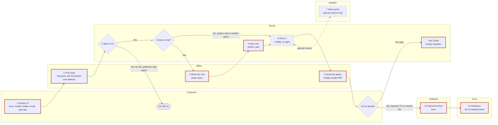

# The sales intake file

One Markdown file, named `sales-intake-<business-name>-<YYYY-MM-DD>.md`. The block at the top is
for Adam's build; the sections below it are for a person. Write every section, in this order.

- Anything not given: `not given`.
- A default you applied: the value followed by `(assumed)`, and listed in `assumed`.
- Something they weren't sure of: `UNCONFIRMED`, and listed in `unconfirmed`.
- Every rule is numbered (R1, R2…) and marked `confirmed`, `from file`, `assumed` or `UNCONFIRMED`.
- No customer, builder or supplier staff names, phones, emails or street addresses anywhere.
  Suburbs are fine. Builder and supplier business names only if `business_names_ok: true`;
  otherwise "builder A", "supplier A".
- No passwords, logins, keys, bank or card details, ever.
- Every price says inc or ex GST.
- Each test case records what the tool **should have done** at each step, not just what happened.
- Step numbers are the same everywhere: the drawing, the Process map, the step table and the
  exceptions table.
- `diagram_confirmed` is `true` only once they said the drawing is right; a drawing they didn't
  check goes in as `false` with the Process map marked `draft, not checked`.
- `consent_to_send` and `sent_via` are written as `not asked` and `not sent` when the file is made,
  then changed (and nothing else) after the send question in step 13 of the skill:
  - `consent_to_send`: `yes` (they said yes to sending it to Adam) · `no` · `not asked` (no send
    tool here, or they stopped before it)
  - `sent_via`: `submit_intake` (sent by the tool after a yes) · `owner (download and share)` ·
    `not sent`
- `skill_exported: false`, `skill_name: not made` and `skill_added_to_cowork: unknown` are written
  when the file is made, then changed after step 12 of the skill (adding it to Cowork), when the
  "Your skill" section is filled in and the file is made again:
  - `skill_exported`: `true` once the zip was made (or the copyable fallback shown) · `false`
  - `skill_name`: the folder name, e.g. `banksia-enquiries` · `not made`
  - `skill_added_to_cowork`: `yes` (they said added) · `later` · `unknown` (no answer)

Below is a complete worked example for the made-up business used in the questions. Banksia Roofing
is fictional; every figure is invented for illustration.

````markdown
---
intake: sales
intake_version: 0.4.0
status: complete            # complete | incomplete
date: 2026-10-15
consent_to_send: yes        # yes | no | not asked
sent_via: submit_intake      # submit_intake | owner (download and share) | not sent
diagram_confirmed: true      # true once they said the drawing is right; false if draft
skill_exported: true         # true | false
skill_name: banksia-enquiries  # folder and zip name | not made
skill_added_to_cowork: later # yes | later | unknown
business: Banksia Roofing
trade: Roofing and guttering (repairs, re-roofs, builder new work)
area: Brisbane northside and Moreton Bay
website: https://banksiaroofing.example
licence: not given
work_types:
  - { name: leak repairs and gutters, share: "about half", path: "site visit or photos" }
  - { name: re-roofs, share: "about a third", path: "site visit" }
  - { name: builder new work, share: "the rest", path: "plans by email" }
  - { name: insurance repairs, share: "a few a month", path: "assessor scope, site visit" }
customers: [homeowners, builders, property managers, insurance assessors]
payer_rules:
  - "insurance: assessor asks, insurer pays, homeowner is the site contact"
  - "rentals: property manager asks, owner pays"
business_names_ok: true
people:
  - { role: owner, does: "site visit, price, final call on every quote" }
  - { role: office (partner, part time), does: "answers phone, books visits, sends quotes" }
  - { role: leading hand, does: "receives won jobs" }
volume:
  enquiries_per_week: "15 to 20"
  quotes_per_week: 8
  wins_per_week: "3 to 4"
  first_reply: "same day, often next morning"
  enquiry_to_quote_days: "about 7"
channels:
  - { channel: owner mobile, lands_with: owner, busiest: true }
  - { channel: website form, lands_with: office email }
  - { channel: builder email with plans, lands_with: owner email }
  - { channel: lead site, lands_with: office email }
  - { channel: Google Business messages, lands_with: nobody checks }
referrals_recorded: false
first_reply:
  expected: same day for leaks
  sender: owner or office
  send_mode: draft only
minimum_charge: "$220 inc GST call-out"
emergencies: "storm or active leak: tarp first at the call-out rate, quote the repair later"
say_no: ["over an hour north unless a re-roof", "asbestos roofs", "builders who paid late before"]
chances_scale: [front-runner, in the pack, long shot]
site_visit:
  needed: "every homeowner job; gutters-only from photos; builders from plans"
  booking: "fitted around jobs, after 3pm, two or three a week"
  length_minutes_with_travel: 60
  reminder: "day before (assumed)"
  special_rules: ["tenanted: property manager books with tenant a week ahead", "pre-1990: check for asbestos first", "wet weather: rebook"]
  capture: [photos, paper pad]
pricing:
  by: owner
  visit_to_quote_days: "2 to 3"
  hold_ups: ["supplier price for colour-matched sheets"]
  note: "pricing detail is for /quote-intake"
quote_number: "next number in Tradify; tool never invents one"
versions: "copy and add rev A, rev B"
review_rule: "owner approves by name (assumed)"
sent_from: Tradify (emails a PDF)
same_quote_to_several_builders: true
quote_valid_days: 30
accepted_after_expiry: "re-check sheet prices before confirming"
deposit: "20% on re-roofs"
follow_up:
  now: "rarely; builders never"
  wanted: "day 2, day 7, day 14, then ask the owner (assumed)"
  stop_on_reply: true
  channel: text
won_when:
  homeowner: deposit received
  builder: "purchase order; regular builder A may text"
  insurance: insurer approval
entity_check_on_win: "confirm business name and ABN before invoicing"
lost_reasons: [price, timing, went with someone else, no reply, changed their mind]
dead_after: "about a month; tool asks first"
review_and_referral_ask: "on completion (assumed)"
handover_to: leading hand by text
record_of_truth:
  enquiries: owner's texts and office email (none in one place)
  quotes: Tradify
  accounts: Xero
stages: [New, Visit booked, Quoting, Quote sent, Won, Lost, On hold]
weekly_view: [enquiries in, quotes out, won, not yet chased]
test_cases: 2
process_steps: 12
exceptions: 16
parking_list: 3
success:
  first_reply: { now: "same day to next morning", target: "every enquiry same day" }
  visit_to_quote_days: { now: "2 to 3 (up to 7 from enquiry)", target: "within 3 of the visit" }
  quotes_chased: { now: "rarely", target: "every quote chased twice" }
  win_rate: { now: "about 1 in 2 of quotes (3-4 of 8)", target: "hold or improve; fewer go quiet" }
questions_asked: 32
assumed: [review_rule, follow_up.wanted, site_visit.reminder, review_and_referral_ask]
unconfirmed: [whether insurance jobs need their own quote numbering, retention on builder jobs]
---

# How Banksia Roofing wins work

## The business
Owner-run roofing business on Brisbane's northside and Moreton Bay: the owner, a part-time office
person (his partner), a leading hand and two roofers. About half the work is leak repairs and
gutters, a third full re-roofs, the rest new-build roofs for two or three builders, plus a few
insurance repairs a month through assessors. The owner visits and prices every job; the office
answers the phone, books visits and sends quotes.

## Who asks and who pays
- **Homeowners:** ask and pay.
- **Rentals:** the property manager asks and arranges access; the owner pays.
- **Insurance:** the assessor sends the scope, the insurer pays, the homeowner is on site. A job was
  once invoiced to the assessor instead of the insurer.
- **Builders:** builder A and builder B ask and pay; the same house is often quoted to two builders.

## Process map

Confirmed with the owner in the drawing, step by step, on 2026-10-15. Paste the block into
mermaid.live to see it drawn.



**The steps, in order** (! = where it goes wrong, ◷ = slow or waiting):

1. **Customer:** enquiry comes in by website form, the owner's mobile, builder email with plans, or
   the lead site. ! Five places; Google messages never checked; the crew hand out the owner's
   number.
2. **Office:** first reply: rings back, asks for photos and the address. ◷ Up to a day. ! Missed
   when the owner's on a roof all day. Storm nights: tarp first, quote later.
3. **Owner, decision:** take it on? No if over an hour north (unless a re-roof), an asbestos roof,
   or a builder who has paid late → **3a** customer told no. Yes → 4.
4. **Owner, decision:** need a visit? Gutters only (from photos) or builder jobs (from plans) → 8.
   Everything else → 5.
5. **Office:** books the site visit in the paper diary; tenanted homes through the property
   manager, a week ahead. ◷ 2 to 4 days out. ! No reminder; nobody home twice this month.
6. **Owner:** site visit: photos of every elevation, measurements on a pad, roof age and storeys.
   ◷ 60 min with travel. ! Photos not matched to the job; downpipes missed once.
7. **Supplier (side check):** price for colour-matched sheets, special colours only; back to 8.
   ◷ Waits on the supplier.
8. **Owner:** prices it in Tradify at night; the next quote number comes from Tradify. ◷ 2 to 3
   days after the visit.
9. **Office:** sends the quote from Tradify (emailed PDF). Same house to two builders: two quotes.
   ! Nobody checks it first.
10. **Customer, decision:** go ahead? Yes (homeowner deposit, builder PO, insurer approval) → 11.
    No reply → **10a** owner chases. ! Mostly forgotten; builders never chased.
11. **Software:** deposit invoice in Xero. ! An insurance job was invoiced to the assessor once.
12. **Crew:** the leading hand gets the job by text: address, colour, scope. ! Things promised on
    site get lost; the customer keeps ringing the owner.

## Each step in detail

| # | Step | Who | Software or paper | Time or gap | Where it goes wrong |
|---|---|---|---|---|---|
| 1 | Enquiry arrives (form, mobile, builder email, lead site, Google messages) | Customer → owner / office | Phone, office email | — | Five places; Google messages never checked; crew hand out his number |
| 2 | First reply: ring back, ask for photos and address | Office or owner | Phone, text | Up to a day | Missed when the owner is on a roof all day |
| 3 / 3a | Take it on? (area, asbestos, past late payers); say no if not | Owner | In head | 1 min | Rules not written down |
| 4 | Visit needed? (gutters only from photos; builders from plans) | Owner | In head | — | — |
| 5 | Book the site visit | Office | Paper diary | 2 to 4 days out | No reminder; nobody home twice this month |
| 6 | Site visit: photos, measurements, what's really wrong | Owner | Phone camera, paper pad | 60 min with travel | Photos not matched to the job; downpipes missed once |
| 7 | Price for special-colour sheets | Supplier | Phone, email | Days | Holds up the quote |
| 8 | Price the job | Owner | Tradify, at night | 2 to 3 days after visit | — |
| 9 | Send the quote | Office | Tradify emails PDF | Same day as priced | Nobody checks it first |
| 10 / 10a | Customer decides; owner chases if no reply | Customer, owner | Text | Rarely chased | Mostly forgotten; builders never chased |
| 11 | Yes arrives (deposit, PO, text, insurer approval); deposit invoice | Owner / office | Xero | — | Wrong company invoiced once |
| 12 | Hand over to the leading hand | Owner | Text | Same day as yes | Things promised on site get lost; customers keep ringing the owner |

Enquiry to quote: about a week, mostly waiting for a visit slot and the owner's evening.

## Rules
- R1. First reply the same business day, by the office or owner; the tool drafts, a person sends. `confirmed`
- R2. Before a visit, must have: suburb and street, what's wrong, roof type, one or two storeys, photos. `confirmed`
- R3. Always ask the roof's age on a "small leak"; old roofs are usually re-roofs. `confirmed`
- R4. No jobs over an hour north unless it's a re-roof. `confirmed`
- R5. No asbestos roofs; any house before 1990 is checked before going up. `confirmed`
- R6. Don't quote builders who have paid late before (owner keeps the list). `confirmed`
- R7. Minimum call-out $220 inc GST. `confirmed`
- R8. Gutters-only jobs can be priced from photos; every other homeowner job needs a visit. `confirmed`
- R9. Tenanted homes: the property manager books the visit with the tenant, a week ahead. `confirmed`
- R10. The tool reads the next quote number from Tradify and never invents one. `confirmed`
- R11. Every change is a new version (rev A, rev B) with the date and reason. `from file`
- R12. Owner approves every quote by name before it goes. `assumed`
- R13. Quotes valid 30 days; 20% deposit on re-roofs. `from file`
- R14. Follow-up at day 2, day 7 and day 14 by text, then ask the owner; stop on any reply. `assumed`
- R15. Builder jobs where Banksia is a long shot: quote, don't chase. `confirmed`
- R16. Won when: homeowner deposit received; builder purchase order (builder A's text accepted); insurer approval for insurance work. `confirmed`
- R17. Before invoicing a win, confirm the business name and ABN of who pays. `confirmed`
- R18. A quiet quote is never marked dead without asking the owner; around a month is normal. `confirmed`
- R19. Every active job has a next step and a date, or it shows on the daily list. `assumed`
- R20. Storm night or active leak: tarp first at the call-out rate, quote the repair later. `confirmed`
- R21. A quote accepted after 30 days: re-check sheet prices before confirming. `confirmed`
- R22. Insurance jobs: nothing starts until the insurer's approval; the homeowner pays the excess to Banksia. `confirmed`
- R23. Ask for details twice (text, then call); after that, ask the owner whether to drop it. `assumed`

## First reply (their words)
"Thanks for getting in touch. Can you send a couple of photos and the address? I'll ring to book a
time to look, usually within the week." Signed with the owner's first name. Sent by text where the
enquiry came by phone; by email otherwise.

## Site visits
Fitted around jobs, two or three a week, usually after 3pm, about an hour with travel. Customer
should be home for anything inside the roof space. Wet weather means rebooking. Captured: photos of
every elevation and problem, measurements on a pad, downpipe and valley counts.

## Getting the quote out
Owner prices at night in Tradify, two to three days after the visit. Office sends from Tradify. Same
house to two builders gets two quotes, each in that builder's name. Options sometimes offered (patch
now or re-roof). Pricing detail is outside this file.

## Follow-up, won, lost
- **Follow-up now:** "mean to ring after a week". A text that got a reply: "Hi, just checking you got
  the quote for the roof. Happy to answer any questions."
- **Notes:** in the owner's texts. A builder rang about three houses in one call; notes went on one
  scrap of paper.
- **On hold:** forgotten today. Wanted: a come-back date on each.
- **Lost:** mostly no reply, so the reason is unknown. Reasons list in the header.
- **After the job:** reviews asked only sometimes; wanted on every finished job (assumed).

## Handover to the job
Today: a text to the leading hand with address, colour and scope. Wanted on every won job: address
and access, site contact, scope in and out, colour and materials, start date, deposit paid, anything
promised on site, any crew already pencilled in. The leading hand is introduced to the customer in
writing so they stop ringing the owner.

## Records and stages
Enquiries live in texts and the office email; quotes in Tradify; accounts in Xero. No single list.
Stages wanted: New → Visit booked → Quoting → Quote sent → Won / Lost / On hold. Weekly view to the
owner: enquiries in, quotes out, won, not yet chased.

## Test case 1: leak that became a half re-roof (won)
**Inputs:** website form, Monday 8pm: "roof leaking in back bedroom, gutters rusted, need quote."
Homeowner, Strathpine. Two photos.
**Steps, as they happened:**
1. Tue 10am: office rang back, booked visit for Thursday 3:30pm. (First reply 14 hours.)
2. Thu: visit. Back section rusted through; became a half re-roof plus new gutters.
3. Following Wed: quote sent from Tradify ($14,850 inc GST), valid 30 days, 20% deposit.
4. Wed + 8 days: owner texted once.
5. Two days later: customer rang, paid the deposit. Job booked three weeks out.
6. Handover to the leading hand by text: address, colour, "back section re-roof, new gutters".
**Outcome:** won. Enquiry to quote 9 days.
**What the tool should have done:** drafted the first reply Monday night for the office to send
Tuesday morning; asked roof age and storeys in that reply (R3); booked with a reminder the day
before; flagged the quote as due by the Monday after the visit; drafted the day 2 and day 7 texts;
built the handover from the quote and visit notes, including what was promised on site.

## Test case 2: builder new-build (lost)
**Inputs:** email from builder A with plans for a single-storey new home in Narangba; quote wanted in
a week. Owner knew two other roofers were pricing it.
**Steps, as they happened:**
1. Same day: no reply sent; owner read the plans on Sunday.
2. Sunday: priced from plans in Tradify ($21,780 inc GST).
3. Monday: quote sent from Tradify. Owner marked it in his head as "in the pack".
4. No follow-up.
5. Five weeks later: heard from builder A it went to another roofer on price.
**Outcome:** lost, reason price (found out by chance).
**What the tool should have done:** sent the owner a draft acknowledgement to builder A the same day;
recorded the chance as "in the pack"; chased once at day 7 (not a long shot, so R15 doesn't apply);
asked the owner at day 14 whether to keep it open; recorded the lost reason when it came in.

## Exceptions and edge cases

From Q26 and the quick-fire sweep (Q27 to Q30). Step = the step number on the drawing.

| Case | Step | What happens now | Rule | Source |
|---|---|---|---|---|
| Storm nights: everyone rings at once | 2 | Tarp first at the call-out rate, quote later | R20 | Q26 |
| "Gutter clean" that was a whole strata block | 3 | Found out on site | R3 | Q26 |
| Insurance work: assessor's scope, insurer's approval | 10, 11 | Nothing starts before approval; excess paid by the homeowner | R22 | sweep 1 |
| Same house to two builders | 9 | Two quotes, same price, each builder's name | — | sweep 1 |
| Tenanted homes | 5 | Property manager books with the tenant, a week ahead | R9 | sweep 1 |
| Pre-1990 houses | 3, 6 | Asbestos check before going up | R5 | sweep 1 |
| Lead site enquiries | 2 | Office rings straight away; first to ring usually wins | — | sweep 1 |
| Flat out in storm season | 2, 10a | Small repairs not quoted; nobody chases | — | sweep 1 |
| Same enquiry by form and phone | 1, 5 | Two visits booked for one house once | — | sweep 2 |
| Nobody home, wet weather | 5, 6 | Partner rebooks by text; wet days push everything a day | — | sweep 2 |
| Customer changes the scope | 8, 9 | Same number, rev A, back in a couple of days | R11 | sweep 2 |
| Accepted after 30 days | 10 | Sheet prices re-checked first | R21 | sweep 2 |
| "Not now" jobs | 10a | Forgotten | R19 | sweep 2 |
| Owner away | all | Partner books visits; nobody prices; enquiries wait | — | sweep 3 |
| Typed twice | 1 → 8 → 11 → 12 | Enquiry from texts into Tradify; total into Xero; handover retyped from the quote | — | sweep 4 |
| Promised on site, crew not told | 12 | Colour match on the ridge capping promised; crew didn't know | — | sweep 4 |

Didn't apply: price matching, discounts to win, supplier price holds shorter than 30 days, form
emails going to spam.

## Judgement calls (rules of thumb)

- **A "small leak" on a roof over about 25 years old is usually a re-roof.** Why: rust under the
  laps you can't see from the ground. **Rule** (R3): always ask the roof's age.
- **Someone who wants a price over the phone and won't send photos is price shopping.** Why: "they
  never book the visit". **Check** for the tool to flag: offer a range first, not a visit.
- **A builder who has sent the plans to ten roofers is a long shot: price quick, don't chase.**
  Why: "they go cheapest every time". **Rule** (R15).
- **Ringing back at night after the last job.** Why: "that's when I get time". **Habit**, not a
  rule.

## What's gone wrong (and what the tool must check)

- **Last one that went wrong:** an insurance job invoiced to the assessor instead of the insurer;
  paid six weeks late; found out when the owner chased it. → The tool asks who pays (business name
  and ABN) at every win, and for insurance work it is always the insurer (R17).
- **Wasted visits:** nobody home twice this month. → A reminder the day before every visit.
- **If the tool got one wrong (owner's guess):** sending a chase text to someone who already said
  yes or no on the phone. → Before every chase the tool asks "any reply since?" and stops on any
  reply (R14).

## What they want the tool to do
- **Must:** put every enquiry from every channel in one list, and draft the first reply the same day
  for the owner or office to send.
- **Checks it runs** (from what's gone wrong and the odd ones): who pays and their ABN at every
  win; a reminder before every visit; "any reply since?" before every chase; one job, not two, when
  the same person enquires twice; insurer approval before an insurance job is marked won.
- **Should:** chase sent quotes by draft text at day 2, 7 and 14; give a daily "chase today" list;
  build the handover text to the leading hand from the quote and visit notes, including anything
  promised on site.
- **Stays the owner's call:** saying no to a job, the final price, marking a job dead.
- **Drafts land in:** texts on the owner's phone and the office email; quotes stay in Tradify.

## Success measures
| Measure | Now | Target |
|---|---|---|
| First reply | same day to next morning | every enquiry same day |
| Visit to quote | 2 to 3 days | within 3 days, every time |
| Quotes chased | rarely | every quote at least twice |
| Enquiries lost track of | not given | none |
| Win rate (of quotes) | about 1 in 2 | hold or improve |

## Your skill

Their own enquiries assistant, built from this file after it was approved, tried on test case 1,
and given to them as `banksia-enquiries.zip` to add to Claude (Customize → Skills → Upload skill).
Not sent to Adam (only this file was).

- **Folder:** `banksia-enquiries/`
- **Files:** `SKILL.md` · `references/follow-up.csv` · `references/rules.md` ·
  `references/process.md` · `references/examples.md` · `references/reply-templates.md`
- **Trigger phrases:** "new enquiry", "reply to this", "who needs chasing", "job's won", "hand this
  over"; and "update my skill" to write in a correction.
- **Test run (test case 1):** drafted the first reply for Tuesday morning with roof age and storeys
  asked (R3), passed the say-no check, booked a visit with a reminder, set chases for day 2, 7 and
  14 after the quote, and built the handover from the quote. Match with what the file says it
  should have done.
- **Added to Cowork:** later (on the phone; will do it at the computer tonight).

## Files they showed
- `website-form-enquiry.png`: test case 1, the enquiry as it arrived
- `quote-2214.pdf`: test case 1, the quote
- `builder-email-plans.pdf`: test case 2, the enquiry and plans
- `quote-2219.pdf`: test case 2, the quote
- `tradify-quotes-list.png`: their current list of quotes
None of these went with the file; they said they'll email all five to Adam.

## Parking list (open items)

| # | Item | Who can answer | Status |
|---|---|---|---|
| 1 | Whether insurance jobs need their own quote numbering | Adam to suggest | open |
| 2 | Whether Google Business messages can be read by the tool, or should be turned off | Adam | open |
| 3 | Retention on builder A's jobs: percentage and when released | Owner's bookkeeper | open |

## Still to ask
None (status complete). If unfinished, list each unasked question number and topic here.

## Questions log

| Q | Topic | Answer (short) | Source |
|---|---|---|---|
| 1 | Business and website | Banksia Roofing, website read | answered |
| 2 | Kinds of work, customers, who pays | Repairs, re-roofs, builders, insurance; payer rules; names OK | answered |
| 3 | What kicks it off | Mobile, form, builder email, lead site, Google; crew hand out number | answered |
| 4 | Before-visit checklist | R2, R3 | answered |
| 5 | What comes out the end | Text to leading hand; promises lost | answered |
| 6 + ↳ | Who and where it's kept | Office books and sends; owner visits and prices; texts, Tradify, Xero | answered |
| 7 | Numbers now | 15 to 20 in, 8 quoted, 3 to 4 won | answered |
| 8–10 | Test case 1 | Leak to half re-roof, won | read from file, confirmed |
| 11–13 | Test case 2 | Builder new-build, lost | read from file, confirmed |
| 14 | Reply speed | Same day to next morning | answered |
| 15 | First reply and sending | Their wording; draft only | answered |
| 16 | Saying no and minimum | R4 to R7 | answered |
| 17 | Builder jobs and chances | Owner picks Sundays; three-level scale | answered |
| 18 | Visit or not, booking | R8, R9; reminder assumed | answered |
| 19 | On-site capture | Photos and pad | answered |
| 20 | Who prices | Owner, 2 to 3 days | answered |
| 21 | Getting the quote out | Tradify number and PDF; nobody checks; 30 days | read from file; review assumed |
| 22 | Follow-up | Rarely; cadence assumed | answered |
| 23 | Daily list, notes, on hold | In his head | answered |
| 24 | Yes and won | R16, R17 | answered |
| 25 | Lost, dead, reviews | No reply mostly; a month | answered |
| 26 | Is it always like this? | Storm nights; strata surprise | answered |
| 27–30 | Quick-fire sweep, 4 rounds | See exceptions table | answered; R23 assumed |
| 31 + why | Judgement calls | Roof age, price shoppers, long-shot builders | answered |
| 32 + ↳ | What's gone wrong | Assessor invoiced; chase after a reply | answered |
| 33 | What they want | One list, drafts, chasing | answered |
| 34 | Success | Same day, chased twice | answered |
````
